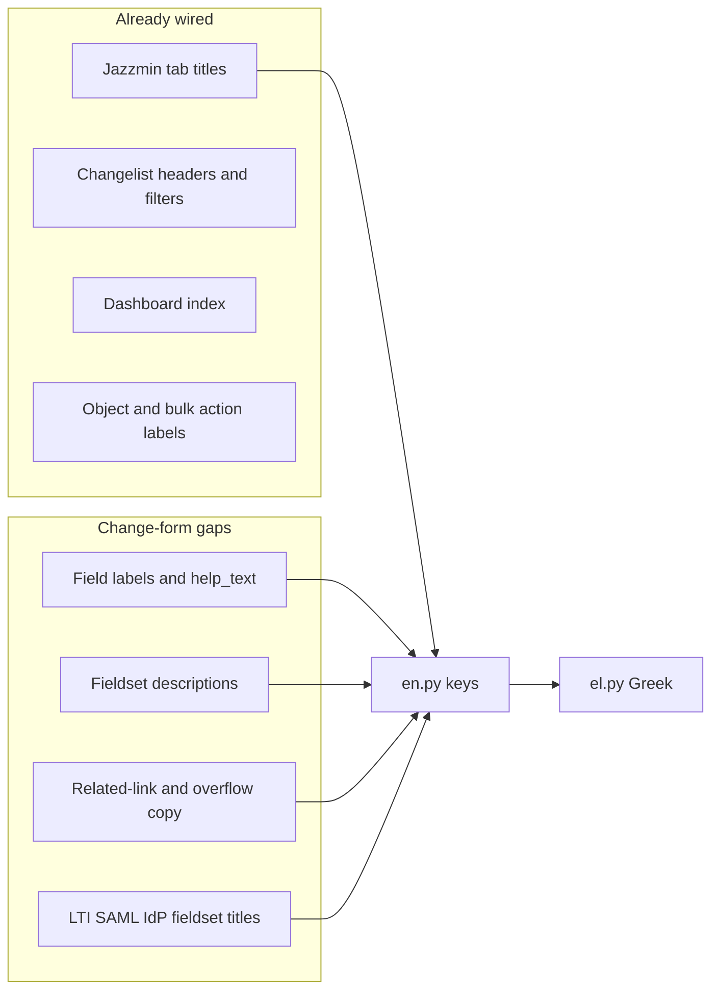

# Admin change-form i18n + Greek (el)

## Established practice (keep this)

MediaCMS does **not** use Django `.po` catalogs for portal/admin UI. It uses:

- English keys in [`files/frontend_translations/en.py`](files/frontend_translations/en.py)
- `python manage.py process_translations` to sync keys into language files
- Templates: `"English"|custom_translate:LANGUAGE_CODE` ([`files/templatetags/custom_filters.py`](files/templatetags/custom_filters.py))
- Python: `translate_string(lang, "English")` ([`files/frontend_translations/__init__.py`](files/frontend_translations/__init__.py))

List views / dashboard already follow this. Change-form **tabs** already work for keys present in `en.py` via [`templates/jazzmin/includes/horizontal_tabs.html`](templates/jazzmin/includes/horizontal_tabs.html) / [`vertical_tabs.html`](templates/jazzmin/includes/vertical_tabs.html).

Core tab titles (Content, Publishing, Sharing, Related, …) already have Greek in [`files/frontend_translations/el.py`](files/frontend_translations/el.py). Language `el` is in `LANGUAGES`; existing keys have **0 empty** Greek values — gaps are **missing keys / unwired UI**.

Django `` chrome in Jazzmin (`Save`, `Delete`, `History`, `View on site`) already gets Greek from Django’s bundled `locale/el`. **Leave those alone**; only MediaCMS-owned strings go through `frontend_translations`.

## Audit findings

**Ready / mostly ready**
- Core fieldset tab titles in files/users/actions (in en + el)
- Object/bulk action dropdown labels via `translate_string` in [`admin_customizations/action_choices.py`](admin_customizations/action_choices.py)
- Choice displays via `translated_choice_display` in [`files/admin_helpers.py`](files/admin_helpers.py)

**Not wired on change forms**
- Field labels: Jazzmin `fieldset.html` renders `field.field.label|capfirst` with no `custom_translate`. Many Media labels exist in en/el; ~15 auto-labels missing (`Hls file`, `Uid`, `Sprites`, `Poster`, `Thumbnail`, whisper fields, …).
- Help texts: Media alone has ~30 `help_text` strings; none in en.py; rendered raw.
- Fieldset descriptions: ~18 core + a few integration; Jazzmin shows them in the fieldset card header raw.
- Related-tab links: hardcoded f-strings like `View {count} comment(s)` in [`files/admin.py`](files/admin.py) / [`users/admin.py`](users/admin.py).
- Inline overflow: `Showing {} of {} related {}. View the full filtered list` in [`files/admin_helpers.py`](files/admin_helpers.py).
- Reports tab HTML: headers, empty state, “Open all MediaActions…” in `MediaAdmin.report_actions_table`.
- Change-form breadcrumbs/title: Jazzmin `change_form.html` still raw/`` (unlike overridden changelist).
- Inline column headers: Jazzmin `edit_inline/tabular.html` uses raw `field.label`.
- Integration tabs: ~25 LTI/SAML/IdP fieldset titles + ~12 inline verbose_names missing from en.py.
- RBAC leftovers: `Access To Categories`, `Contributors`, `Timestamps`, plus several descriptions/verbose_names.
- IdP JS: hardcoded `Provider:` → `Protocol:` in [`templates/admin/identity_providers/change_form.html`](templates/admin/identity_providers/change_form.html).
- Object-actions strip: leftover `` / `Run the selected action` in [`templates/admin/change_form_with_object_actions.html`](templates/admin/change_form_with_object_actions.html).

## Implementation

### 1. Template overrides (match changelist pattern)

Copy Jazzmin templates into the repo and pipe MediaCMS strings through `custom_translate`:

- **New** `templates/admin/includes/fieldset.html` — translate `fieldset.name`, `fieldset.description`, `field.field.label`, `field.field.help_text`. Do **not** `|capfirst` after translate (breaks Greek).
- **New** `templates/admin/change_form.html` — breadcrumbs / app / model verbose names like [`templates/admin/change_list.html`](templates/admin/change_list.html); keep Django `` for Save/Delete/History chrome.
- **New** `templates/admin/edit_inline/tabular.html` — translate column labels/help; keep ``.
- Update [`templates/admin/change_form_with_object_actions.html`](templates/admin/change_form_with_object_actions.html) — `Go` / tooltip via `custom_translate`.
- Overflow note stays rendered by [`templates/admin/edit_inline/related_readonly_tabular.html`](templates/admin/edit_inline/related_readonly_tabular.html); translate in Python before render.

### 2. Python helpers for dynamic copy

In [`files/admin_helpers.py`](files/admin_helpers.py), add:

- `admin_text(lang, english, **format_kwargs)` → `translate_string` then `.format` when needed

Use it for related links, overflow notes, report-table chrome, and still-hardcoded action/confirmation messages in:

- [`files/admin.py`](files/admin.py)
- [`users/admin.py`](users/admin.py)
- [`files/admin_helpers.py`](files/admin_helpers.py) overflow note

Replace IdP JS label swap with a translated string from the template (`custom_translate`).

Static fieldset titles/descriptions need **no** Python wrapping once the fieldset template translates them — keys must match the English source exactly.

### 3. Catalog: en.py then el.py

Add exact English source strings as keys in [`files/frontend_translations/en.py`](files/frontend_translations/en.py):

1. Missing core/RBAC fieldset titles and all fieldset descriptions
2. Missing field labels + help_texts visible on change forms (Media first, then other core models, then integrations)
3. Format templates: `View {count} comment(s)`, overflow/report-table strings, action result messages
4. Integration fieldset titles and inline verbose_names (LTI, SAML, IdP, MigrationService)

Then run `process_translations` and fill every new key in [`files/frontend_translations/el.py`](files/frontend_translations/el.py) with concise Greek aligned to existing admin tone (Media→Πολυμέσα, Reports→Αναφορές, Related→Σχετικά, Publishing→Δημοσίευση). Keep `{count}` / `{limit}` placeholders intact.

### 4. Coverage order (all registered ModelAdmins)

1. Infrastructure — template overrides + helpers
2. Core content/moderation — Media, User, Channel, Comment, Category, Tag, Playlist, Encoding, Caption/Trim/Transcription, MediaAction, Page, License, EncodeProfile, MediaPermission
3. RBAC — RBACGroup / Membership
4. Integrations — Identity providers, SAML, LTI, MigrationService

### 5. Verification

- Spot-check admin with language `el`: Media (all tabs), User, Category (RBAC if enabled), one LTI or SAML form
- Confirm Save/Delete/History still Greek via Django locale; tabs/labels/descriptions/Related links/overflow in Greek via frontend_translations
- Run admin tests under [`tests/admin/`](tests/admin/); adjust any assertions that expect raw English in rendered HTML
- Optional: assert `translate_string("el", key)` is non-English for a sample of new keys

## Non-goals

- Introducing Django `makemessages` / repo `locale/` for MediaCMS strings
- Re-translating already-complete `el.py` keys
- Converting Jazzmin submit-row `` chrome to `custom_translate`
