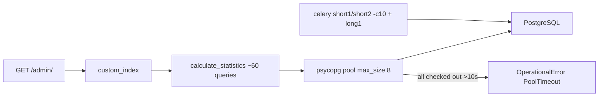

# Admin dashboard and portal performance audit

## Verdict

The `couldn't get a connection after 10.00 sec` error matches the Django **psycopg pool timeout** (`OPTIONS.pool.timeout: 10` in [`cms/settings.py`](cms/settings.py) / [`cms/local_settings.py`](cms/local_settings.py)), not a Django ORM timeout. Under 1000 media + active encoding, `/admin/` becomes slow because [`calculate_statistics()`](admin_customizations/admin.py) runs **~55–60 uncached queries on every GET**, while Celery saturates Postgres with progress/status writes. Multi-threaded `runserver` then exhausts the web process pool (`max_size: 8`) while those slow queries hold connections.

## What `/admin/` does today

[`admin_customizations/apps.py`](admin_customizations/apps.py) patches `admin.site.index` to call `calculate_statistics()` synchronously, then renders [`templates/admin/index.html`](templates/admin/index.html).

Hotspots in [`admin_customizations/admin.py`](admin_customizations/admin.py):

- **Many separate COUNTs** instead of one grouped aggregate: media by type/state/encoding_status (~12 queries), user role counts (~8), system totals that **duplicate** media encoding_queue/fail counts.
- **Heavy analytics on every load**:
  - `recent_activity`: `Max` over `media`, `useractions`, `comment` + `Greatest(...)` ordered top-10 (full user-side join cost).
  - `top_uploaders_by_size`: `Case`/`When`/`regex` parse of `media.size` strings like `"12.3MB"`.
  - `most_commented`: `annotate(Count('comments'))` over Media.
  - four `recent_by_type` queries + several MediaAction top-N group-bys.
- **No cache**: Redis is already configured; dashboard never uses it.

Live celery_worker in this env: `short1` + `short2` at `-c10` each (20 processes) plus `long1`, all writing encoding progress (~every 60 ffmpeg ticks in [`files/tasks.py`](files/tasks.py)). That is the background saturation; the dashboard query storm is what tips the admin request over the pool timeout.

## Admin portal hotspots (beyond the dashboard)

In [`files/admin.py`](files/admin.py):

- `MediaAdmin.get_queryset` **always** annotates `Count("comments")` and `Count("encodings")` even when those optional columns are hidden — expensive with many Encoding chunk rows per video.
- Several `RelatedOnlyFieldListFilter`s (`user`, `channel`, `tags`, `playlist` on Media; `media` on Encoding/Subtitle/Trim/Transcription) run DISTINCT related lookups on large tables.
- `date_hierarchy = "add_date"` on Media/Comment/Playlist adds extra date-bucket queries on large changelists.
- `Encoding.status` is filtered in admin but **not indexed** ([`files/models/encoding.py`](files/models/encoding.py)); `MediaAction.action`/`action_date` filters used by dashboard links lack a dedicated `(action, -action_date)` index.

## Implementation plan (concrete)

### 1. Cache dashboard stats (highest impact)

In [`admin_customizations/admin.py`](admin_customizations/admin.py) / [`apps.py`](admin_customizations/apps.py):

- Wrap `calculate_statistics()` with `django.core.cache.cache` (Redis), key like `admin_dashboard_stats_v1`, **TTL 60s**.
- Keep computation synchronous on cache miss so the template contract stays the same.
- Add a simple bust path: honor `?refresh_stats=1` for staff, and/or delete the key from existing media/moderation admin actions later if needed.

### 2. Collapse COUNT/aggregate round-trips

Rewrite the stats helpers to use fewer SQL statements:

- One `Media` aggregate for totals + `Count(..., filter=Q(media_type=...))` / state / encoding_status / featured / reported / unreviewed / views/likes/dislikes sums.
- One `User` aggregate for role/registration buckets.
- One `MediaAction` aggregate for 7-day moderation + engagement tops where practical.
- Drop duplicated system `encoding_failures` / `encoding_queue` queries; reuse media stats values.

Target: roughly **~60 queries → ~10–15** on cache miss.

### 3. Soften or replace the worst analytics queries

- Replace `recent_activity` Greatest/Max join with a cheaper source: prefer `order_by('-last_login')` for the activity widget, or a bounded subquery — do not scan all users against three related tables on every miss.
- Replace `top_uploaders_by_size` regex parsing with either omit-from-hot-path (cache-only recomputation) or a simpler `Count`-based top uploaders already present; keep size ranking only if it can be computed without per-row regex (e.g. defer or approximate).
- Keep top-N list widgets (`[:5]` / `[:10]`) but ensure they use indexed order columns (`-add_date`, `-likes`, `-views`) only.

### 4. Media admin changelist query hygiene

In `MediaAdmin.get_queryset`:

- Conditionally annotate `_comments_count` / `_encodings_count` only when those columns are actually in `get_list_display(request)`.
- Leave `list_select_related = ("user", "channel")` as-is.

For filters under bulk load:

- Swap high-cardinality `RelatedOnlyFieldListFilter` for `media`/`user` on Encoding (and similarly heavy admins) to autocomplete fields or plain FK filters that do not DISTINCT the whole related set on every changelist render.

### 5. Small schema/index follow-ups

- Add `db_index=True` on `Encoding.status`.
- Add `MediaAction` index on `(action, -action_date)` to speed dashboard moderation/engagement filters.
- Migration only; no behavior change.

### 6. Tests

Extend [`tests/admin/test_admin_dashboard_stats.py`](tests/admin/test_admin_dashboard_stats.py):

- Assert cache hit avoids re-query (or that a second `calculate_statistics()` returns same payload without breaking sections).
- Keep existing section/shape assertions.
- Add a regression that MediaAdmin queryset does not annotate encoding/comment counts when those columns are hidden (admin unit test alongside existing admin tests).

### 7. Out of scope for code (ops note only)

No docker-compose concurrency redesign in this change set. Local bulk encode will still stress CPU/DB; the code changes above make `/admin/` resilient under that load. If needed later: lower short-worker `-c10` for dev, or raise web pool `max_size` modestly — treat as env tuning, not the primary fix.

## Success criteria

- `/admin/` responds without PoolTimeout while encodings are running after 1000 media populate.
- Cache miss dashboard uses far fewer queries; cache hit is near-instant.
- Media changelist no longer always joins/counts all encodings.
- Existing dashboard tests still pass; new cache/conditional-annotate coverage added.
