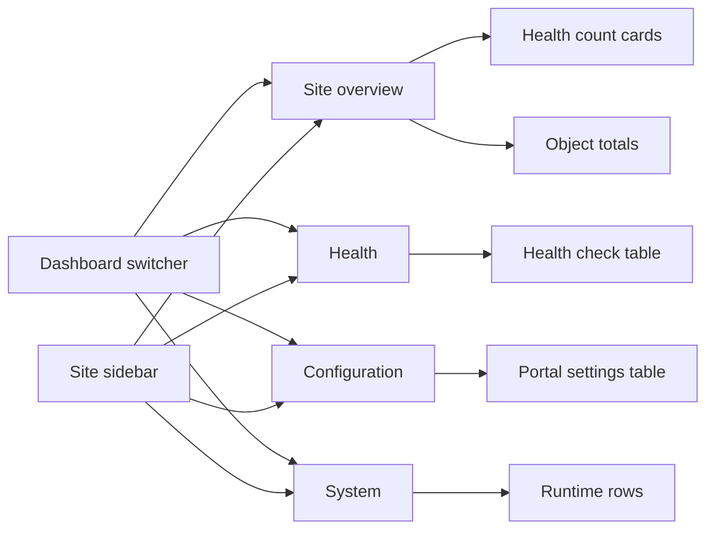

# Split Site overview and fix the admin sidebar

The Site dashboard is one page in [`templates/admin/dashboard/_site.html`](templates/admin/dashboard/_site.html): health count cards, the health-check table, the configuration table, and object totals. Sections are registered in [`admin_customizations/views.py`](admin_customizations/views.py) and linked from the switcher in [`templates/admin/dashboard/_section_nav.html`](templates/admin/dashboard/_section_nav.html) and the Site group in [`admin_customizations/sidebar.py`](admin_customizations/sidebar.py).



## Site, Health, Configuration, System

- Keep **Site** as the short overview: the four health count cards and the object-totals grid. Add a footer on the count cards that links to the Health page.
- Move the health-check table to `/admin/dashboard/health/` and the configuration table to `/admin/dashboard/configuration/`. Reuse the existing markup from `_site.html` in new partials and page templates that extend [`templates/admin/dashboard/section_base.html`](templates/admin/dashboard/section_base.html).
- Add `/admin/dashboard/system/` with a grouped runtime table, built by a new `get_system_runtime_rows()` in `admin_customizations/runtime_info.py` and attached on the existing stats payload in [`admin_customizations/admin.py`](admin_customizations/admin.py) (`get_system_statistics`). Bump `DASHBOARD_STATS_CACHE_KEY` so cached payloads pick up the new key.
- Register `health`, `configuration`, and `system` in `DASHBOARD_SECTIONS`, the switcher (after Site), the home Sections grid in [`templates/admin/index.html`](templates/admin/index.html), the Site sidebar (Overview, Health, Configuration, System, then the existing models), and Jazzmin icons in [`cms/settings.py`](cms/settings.py).

Runtime rows, distinct from the settings table:

- **Python:** `sys.executable`, `sys.version`, `sys.prefix`
- **Packages:** Django, Celery, psycopg, and redis-client versions when importable
- **Process:** pid, user, cwd, settings module, `TIME_ZONE`, `DEBUG`
- **Database:** engine and server version only (no name, user, password, or URL)
- **Cache / Celery:** backend class, and broker host with userinfo stripped
- **Binaries:** resolved path and first version line for `FFMPEG_COMMAND` and `FFPROBE_COMMAND` (`shutil.which`, 1s timeout; missing binary is a row, not an error)
- **Paths:** `BASE_DIR`, `MEDIA_ROOT`, `PATH`, `sys.path`
- **Environment:** show full values only for a safe allowlist (`PATH`, `PYTHONPATH`, `VIRTUAL_ENV`, `DJANGO_SETTINGS_MODULE`, `LANG`, `TZ`, `USER`, `HOME`, `HOSTNAME`). Every other variable is listed by name with the value `(set)` so secrets are not rendered.

## Copy tables

Each of the Health, Configuration, and System tables gets a header control to copy the visible rows as plain text, CSV, or Markdown. One small script in [`templates/admin/dashboard/section_base.html`](templates/admin/dashboard/section_base.html) reads the table next to the buttons, so the copied text matches what is on screen (badge labels such as OK / Warning, link text, not raw HTML).

- **Text:** tab-separated header and rows, so it pastes into a ticket or a spreadsheet.
- **CSV:** the same cells with quotes around fields that contain commas, quotes, or newlines.
- **Markdown:** a GitHub pipe table, with `|` and line breaks escaped inside cells.

The buttons sit in the card header (`Copy text`, `Copy CSV`, `Copy Markdown`). On success the clicked button briefly reads `Copied`. Strings go through the usual translation workflow.

## Get Support

Add a top-level **Get Support** item at the bottom of the admin sidebar in [`templates/admin/base.html`](templates/admin/base.html), outside the collapsible groups, linking to `/admin/dashboard/support/`. It is a staff dashboard page, not one of the workflow switcher buttons.

The page has three parts:

- **Download support bundle.** Two large buttons, Download as text and Download as Markdown, hit a staff-only admin view that returns an attachment (`mediacms-support.txt` or `mediacms-support.md`). The file is built from the same collectors as the Health, Configuration, and System pages: failing and warning health checks, the configuration rows, and the runtime rows. Values already redacted on System stay redacted. Do not add secrets (`SECRET_KEY`, database passwords, `EMAIL_HOST_PASSWORD`, raw broker URLs). Include a generated-at timestamp and a short note that the file is safe to paste into an issue.
- **Where to ask.** Links, opened in a new tab: [admin docs](https://github.com/mediacms-io/mediacms/blob/main/docs/admins_docs.md), [discussions](https://github.com/mediacms-io/mediacms/discussions), [new bug](https://github.com/mediacms-io/mediacms/issues/new?template=bug_report.md), [feature request](https://github.com/mediacms-io/mediacms/issues/new?template=feature_request.md), and contact `info@mediacms.io` (paid help stays the existing [services page](https://mediacms.io/#services/)). Short instructions: search discussions first, open a GitHub issue for bugs, and attach the bundle.
- **Example reports.** Six cards, each with Copy text and Copy Markdown, prefilled so an admin can paste them into a new issue and fill the blanks. Each one names the relevant doc and says to attach the bundle.
  - Missing translation, pointing at [Translations](https://github.com/mediacms-io/mediacms/blob/main/docs/admins_docs.md#20-translations). Ask for the language, the string, and where it appears.
  - Transcoding failure, pointing at [transcoding](https://github.com/mediacms-io/mediacms/blob/main/docs/transcoding.md). Ask for media id, encode profile, and the failed status.
  - Media not viewable. Ask for the media URL, type, and whether original or encoded playback fails.
  - Emails not sent, pointing at [email settings](https://github.com/mediacms-io/mediacms/blob/main/docs/admins_docs.md#512-set-email-settings). Ask for the mail host and TLS/SSL flags, not the password.
  - Reverse proxy, pointing at the [reverse proxy deployment](https://github.com/mediacms-io/mediacms/blob/main/docs/admins_docs.md#advanced-deployment-with-reverse-proxy-accessed-as-httpmediacmsio). Ask for `FRONTEND_HOST`, proxy headers, and the symptom (redirect loop, CSRF, mixed content).
  - Other / general, following the fields in [`.github/ISSUE_TEMPLATE/bug_report.md`](.github/ISSUE_TEMPLATE/bug_report.md): what happened, steps, expected behavior, environment.

## Sidebar

The horizontal scrollbar comes from this rule in [`static/jazzmin/css/main.css`](static/jazzmin/css/main.css):

```1592:1595:static/jazzmin/css/main.css
/* Indent treeview children under their workflow group. */
#jazzy-sidebar .nav-sidebar .nav-treeview {
    margin-left: 16px;
}
```

`margin-left` on a full-width list makes the whole menu 16px wider than the sidebar, so top-level items scroll with the children. Replace it with padding on second-level `.nav-link`s only, keep top-level links at the default inset, clip overflow on `#jazzy-sidebar .sidebar`, and ellipsize long labels.

Add **Expand all** / **Collapse all** buttons at the top of the menu in [`templates/admin/base.html`](templates/admin/base.html). They toggle `menu-open` on every `li.has-treeview` and show or hide its `.nav-treeview`, using the same classes Jazzmin already uses in [`static/jazzmin/js/main.js`](static/jazzmin/js/main.js).

## Tests and translations

- Update [`tests/admin/test_admin_sidebar.py`](tests/admin/test_admin_sidebar.py) for the three new Site links.
- Update [`tests/admin/test_admin_dashboard_stats.py`](tests/admin/test_admin_dashboard_stats.py) so Site no longer contains the health and configuration tables, and the new section URLs return 200 and contain those tables.
- Unit-test runtime rows and env redaction without calling real binaries (mock `subprocess`).
- Cover Get Support: the page returns 200, the sidebar links to it, and the bundle download includes a warning row while omitting a planted secret.
- Add new UI strings to [`files/frontend_translations/en.py`](files/frontend_translations/en.py) first (`Expand all`, `Collapse all`, `Copy text`, `Copy CSV`, `Copy Markdown`, `Copied`, and any new runtime labels). `Health`, `Configuration`, and `System` already exist. Then run `process_translations`.
