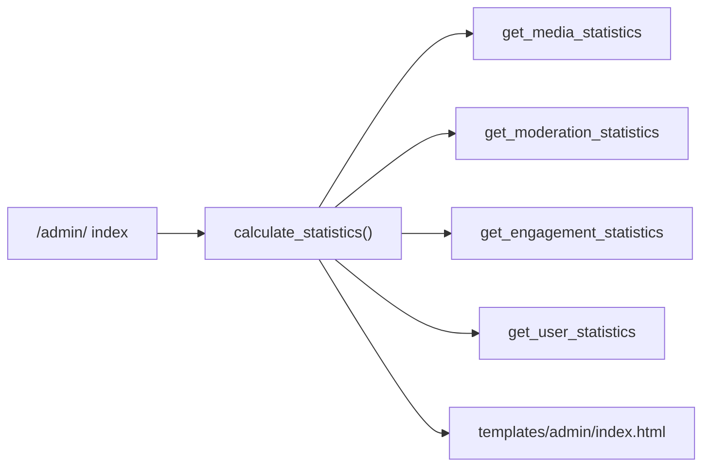

# Admin dashboard stats additions

## Approach

Reuse the current dashboard pattern only: compute lists in [`admin_customizations/admin.py`](admin_customizations/admin.py), render Jazzmin table cards in [`templates/admin/index.html`](templates/admin/index.html), and briefly document them in [`docs/admins_docs.md`](docs/admins_docs.md). No models, migrations, or new admin URLs.

## Data sources (existing only)

| Stat | Source |
|------|--------|
| Top Videos by Duration | `Media.duration` (`media_type='video'`, `duration__gt=0`) |
| Top Reviewers | `MediaAction` where `action='media_reviewed'`, group by user |
| Recent Report Clears | `MediaAction` where `action='report_cleared'`, newest first |
| Recent Media Reviews | `MediaAction` where `action='media_reviewed'`, newest first |
| Most Commented Media | `Media` annotated with `Count('comments')` |
| Most Disliked Media | `Media.dislikes` |
| Top commenters | `Comment` group by user |
| Top Likers / Top Dislikers | `MediaAction` `like` / `dislike`, group by user |
| Top reporters | `MediaAction` `report`, group by user |

Anonymous `MediaAction` rows (`user=None`) are excluded from user rankings so tables stay linked to user admin pages. Review/clear tables only reflect events written by current moderation helpers (`set_media_reviewed` / `clear_media_reports`); older pre-audit history will not appear.

## Backend changes — [`admin_customizations/admin.py`](admin_customizations/admin.py)

Keep top size at **5**, matching existing `most_liked` / `top_uploaders`.

- Add a tiny `format_duration(seconds)` helper that returns `H:MM:SS` / `M:SS` for the duration table (no existing templatetag).
- **`get_media_statistics`**: `longest_videos` — top 5 videos by `-duration`, values `id`, `title`, `duration`, `friendly_token`, plus a preformatted `duration_display`.
- **`get_moderation_statistics`**:
  - `top_reviewers` — count of `media_reviewed` by user
  - `recent_report_clears` — last 5 clears with media/user/`action_date`/`extra_info`
  - `recent_media_reviews` — last 5 `media_reviewed` with media/user/`action_date`
- **`get_engagement_statistics`**:
  - `most_commented` — annotate `comment_count`, order desc
  - `most_disliked` — same shape as `most_liked` but `-dislikes`
- **`get_user_statistics`**:
  - `top_commenters`
  - `top_likers`, `top_dislikers`
  - `top_reporters`

Use `.values(...)` / `select_related` consistent with existing top lists so the template can deep-link with `` and ``.

## Template changes — [`templates/admin/index.html`](templates/admin/index.html)

Mirror existing card-outline tables (see Most Liked / Top Uploaders):

- **Media Overview**: after the small-boxes, add **Top Videos by Duration** (title, duration display, View).
- **Content Moderation**: after the small-boxes, add three tables — **Top Reviewers**, **Recent Report Clears**, **Recent Media Reviews** (media title, moderator, when; clears can show truncated `extra_info`).
- **Engagement Metrics**: extend the existing top-media row (or add a second row) with **Most Commented Media** and **Most Disliked Media**.
- **User Statistics**: below Top Uploaders, add tables for **Top Commenters**, **Top Likers**, **Top Dislikers**, **Top Reporters** (username, count, View user). Prefer a 2-column grid so the section stays compact.

Empty states use the existing ` No data available` pattern.

## Docs — [`docs/admins_docs.md`](docs/admins_docs.md)

In §7, add the new tables to the dashboard map (what they show / which admin change page they open). Note that review/clear tables come from moderation audit `MediaAction`s.

## Out of scope

- Schema, model, or migration changes
- Caching / async stats
- Ranking anonymous session/IP actors
- New filters or changelist pages beyond existing deep links
- Unit tests (dashboard currently has none; keep change surface matching existing style)
