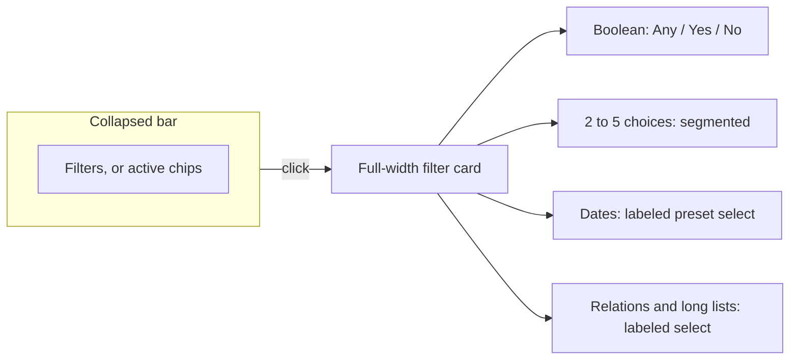

# Admin changelist filter bar

Jazzmin renders every `list_filter` through one override, [templates/admin/filter.html](templates/admin/filter.html): a Select2 dropdown whose first option is the field name. Once a value is chosen, that label disappears, so a row of “Yes” / “No” / “Public” selects is hard to read. The same form ([jazzmin’s `admin/search_form.html`](https://github.com/farridav/django-jazzmin/blob/v3.0.1/jazzmin/templates/admin/search_form.html), included from [templates/admin/change_list.html](templates/admin/change_list.html)) puts those selects, the search box, the Search button, and the result count on one inline row. The result count sits in `#search_group` immediately after the button.

The filter card will live in the same `col-12` as the actions bar and results table, so it matches their width. Search stays on its own row. The result count moves to the line under Search, with clear spacing.

## Control standard

One classifier picks the widget from the filter spec. `list_filter` entries stay as they are, so query strings do not change. Django’s “All” choice becomes the visible unset state.

Unset controls must omit their query parameter. An empty value such as `is_reviewed__exact=` is not the same as “Any”: Django’s boolean filter treats a present empty value as a real lookup, and Media’s column logic treats only a non-empty value as active. “Any”, an unchecked checkbox, and **Clear filters** therefore drop the parameter entirely. Yes/No still submit Django’s boolean values `1` and `0`.

- **Boolean** (`BooleanField`): labeled segmented control, `Any` / `Yes` / `No`. Covers reviewed, featured, listable, download, comments, user flags, LTI toggles, SAML flags, login-option active, encode-profile active, encoding chunk, translate-to-English.
- **Short choices (2–5)**: same segmented control, with the field label always visible and `Any` for the unset state. Covers media state, media type, encoding status, trim status/action/style, permission, source, file type, extension, codec, RBAC role, LTI launch type and roles, migration provider/object type/record status, reports, encoding queue.
- **One-option custom filters**: a checkbox using the lookup label. `JoinedRecentlyFilter` (“Last 7 days”), `ActiveUploaderFilter` (“Uploaded in the last 30 days”), `RegularUserFilter` (“Regular users”) in [users/admin.py](users/admin.py).
- **Dates**: keep the preset select (`Any date`, `Today`, `Past 7 days`, `This month`, `This year`) and add a persistent label. Date hierarchy above the list stays as it is.
- **Relations and long lists (6+)**: labeled Select2. Covers category, tags, playlist, license, channel, user, media, language, profile, platform, identity provider, social app, encode resolution (9), media actions (9), migration status (6).

Active controls get a visible active state (border or filled segment) in addition to the label. The collapsed summary lists only applied filters as `Label: value` chips, plus a **Clear filters** link that drops filter params and keeps the search query.

`EncodingQueueFilter` stays. The dashboard, sidebar, and processing page link to `?encoding_queue=yes` and `?encoding_queue=fail`. It overlaps `encoding_status`, but removing it would break those links. It becomes a two-option segmented control labeled “Encoding queue”.

Models with no `list_filter` only get the search-row spacing fix. That includes Tag, Page, Language, and License. Category filters appear only when RBAC, identity providers, or LTI is enabled ([files/admin.py](files/admin.py) `CategoryAdmin.get_list_filter`).

## Layout

Override `templates/admin/search_form.html` and move `` inside the `col-12` in [templates/admin/change_list.html](templates/admin/change_list.html), above the actions bar. [templates/admin/files/media/change_list.html](templates/admin/files/media/change_list.html) keeps the column chooser after that block and still before `#changelist-form`. The chooser is its own GET form. It must not be nested in the filter form or the changelist POST form. Its preserved query string already copies the current GET params, so it keeps working as long as filter parameter names do not change.

- Search input and Search button on one row.
- Result count on the next line (`N results (M total)`), not beside the button.
- A full-width card using `
`, **closed by default** whether or not filters are active.
- Summary reads **Filters** when nothing is applied, or **Filters** plus chips (`State: Public`, `Reviewed: Yes`) when something is.
- Opening the card shows a wrapping grid of labeled controls at the card’s full width.
- Select2 is initialized when the card opens the first time, so hidden selects do not get a zero width. Only `.search-filter` selects use Select2; segmented controls and checkboxes do not.

Styles go in [static/jazzmin/css/main.css](static/jazzmin/css/main.css), using logical properties so RTL stays intact. New chrome strings (`Clear filters`, `Any`, and any summary text not already in [files/frontend_translations/en.py](files/frontend_translations/en.py)) are added there first, then `process_translations` is run. Existing Django choice labels (Yes, No, Today, and model choices) stay on Django’s own translations.

## Media columns stay tied to filters

Do not change `MediaAdmin.optional_list_columns` or `_filter_enabled_optional_columns` in [files/admin.py](files/admin.py). A column is forced on when any of its parameters is present and non-empty. Forced columns are checked in the column chooser, marked with `*`, and become list-editable. Clearing the filter hides the column again unless the user also saved it in the chooser. Duration and the Comments count are chooser-only; no filter turns them on.

The new widgets must submit these existing names:

- `is_reviewed__exact` (`1` / `0`) shows **Is reviewed**
- `featured__exact` shows **Featured**
- `allow_download__exact` shows **Allow download**
- `enable_comments__exact` shows **Allow comments**
- `encoding_status__exact` or `encoding_queue` shows **Encodings**
- `reported` (`yes` / `threshold` / `clean`) shows **Reported times**

`test_related_filters_force_optional_columns` and `test_column_chooser_persists_selection_in_session` in [tests/admin/test_admin_files.py](tests/admin/test_admin_files.py) stay valid. Browser check on Media: apply Reviewed and Allow comments, confirm those columns appear and are marked forced, then clear the filters and confirm the columns hide again.

## What does not change

- No model or migration edits.
- No new filters on models that do not have them.
- `list_filter` parameter names stay the same, including `is_reviewed__exact`, `enable_comments__exact`, `encoding_queue`, `reported`, `joined`, `activity`, and `role`.
- Media’s filter-to-column mapping is unchanged. New widgets only change how those parameters are chosen.
- Applying filters still uses the Search button, so multi-select pages do not reload on every click.
