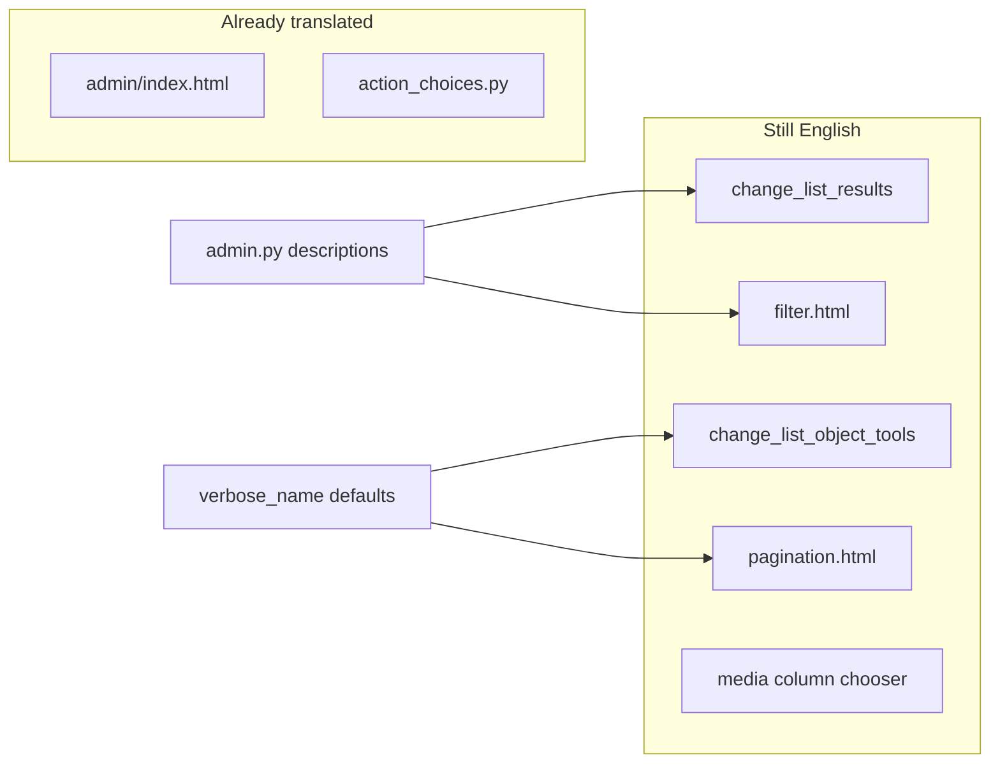

# Admin changelist internationalization

## Root cause

Dashboard/confirm pages already use `custom_translate`. Standard model changelists do not.

- **Add button**: Jazzmin `Add {{ name }}`. Greek Django msgstr is `%(name)s: προσθήκη`, so you see `media: προσθήκη` / `comment: προσθήκη` (often described as "media: greek") because model `verbose_name` defaults to lowercase English.
- **Column headers**: Jazzmin `change_list_results.html` prints `header.text` from `@admin.display(description=...)` or field `verbose_name` (plain English).
- **Filters**: Jazzmin `filter.html` prints `title` / choice labels from `SimpleListFilter.title` and field names (plain English).
- **Column chooser**: [templates/admin/files/media/change_list.html](templates/admin/files/media/change_list.html) uses Django `` plus English labels from `optional_list_columns`.
- **Pagination totals**: [templates/admin/pagination.html](templates/admin/pagination.html) prints raw `cl.opts.verbose_name(_plural)`.

## Approach

Use the MediaCMS pipeline (`en.py` -> `process_translations` -> `el.py` + `custom_translate` / `translate_string`). Override Jazzmin templates into `templates/admin/` (same pattern as existing [change_list.html](templates/admin/change_list.html), [pagination.html](templates/admin/pagination.html)).

Do **not** keep Django `blocktrans` for Add — that causes the colon-reordered Greek text.

Keep `@admin.display(description="...")` and filter `title` as English catalog keys; translate at render time in templates so descriptions stay request-safe.

## Implementation

### 1. Override Jazzmin changelist templates

Add:

- [templates/admin/change_list_object_tools.html](templates/admin/change_list_object_tools.html): `{{ "Add"|custom_translate:LANGUAGE_CODE }} {{ cl.opts.verbose_name|custom_translate:LANGUAGE_CODE }}`
- [templates/admin/change_list_results.html](templates/admin/change_list_results.html): translate `header.text` with `custom_translate`
- [templates/admin/filter.html](templates/admin/filter.html): translate `title` and `choice.display` with `custom_translate`

### 2. Fix MediaCMS changelist shell templates

- [templates/admin/change_list.html](templates/admin/change_list.html): load `custom_filters`; translate breadcrumb / content title model and app names
- [templates/admin/pagination.html](templates/admin/pagination.html): translate `verbose_name` / `verbose_name_plural` and `Show all`
- [templates/admin/files/media/change_list.html](templates/admin/files/media/change_list.html): replace `` with `custom_translate` for Columns / help / Apply columns / forced-filter tooltip

### 3. Python label pass-through

In [files/admin.py](files/admin.py) `MediaAdmin.changelist_view`, wrap optional column labels with `translate_string(request.LANGUAGE_CODE, label)`.

Ensure filter lookup display strings in [files/admin.py](files/admin.py) and [users/admin.py](users/admin.py) are stable English keys present in the catalog.

### 4. Translation catalog

Collect unique strings from `@admin.display` descriptions, `optional_list_columns`, filter titles/lookups, common field/model names (`title`, `state`, `media_type`, lowercase `media`/`comment`, plurals), and chrome strings (`Add`, `Columns`, `Apply columns`, `Show all`).

1. Add missing keys to [files/frontend_translations/en.py](files/frontend_translations/en.py)
2. Run `python manage.py process_translations`
3. Fill Greek in [files/frontend_translations/el.py](files/frontend_translations/el.py) using existing tone (`Αρχεία`, `Ιδιοκτήτης`, `Ενέργειες`, `Κωδικοποίηση`)

### 5. Tests

Assert under language `el` for Media (and Comment):

- Add button uses natural order (no `media: ...` Django reorder) and Greek wording
- Pagination footer uses translated model name
- Optional column chooser label is translated

## Out of scope

Rewriting every model `Meta.verbose_name` to `gettext_lazy`. Template-level `custom_translate` on the English key is enough and matches this branch.
