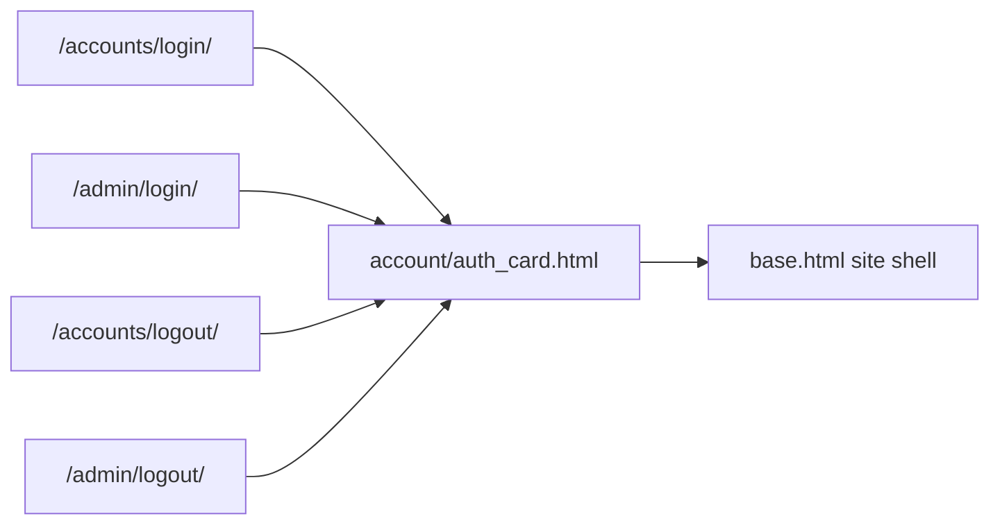

# Match the admin login to the site sign-in

The two logins stay separate. `/accounts/login/` remains allauth (and the identity-provider chooser when that is enabled). `/admin/login/` stays Django admin’s staff form: same `User` session, `AdminAuthenticationForm` still rejects non-staff, and the POST target stays `{{ app_path }}`.

Today the admin page is Jazzmin’s AdminLTE card. [templates/registration/base.html](templates/registration/base.html) is that shell; the form body comes from Jazzmin’s `admin/login.html`. The public page is [templates/account/login.html](templates/account/login.html), which extends [templates/base.html](templates/base.html) and uses `.user-action-form-wrap` / `.user-action-form-inner` (header, sidebar, footer, light/dark theme). Those classes already style labels, inputs, the submit button, and `.errorlist`.

## Shared card

Add [templates/account/auth_card.html](templates/account/auth_card.html) extending `base.html`. It owns the wrap, inner card, language and theme controls, `h1`, optional intro, and an actions block for the form or a follow-up link.

Thin [templates/account/login.html](templates/account/login.html) and [templates/account/logout.html](templates/account/logout.html) so they extend that card and keep current behavior. Public login still posts to `` and keeps the signup sentence. Public logout still posts to `` and keeps the cancel link.

## Admin page

Add [templates/admin/login.html](templates/admin/login.html) extending the same card. Project `templates/` is ahead of app templates, so this replaces Jazzmin’s login template. It will:

- Use the same “Sign In” heading and card.
- Replace the signup sentence with a short staff line, with no signup link.
- POST to `{{ app_path }}` and include `<input type="hidden" name="next" value="{{ next }}">`.
- Show non-field errors (this is how Django reports “not a staff account”).

Leave [templates/registration/base.html](templates/registration/base.html) in place. The rest of `/admin/` stays Jazzmin.

## Admin logout

`/admin/logout/` stays Django admin’s logout, separate from `/accounts/logout/`. The navbar already posts to `admin:logout`. Django 5.2 then renders `registration/logged_out.html` inside the same Jazzmin login shell, which is why that page also has no language or theme control.

Add [templates/registration/logged_out.html](templates/registration/logged_out.html) extending the shared card. It shows a signed-out message and a link to ``. It does not post to `account_logout`.

## Language and theme on the account card

The site already has a sidebar theme switch and a Language link, but the sidebar starts closed, and [templates/cms/set_language.html](templates/cms/set_language.html) posts `next=/`, so a language change leaves the page. Those controls are also missing from the admin login shell: the globe and theme button live in the admin navbar in [templates/admin/base.html](templates/admin/base.html), which the login and logged-out pages do not use. The shared card gets its own controls, so login and logout for both the site and the admin can switch without opening the sidebar or leaving the page.

- **Language.** A `<select>` on the card posts to Django’s `` (`/i18n/setlang/`) with `next` set to `request.get_full_path`. The user stays on that login URL, including an admin `?next=` when one is present. This is the same endpoint the admin navbar and `/setlanguage` already use.
- **Theme.** A light/dark toggle on the card uses the existing site key `MediaCMS[mediacms][theme][mode]` and toggles `body.dark_theme`, the same contract as [templates/root.html](templates/root.html) and `ThemeContext`. No second theme store. A small listener in [frontend/src/static/js/utils/contexts/ThemeContext.js](frontend/src/static/js/utils/contexts/ThemeContext.js) follows a `mediacms-theme` event so the sidebar switch stays in agreement when it is open. That listener needs `make build-frontend`.
- **Copy.** Card strings (“Sign In”, “Sign Out”, the signup sentence, the staff line, the signed-out message, control labels) go through `custom_translate`. Add them to [files/frontend_translations/en.py](files/frontend_translations/en.py) first, then run `python manage.py process_translations`. Allauth’s own field labels follow the `django_language` cookie through LocaleMiddleware.

## Test

In [tests/admin/test_admin_smoke.py](tests/admin/test_admin_smoke.py), GET `admin:login` and assert the response is 200, contains `user-action-form-inner`, the set-language form with `next` pointing at the admin login, and the theme toggle, and does not offer signup. POST `admin:logout` as staff and assert the logged-out page uses the same card, language form, and theme toggle, with a link to `admin:login`. Assert the same language form and theme toggle on `/accounts/login/` and `/accounts/logout/`. Existing redirects for anonymous and non-staff users stay as they are.
