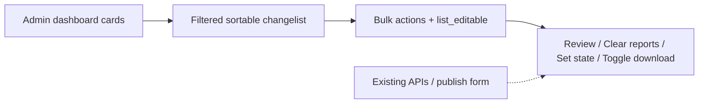

# Admin Portal Moderation Enhancements

## Verdict

The enhanced dashboard on `feat-enhanced-admin-dashboard` correctly surfaces moderation queues, but Django admin is still **inventory-oriented**, not **action-oriented**. Clicking “Review reports” / “Needs Review” lands on Media/User changelists that mostly lack the dropdown actions those queues imply. Most of those capabilities already exist in the owner/editor APIs and publish form — admin simply never caught up.

There is **no** `MediaReport` model. Reports are `MediaAction(action="report")` plus `Media.reported_times`. “Mark report reviewed” in product terms maps to **clearing reports** (delete report actions + reset counter), optionally restoring visibility.

**List UX (filters / sort / columns):** Making changelists more robust is **low–medium effort** and folds cleanly into this work if we stay on **stock Django 5.2 + Jazzmin 3.0.1** (richer filters, sortable headers, more columns, `list_editable`). A true per-user “column picker” is a separate, harder product feature and is **out of scope**.



---

## Model review (moderation surface)

Primary file: [`files/models/media.py`](files/models/media.py)

- `state` — `public` / `private` / `unlisted` (default from `PORTAL_WORKFLOW`)
- `is_reviewed` — gate for public listings when `MEDIA_IS_REVIEWED=False`
- `listable` — derived: public + encoding success + reviewed
- `reported_times` — report counter; at `REPORTED_TIMES_THRESHOLD` auto-sets `state=private` ([`files/tasks.py`](files/tasks.py))
- `allow_download` — download control
- `enable_comments` — per-media comments on/off
- `featured` — editorial highlight
- `encoding_status` — encoding pipeline health

Related:

- **Reports log:** [`actions/models.py`](actions/models.py) `MediaAction` — `extra_info` holds report reason
- **Comments:** [`files/models/comment.py`](files/models/comment.py) — delete-only (no approve/spam flag)
- **Users:** [`users/models.py`](users/models.py) — `is_approved` when `USERS_NEEDS_TO_BE_APPROVED`; `is_active` exists but is **excluded** from [`users/admin.py`](users/admin.py)

**Listable rule:**

```336:340:files/models/media.py
        if self.state == "public" and self.encoding_status == "success" and self.is_reviewed is True:
            self.listable = True
        else:
            self.listable = False
```

---

## Use-case analysis

- **Triage reported media** — dashboard `?reported_times__gt=0` is effectively broken today (`reported_times` not in `list_filter`)
- **Clear / resolve reports** — API DELETE exists; no admin action
- **Review / approve media** — publish form / API `type=review`; no bulk admin action (filter works)
- **Change visibility / downloads / comments / featured** — owner APIs/forms exist; admin mostly per-object only
- **Approve pending users** — filter works when flag on; no bulk Approve
- **Ban / deactivate user** — `is_active` excluded from UserAdmin

Existing Media bulk action: only `generate_missing_encodings` in [`files/admin.py`](files/admin.py).

---

## Difficulty: robust filtering, sorting, columns

| Capability | Stock Django today | Effort to improve | Approach in this plan |
|------------|--------------------|-------------------|------------------------|
| **Filtering** | Sparse `list_filter`; MediaAction has `date_hierarchy` only | **Low** | More `list_filter` fields + custom `SimpleListFilter`s + `date_hierarchy` on Media/Comment/User |
| **Search** | Media searches `title` only | **Low** | Broader `search_fields` (`user__username`, `friendly_token`, email, etc.) |
| **Sorting** | Model fields in `list_display` already click-sort; custom methods often do not | **Low** | Set `admin_order_field` / `ordering` on computed columns (e.g. comments count) |
| **More columns** | Fixed thin `list_display` | **Low** | Expand defaults for triage (`reported_times`, `allow_download`, `enable_comments`, views/likes where useful) |
| **Inline edit** | Almost unused (only Identity Providers uses `list_editable`) | **Low** | `list_editable` for safe booleans: `is_reviewed`, `featured`, `allow_download`, `enable_comments` (+ user `is_approved` when enabled) |
| **Per-user column picker** | Not supported by Django or Jazzmin | **Medium–high** | **Out of scope** — needs custom JS + session/cookie + Jazzmin template overrides |

**Bottom line:** accommodating “a little more robust” filtering/sorting/columns alongside moderation actions is straightforward (~same PR, modest extra surface). Building a spreadsheet-style column chooser would roughly double complexity and fight Jazzmin — skip it.

---

## Recommended enhancements (concrete scope)

Implement as a follow-on to the dashboard PR (same branch or sibling). Prefer stock Django admin APIs — no new models, no new admin UI packages.

### Phase 1 — Make dashboard queues usable

**[`files/admin.py`](files/admin.py) `MediaAdmin`:**

- `list_display`: add `reported_times`, `allow_download`, `enable_comments` (keep `is_reviewed` / `state`)
- `list_filter`: custom `ReportedTimesFilter` (Any / Above threshold / Clean), `media_type`, keep existing
- `search_fields`: `title`, `user__username`, `friendly_token`
- `date_hierarchy`: `add_date`
- Bulk actions (loop + `.save()` so `listable` stays correct):
  - Mark reviewed / unreviewed
  - Clear reports (delete report `MediaAction`s + `reported_times=0`)
  - Set state public / private / unlisted
  - Enable / disable download and comments
  - Feature / Unfeature

**[`actions/admin.py`](actions/admin.py) `MediaActionAdmin`:**

- Show `extra_info` in `list_display`
- Action: clear reports for related media

**[`users/admin.py`](users/admin.py)** (when `USERS_NEEDS_TO_BE_APPROVED`):

- Bulk Approve / Unapprove selected users

Align dashboard card URLs to custom filter params (`?reported=yes` / `?reported=threshold`).

### Phase 1b — Changelist UX robustness (same PR)

Apply consistently to **Media, MediaAction, Comment, User, Encoding** (the pages operators actually live in):

- **Filters:** boolean/choice fields already useful for triage; `RelatedOnlyFieldListFilter` for `user` / `media` where cardinality is high; keep Category as-is
- **Search:** Comment → text + `user__username` + `media__title`; User already decent; Encoding → `media__title`
- **Sort:** ensure every non-field `list_display` method has `admin_order_field` where a DB field exists (e.g. `get_comments_count` → annotate or drop sort)
- **Columns / inline edit:**
  - Media: `list_editable = ("is_reviewed", "featured", "allow_download", "enable_comments")` — fastest path for “approve this row” without the Actions dropdown
  - Note: `state` stays action-based (choice field + `listable` side effects; avoid list_editable on state)
  - User: when approval flag on, `list_editable` for `is_approved` if safe alongside roles
- **Performance:** `list_select_related("user")` on Media/Comment/MediaAction; annotate comment counts if sorting by them
- **Jazzmin:** no theme/package changes; wider tables rely on existing horizontal scroll

### Phase 2 — Comment + user hardening

- CommentAdmin: date filter / hierarchy; clearer media link
- UserAdmin: Deactivate / Reactivate actions (or stop excluding `is_active`)
- Optional: register Playlist / Channel as read-oriented admins for dashboard count drill-down

### Phase 3 — Docs + smoke tests

- Fill §7 in [`docs/admins_docs.md`](docs/admins_docs.md): dashboard card → filter → action / list_editable
- Extend admin smoke tests (MediaAction creation already in `4335a21`) for filters, clear-reports, and list_editable save path

### Explicitly out of scope

- Per-user show/hide column picker / DataTables-style grids
- New admin packages (`django-admin-rangefilter`, etc.) unless stock filters prove insufficient
- New `MediaReport` model or reviewed_by audit fields
- Comment approve/reject workflow
- Replacing `/manage/*` with admin

---

## Implementation notes

- **Permissions:** moderation actions use `permissions=["change"]`; clear-reports allowed for **superusers and editors/managers** (slightly broader than API superuser-only); document it
- **Avoid `QuerySet.update` for `state` / `is_reviewed`:** interact with `listable` in `Media.save()`
- **`list_editable` + actions:** Django requires a visible “Save” on changelist when `list_editable` is set; keep both patterns (quick toggles vs bulk queue ops)
- **Filter UX:** custom `ReportedTimesFilter` beats raw integer filter for dashboard deep-links

---

## Success criteria

1. Dashboard “Review reports” / “Urgent” / “Needs Review” links open correctly filtered Media lists.
2. Operators can mark reviewed, clear reports, set visibility, and toggle downloads from the changelist (Actions and/or `list_editable`).
3. Pending users can be bulk-approved; report reasons visible on MediaAction; related reports clearable.
4. Media / MediaAction / Comment / User / Encoding changelists support stronger filter + search + sort, with triage-relevant columns visible by default.
