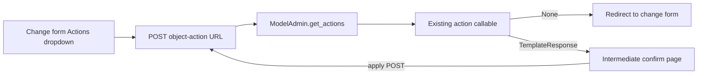

# Admin change-form Actions dropdown

## Goal
On any model change page (History / View on site area), show an **Actions** dropdown listing that ModelAdmin’s bulk actions, runnable against the current object only.

## Affected models (today)
Only ModelAdmins with non-delete custom actions will show items; others get no dropdown:

- [files/admin.py](files/admin.py) — **Media** (24 actions, including intermediate `change_owner` / `delete_original_media_files`), **Encoding** (`retry_failed_encodings`)
- [actions/admin.py](actions/admin.py) — **MediaAction** (`clear_reports_for_related_media`)
- [users/admin.py](users/admin.py) — **User** (approve/unapprove when enabled, deactivate/reactivate)
- [lti/admin.py](lti/admin.py) — **LTIToolKeys** (`regenerate_keys`)

No per-model action rewrites: reuse existing action callables with `queryset = model.objects.filter(pk=obj.pk)`.

## Approach
Global monkeypatch via [admin_customizations/apps.py](admin_customizations/apps.py) (same pattern as the existing `AdminSite` patches), plus a thin template that fills Jazzmin’s existing ``.

### 1. Shared object-action wiring — new [admin_customizations/object_actions.py](admin_customizations/object_actions.py)
- `object_actions_for_request(model_admin, request)` — from `get_actions(request)`, drop built-in `delete_selected` (Delete button already exists), return `[{name, description}, ...]`.
- `object_action_view(model_admin, request, object_id)` — POST-only; resolve object; validate action name against `get_actions`; call `func(model_admin, request, queryset)`; if response is truthy (intermediate pages), return it; else redirect to the object change URL.
- Patch helpers applied in `ready()`:
  - Wrap `ModelAdmin.get_urls` to prepend `<path:object_id>/object-action/` named `{app}_{model}_object_action`.
  - Wrap `ModelAdmin.render_change_form` to set `context["object_actions"]` when `change` and `obj` are set.
  - Set `ModelAdmin.change_form_template = "admin/change_form_with_object_actions.html"` as the default (subclasses that already set their own template keep it).

### 2. Template — [templates/admin/change_form_with_object_actions.html](templates/admin/change_form_with_object_actions.html)
Extends Jazzmin’s `admin/change_form.html` (project path is not `admin/change_form.html`, so Jazzmin is not shadowed) and fills `extra_actions`:

- Bootstrap/AdminLTE dropdown labeled **Actions** (only if `object_actions` is non-empty).
- Each item: small POST form to the object-action URL with CSRF + hidden `action=<name>`.

Chain existing custom change forms through this template so they keep the hook:

- [templates/admin/files/category/change_form.html](templates/admin/files/category/change_form.html)
- [templates/admin/rbac/rbacgroup/change_form.html](templates/admin/rbac/rbacgroup/change_form.html)
- [templates/admin/socialaccount/socialapp/change_form.html](templates/admin/socialaccount/socialapp/change_form.html)
- [templates/admin/identity_providers/change_form.html](templates/admin/identity_providers/change_form.html)

Change extends target from `admin/change_form.html` to `admin/change_form_with_object_actions.html`.

### 3. Intermediate Media actions
`change_owner` / `delete_original_media_files` already return `TemplateResponse` and re-resolve PKs when `apply` is present — that works when the confirm form posts back to the object-action URL.

Small UX tweaks in:

- [templates/admin/files/media/change_owner_confirmation.html](templates/admin/files/media/change_owner_confirmation.html)
- [templates/admin/files/media/delete_original_confirmation.html](templates/admin/files/media/delete_original_confirmation.html)

Pass `cancel_url` from `_intermediate_action_context` in [files/admin.py](files/admin.py): prefer the single-object change URL when the queryset has one item, else changelist. Cancel link uses `cancel_url`.

After a successful apply from the object-action view, redirect stays on the change form (not changelist).

### 4. Light CSS
Extend [static/jazzmin/css/main.css](static/jazzmin/css/main.css) so the Actions control matches History / View on site width in `.object-tools`.

### 5. Tests — [admin_customizations/tests.py](admin_customizations/tests.py) (or `tests/admin/`)
- Change form for Media includes Actions dropdown entries (e.g. `generate_missing_encodings`) and omits `delete_selected`.
- POSTing object-action runs the existing action once for that PK and redirects to change form.
- User without change permission does not see/run restricted actions.
- Intermediate `change_owner` from change form still renders confirm and applies.
- Model with no custom actions (e.g. Comment) has no Actions dropdown.
- Smoke: Encoding / User object-action URL resolves.

## Out of scope
- Rewriting individual action implementations
- Changing changelist bulk-action UI
- Adding new business actions
