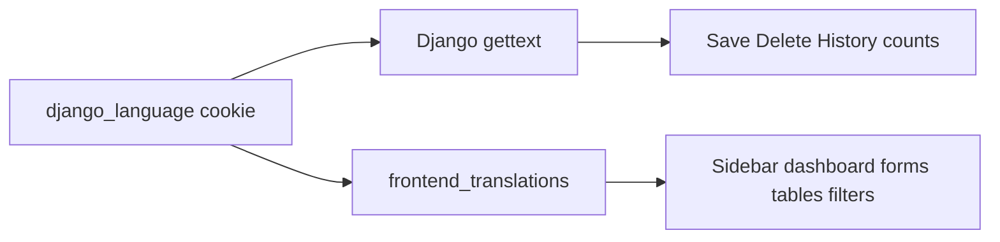

# Admin portal translation audit and completion

Admin copy uses MediaCMS’s dictionary in [`files/frontend_translations/`](files/frontend_translations/), looked up by the English phrase via `custom_translate` / `admin_text()`. English is the source string (`en.py` values are empty on purpose; `translate_string` returns the key for `en`). There is no `locale/` tree. Stock Django/Jazzmin chrome (`Save`, `Go`, `History`, result counts) uses `` and Django’s packaged catalogs, which already cover Greek, German, and Spanish. Leave that path as-is.

Language switching already works: the navbar posts to `/i18n/setlang/` and the `django_language` cookie drives both systems. Sidebar group and model names in [`admin_customizations/sidebar.py`](admin_customizations/sidebar.py) are English keys rendered through `custom_translate` in [`templates/admin/base.html`](templates/admin/base.html).

## Rename the media Reports tab to Audit log

The media change form tab named `Reports` in [`files/admin.py`](files/admin.py) (fieldset around line 804) shows the open-report counter plus every moderator and system event in `MEDIA_REPORT_TAB_ACTIONS`: user reports, report cleared, report confirmed, media reviewed, media unreviewed, original deleted, metadata refreshed, and integrity warning. A report is one of those events, not the name of the list.

**English name: Audit log.**

Use that exact string for the tab, the table’s admin description (`Report & moderation actions`), and the empty state (`No audit log entries yet.`). Update the tab description so it says the log lists reports and other staff actions (review, delete original, refresh metadata, integrity warning), and that Clear reports only resets the report counter.

Why this and not “Audit history”: Django admin already uses History for the object change log. “Audit log” is the plain name other admin products use for an append-only record of actions, and it stays distinct from Report. “Audit” alone is already the icon column on the moderation dashboard (`templates/admin/dashboard/_moderation.html`), so the tab needs the extra word “log”.

Keep Report and Reports for the user flag and its counts. Do not rename:

- The changelist filter title `Reports` and its choices (`Has reports`, `No reports`, `Above threshold`) in `ReportedTimesFilter`.
- Dashboard metrics `Reports cleared (7 days)` and `Reports confirmed (7 days)`.
- The people-table column `Reports`.
- Action labels `Report`, `Report cleared`, `Report confirmed`, and the Clear reports actions.
- The moderation card `Recent report audit actions`. That card is only the report-related subset (`REPORT_AUDIT_ACTIONS`), not the full log. Rename that heading to `Recent report actions` so “audit log” is not used for a report-only list.
- The Related-tab link `Actions / reports`. That list includes likes and watches, so it is not the audit log.

Update the hardcoded `#reports-tab` anchors (dashboard media links and [`actions/admin.py`](actions/admin.py)) to the tab id Jazzmin generates for `Audit log`. Update [`tests/admin/test_admin_files.py`](tests/admin/test_admin_files.py), which asserts the fieldset name `Reports`.

Locked terms for every language, so the parallel translators do not invent a second word:

- Audit log: Greek `Αρχείο ελέγχου`, German `Auditprotokoll`, Spanish `Registro de auditoría`. Other languages use the same concept (the record of staff actions), not the word for a user report.
- Report: keep the existing term in each file (Greek `Αναφορά`, German `Meldung`, Spanish `Reporte`). A report is an entry in the audit log, not another name for the log.
- Do not reuse the existing short `Audit` translation (`Έλεγχος`, `Audit`, `Auditoría`) as the tab name. That word stays on the dashboard icon column.

## What is already translated

Greek, German, and Spanish each have all 1,277 English keys (none missing). Sidebar groups (`Moderation`, `Library`, `Processing`, `People`, `Integrations`, `Site`), queue links (`Reported media`, `Encoding queue`, `Failed encodings`), and most changelist headers, filters, choice labels, and form labels already go through the dictionary and are translated. Rough coverage of the whole catalog: Greek 84%, Spanish 84%, German 80%. The other 18 languages are about 13–21% and are out of scope except for the admin strings below.

## Gaps to fix

**Empty in Greek, German, and Spanish (same 163 keys).** These render as English. They are the newer admin UI: sidebar `Expand all` / `Collapse all` / `Get Support`, dashboard metrics (`Passing checks`, `Warnings`, `Failures`, `Health checks`, `Configuration`), health-check names (`DEBUG disabled`, `Cache / Redis reachable`, …), support-page chrome, theme switcher, `Copied` / `Copy CSV`, relative times (`today`, `yesterday`, `last Friday`, `{count} hours ago`), and short actions (`Change`, `Delete`, `View on site`) where the template uses `custom_translate` rather than ``.

**Strings that never hit the dictionary:**

- Sort clear control in [`templates/admin/includes/changelist_header_cell.html`](templates/admin/includes/changelist_header_cell.html) (`Clear sorting`).
- Breadcrumb script in [`templates/admin/base.html`](templates/admin/base.html) overwrites two crumbs with the English word `Users`, and hides the Identity Providers header only when the visible text is exactly `Identity_Providers` (a translated header will not match).
- Identity-provider inlines ([`templates/admin/socialaccount/socialapp/custom_tabular_inline.html`](templates/admin/socialaccount/socialapp/custom_tabular_inline.html) and the groups variant) print raw labels, help text, `Actions`, and the group-mapping warning.
- Health-check **details** are interpolated English sentences printed raw in [`templates/admin/dashboard/_health.html`](templates/admin/dashboard/_health.html) and [`templates/admin/dashboard/_integrations.html`](templates/admin/dashboard/_integrations.html). Labels are translated; details are not, and formatting happens before lookup so a `{count}` key would not match. Builders live in [`admin_customizations/admin.py`](admin_customizations/admin.py), [`admin_customizations/status_health.py`](admin_customizations/status_health.py), and [`admin_customizations/deployment_health.py`](admin_customizations/deployment_health.py).
- Flash messages that skip `admin_text`: [`actions/admin.py`](actions/admin.py) (`Cleared reports for {count} media item(s).`, key already exists) and [`lti/admin.py`](lti/admin.py) (`Keys regenerated for {key_id}`).

**Leave in English on purpose:**

- Support example bodies in [`admin_customizations/support_bundle.py`](admin_customizations/support_bundle.py) (`SUPPORT_EXAMPLES`). They are paste-ready GitHub issue templates. Translate the page chrome around them (titles, buttons, instructions); keep the template text English.
- Setting names, paths, and identifiers shown in `<code>` on the configuration tables.
- True international tokens that are the same word in the target language (`LTI`, `PDF`, `IP`, `MD5`, German `System` / `Status` / `Video`). Do not invent a different word just to make the value differ from the key.

## Coverage gate

Every user-visible string on the surfaces below must go through `custom_translate` or `admin_text()` before it is shown. `` stays only for stock Django and Jazzmin chrome that already exists in Django’s catalogs (`Save`, `Delete`, `History`, `Go`, result counts). Titles, user names, file paths, setting identifiers, and values inside `<code>` stay as data. Support-example bodies stay English, as already decided. A string that only passes through the filter and is still missing from Greek, German, and Spanish is not done: the sweep adds the English key, and the translation waves fill it.

Surfaces:

- **Dashboard.** [`templates/admin/index.html`](templates/admin/index.html) and the shared dashboard chrome in [`templates/admin/dashboard/section_base.html`](templates/admin/dashboard/section_base.html) (titles, metrics, table headers, empty states, copy buttons).
- **Overviews.** Moderation, people, library, processing, engagement, integrations, and site, plus the site pages health, configuration, and system. Templates live under [`templates/admin/dashboard/`](templates/admin/dashboard/). Health-check details are part of this surface and must be translated at render time, not left as raw English sentences.
- **Change forms.** [`templates/admin/change_form.html`](templates/admin/change_form.html), the model overrides (media, category, RBAC group, identity providers, social apps), fieldsets, help text, choice labels, inlines, object tools, and the submit row. The media Audit log tab is included.
- **Changelists.** [`templates/admin/change_list.html`](templates/admin/change_list.html) and the per-model changelist templates, plus search, filters, column headers, the column chooser, pagination, bulk actions, and the sort-clear control.
- **Related templates.** Confirmation pages ([`templates/admin/files/media/delete_original_confirmation.html`](templates/admin/files/media/delete_original_confirmation.html), [`templates/admin/files/media/change_owner_confirmation.html`](templates/admin/files/media/change_owner_confirmation.html)), admin widgets under [`admin_customizations/templates/admin/widgets/`](admin_customizations/templates/admin/widgets/), inline templates, and the Related-tab links built in Python. On the delete-original page, `media_type` and `encoding_status` are still printed raw; those display values go through `admin_text` too.

Known strings on these surfaces that skip the dictionary today, and that this sweep must fix: `Clear sorting`, the Users breadcrumb rewrite, identity-provider inline labels, help, `Actions`, and the group-mapping warning, health-check `check.detail`, the two flash messages in [`actions/admin.py`](actions/admin.py) and [`lti/admin.py`](lti/admin.py), and the raw type and encoding status on the delete-original confirmation.

## Implementation

1. **Sweep those surfaces and wire anything still raw.** Pass `Clear sorting`, inline labels/help/`Actions`, and the group-mapping warning through `custom_translate`. Set the Users breadcrumb from a `data-users-label` that is already translated, and hide the Identity Providers block with a stable marker (class or data attribute) instead of matching English text. Route the two flash messages through `admin_text()`. Translate `media_type` and `encoding_status` on the delete-original confirmation. While sweeping, add any other visible English literal on a dashboard, overview, change form, changelist, or related template to the dictionary in the same way. Do not add a second translation path.

2. **Translate health-check details at render time.** Keep an English template plus format kwargs on each check (stop calling `.format()` before lookup). Add a small template filter that calls `admin_text()`. The support bundle keeps formatting the English sentence so pasted reports stay English. Add every distinct detail template to `en.py`.

3. **Freeze the key list before any translation.** Add new English keys to [`files/frontend_translations/en.py`](files/frontend_translations/en.py), run `process_translations`, then write one shared brief: the admin keys still empty or newly added, plus the repeated nouns already used in each area (media, playlist, channel, category, tag, caption, encoding, comment, report). Include the locked pair from the rename: `Audit log` versus `Report`. No subagent edits `en.py` or another language’s file. English source strings added in steps 1–2 follow the same plain-language rules as the translations (short, one idea, no idiom).

4. **Translate in parallel, one subagent per language file.** Each agent writes only `files/frontend_translations/<lang>.py`.

   - Wave 1, together: Greek (`el.py`), German (`de.py`), Spanish (`es.py`). These three must finish every key in the brief. They draft from the English source only, because the other two files are still being written.
   - Cross-check, after wave 1: one review pass reads all three files. For every admin key, compare each language with the other two. Fix meaning drift in the language that disagrees. This pass is sequential and is the accuracy gate for the languages that must be complete.
   - Wave 2, together: one agent each for `ar`, `bn`, `da`, `nl`, `fr`, `hi`, `id`, `it`, `ja`, `ko`, `pt`, `ru`, `zh_hans`, `sl`, `zh_hant`, `tr`, `ur`, `he`. Same key list, best effort. Do not translate the rest of the public-site catalog. Before saving a value, the agent compares that English key with two finished priority translations, rotating the pair so the three anchors are all used: German and Spanish, Greek and German, or Greek and Spanish. If the two references agree and the new translation does not, change the new translation. If the two references disagree, follow the English source and note the conflict.

   Each agent, before it writes:

   - Read how that language already translates the repeated nouns in its own file, and keep those words. The admin UI must not gain a second word for a concept the file already names.
   - Check the usual wording on other media sites in that language, in this order: PeerTube (open Weblate catalog, same product concepts), YouTube, then Vimeo or Dailymotion. Prefer that wording when it is plain and matches the term already in the file. When the site term and the file term differ, keep the file term and say so in the agent summary.
   - Apply simplified-technical-language rules, in the spirit of ASD-STE100, in the target language:
     - One word for one concept. Do not alternate synonyms (`delete` / `remove`, `video` / `movie`).
     - Short sentences, one idea each. Active voice and a concrete verb.
     - No idioms, slang, jokes, or figurative phrases. Write the literal action (`Clear sorting`, not a colloquial equivalent).
     - Labels stay short noun phrases. Each sentence in help text and health details stays short. Do not merge two source sentences into one.
     - Do not add politeness filler that is not in the English source.
     - Leave placeholders (`{count}`, `{cleared}`, `{key_id}`, and any others) unchanged, including braces.
     - Leave tokens that are names or protocols untranslated (`LTI`, `PDF`, `HLS`, `Redis`, `DEBUG`, setting names).
     - If the target language uses the same word as English (`System` in German), keep it.
   - Return a findings list. Do not edit Python, templates, models, or migrations. Each item names the English key, what is wrong in context, the template or admin code that produces it, and why a dictionary value cannot fix it. Typical items: a sentence is built by concatenation so word order is wrong, a short date label cannot fit the column, a placeholder sits in the wrong place for that language, or one English string is used for two different meanings. If there is no such problem, return an empty list.

5. **Read multi-sentence strings and shrinking dates in context.** Do this in the priority cross-check, and again inside each wave 2 agent for the strings it writes. The cross-check adds its own findings in the same shape. It still does not edit application code.

   Multi-sentence and help text (health-check details, support instructions, warnings): substitute a realistic value for each placeholder (`{count}` = 2, names in quotes left as-is). Read the result as it sits in the health table, next to the check name, or on the support page. The sentence must be grammatical on its own and must state the same fact as the other two languages. Do not split or join sentences in a way that hides which value failed.

   Shrinking dates come from `describe_relative_when` in [`files/templatetags/custom_filters.py`](files/templatetags/custom_filters.py). The dashboard renders three labels in one `<time class="when-fit">`: full, mid, and short. CSS in [`templates/admin/dashboard/section_base.html`](templates/admin/dashboard/section_base.html) shows full above 6.2rem, mid between 3.4rem and 6.2rem, and short below 3.4rem. The short label is what a narrow audit column actually shows. Columns that hold these values are about 4.25rem to 8.5rem wide.

   For a sample count of 2, write the full, mid, and short forms next to each other (`2 hours ago` / `2h ago` / `2h`, and the same for minutes, weeks, months, and years). Also check `today`, `yesterday`, `recently`, `last Friday` against `Fri`, and `last year`. Rules:

   - Full, mid, and short must mean the same thing in that language.
   - The short form stays as compact as the English unit suffix (`2h`, `2m`, `2w`, `2mo`, `2y`). No extra words. Weekday abbreviations stay about as short as `Mon`.
   - The mid form may include the short “ago” word, and must still fit a column near 6rem.
   - Compare those three forms with the same three forms in the two reference languages. A short form that reads as a different unit (hours vs. weeks) is a miss even if the full sentence is correct.
   - `aria-label` uses the full string, so the short form may be abbreviated. It still has to be recognizable on its own.

6. **Review the diffs in the main session** before the expert review. Reject a language file that drops or renames a placeholder, translates a setting name inside a sentence that should stay literal, or leaves a priority-language admin key empty. Reject a short date label that is longer than the English short form by more than a couple of characters, or that does not match its own full form. Spot-check that `Media`, `Playlist`, `Encoding`, and `Channel` each use one term inside that file, and that a sample of multi-sentence health details agrees across Greek, German, and Spanish. Collect every translator and cross-check finding into one list.

7. **Expert review after all translations.** Launch one MediaCMS subagent that knows this repository’s Django admin and the admin templates and scripts. Give it the collected findings and the relevant code. It recommends a fix, a test, or no change for each finding.

   - Prefer a template or Python string change that keeps `admin_text` / `custom_translate` and natural word order.
   - Model changes are a last resort. Recommend one only when the visible text cannot be fixed in a template, a `ModelAdmin`, or the translation dictionary. Do not make that model change in this pass.
   - Database migrations are forbidden. Do not add, edit, or generate a migration.
   - Apply the accepted template and Python fixes in the main session. When a fix adds a new English string, add the key and send only that key back to the Greek, German, and Spanish agents.
   - Add the test cases the expert recommends when they cover a real admin page. Fold them into the Greek render tests below.

8. **Tests.** With the Greek cookie, render the admin index, each overview (moderation, people, library, processing, engagement, integrations, site, health), the media change form, and the media changelist. Assert sidebar `Expand all`, a health-check detail, `Clear sorting`, the Users breadcrumb, and the Audit log tab use the Greek string. Assert the same pages do not contain the English source for those labels. Update the LTI assertion in [`tests/lti/test_lti_models.py`](tests/lti/test_lti_models.py) if the message goes through `admin_text` (English still matches when the language is English). Include any extra cases from the expert review.
