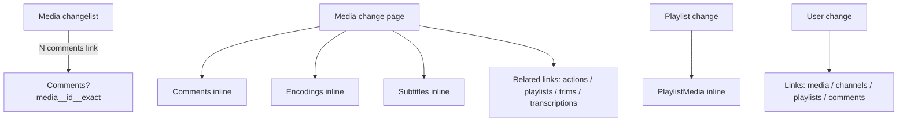

# Admin Relationship Navigation

## Problem

Media changelist shows a comments count, but the Media change page has no related comments (or encodings, playlists, etc.). Related models are registered separately with almost no inlines or deep-links, so operators cannot follow object relationships in admin.

## Approach

Use the same patterns already in-repo ([`rbac/admin.py`](rbac/admin.py) filtered changelist links; [`identity_providers/admin.py`](identity_providers/admin.py) `TabularInline` + `show_change_link`):

1. **Readonly tabular inlines** on parent change pages (see + delete where useful; no add)
2. **Clickable count/link columns** on changelists that open filtered related changelists
3. **Clickable FK columns** on child changelists (media/user links)

No new models. Keep MediaPermission registration lightweight and read-oriented.



---

## Media change page ([`files/admin.py`](files/admin.py))

Add readonly inlines (extra=0, max_num=0, can_delete where moderation helps, `show_change_link=True`):

| Inline | Fields shown | Delete? |
|--------|--------------|---------|
| `CommentInline` | user, text (truncated), add_date | Yes |
| `EncodingInline` | profile, status, progress, chunk, update_date | No |
| `SubtitleInline` | language, user | No |

Add a **Related** readonly section on Media via `readonly_fields` helpers that render HTML links (using `format_html` + `reverse`):

- View all comments (`admin:files_comment_changelist?media__id__exact=<pk>`)
- View encodings (`admin:files_encoding_changelist?media__id__exact=<pk>`)
- View media actions / reports (`admin:actions_mediaaction_changelist?media__id__exact=<pk>`)
- View playlists containing this media (`admin:files_playlist_changelist` filtered via search or a simple `media__id` filter once PlaylistAdmin supports it — prefer linking PlaylistMedia-style filter through a custom filter or list of playlist titles with change links)
- View trim / transcription requests similarly

For playlists specifically: show linked playlist titles (from `obj.playlist_set.all()[:20]`) as change-page links rather than relying on a fragile M2M querystring.

Make existing readonly FKs navigable: replace plain `user` / `channel` display with link methods (`link_user`, `link_channel`) in `readonly_fields` / fieldsets so clicking opens the User/Channel change page.

Organize Media fieldsets so related inlines appear under clear headings (Jazzmin already stacks inlines below the form).

---

## Media changelist

- Change `get_comments_count` into a **HTML link** to the filtered Comment changelist (preserve `admin_order_field` / annotation).
- Add similar compact links for encodings count (annotate `Count("encodings")`) if cheap; otherwise only on change page.

---

## Child admins — round-trip links

**CommentAdmin:** link `media` and `user` columns to their change pages; add `list_filter` with `("media", admin.RelatedOnlyFieldListFilter)` so `?media__id__exact=` from Media works and operators can refine.

**EncodingAdmin / SubtitleAdmin / TranscriptionRequestAdmin / VideoTrimRequestAdmin / MediaActionAdmin:** link `media` (and `user` where present) in `list_display`; ensure FK filters accept `media__id__exact` (default FK list_filter or RelatedOnly).

**PlaylistAdmin:** add `PlaylistMediaInline` (ordering, media with `show_change_link`, autocomplete or raw_id for media). Register `PlaylistMedia` only if needed for standalone list; prefer through-inline only.

**ChannelAdmin / UserAdmin ([`users/admin.py`](users/admin.py)):** readonly related-link blocks:

- User → media / channels / playlists / comments changelist filters (`user__id__exact`)
- Channel → media changelist filter (`channel__id__exact`) — add `channel` to Media `list_filter` if missing

**MediaPermission:** register a simple `MediaPermissionAdmin` (list: media, user, owner_user, permission) and a readonly `MediaPermissionInline` on Media so sharing ACL is visible.

---

## Shared helper

Add a small helper in [`files/admin.py`](files/admin.py) (or `files/admin_helpers.py` if the file gets large):

```python
def admin_changelist_link(model, text, **query):
    url = reverse(f"admin:{opts.app_label}_{opts.model_name}_changelist")
    return format_html('<a href="{}?{}">{}</a>', url, urlencode(query), text)
```

Reuse for count columns and Related sections. Mirror the LTI/RBAC `format_html` link style.

---

## Tests + docs

- Extend [`tests/admin/test_admin_files.py`](tests/admin/test_admin_files.py): Media change page contains comment text / related links; comments count column contains changelist URL with `media__id__exact`; Comment changelist filter by media works; Playlist change shows media inline.
- Update smoke `build_instances` if MediaPermission is registered.
- Brief addition to [`docs/admins_docs.md`](docs/admins_docs.md) §7: “Related objects on Media / User / Playlist”.

---

## Out of scope

- Editable creation of comments/encodings from Media admin
- Full graph UI / custom React admin
- Registering Rating / VideoChapterData / EmbedMediaCourse unless they become operationally needed
