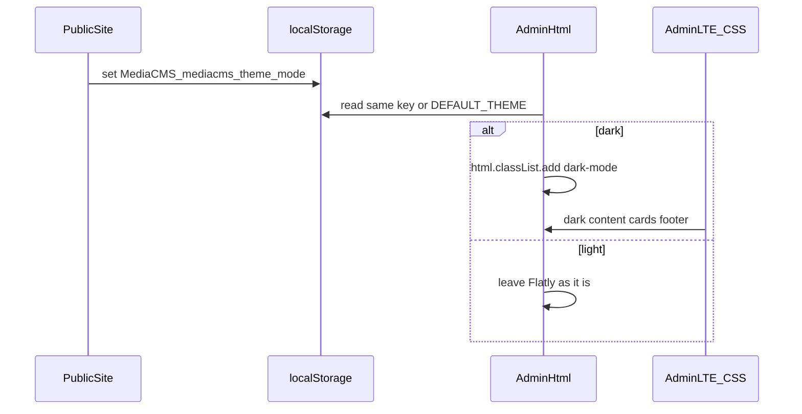

# Share frontend light/dark with the admin

The public site and the admin do not share a theme today.

- Frontend preference is per-browser in `localStorage` key `MediaCMS[mediacms][theme][mode]` (`light` or `dark`), with [`DEFAULT_THEME`](cms/settings.py) as the fallback. [`templates/root.html`](templates/root.html) applies it before paint. There is no cookie and no user-profile field.
- Admin is always Bootswatch Flatly ([`JAZZMIN_UI_TWEAKS = {"theme": "flatly"}`](cms/settings.py)). Jazzmin’s `dark_mode_theme` is unset, so the admin ignores both that stored preference and the OS color scheme.

“Same settings” here means the admin reads that existing key. It does not mean loading the frontend `dark_theme` stylesheet into Jazzmin, and it does not add an admin toggle. Changing theme on the public site, then opening or refreshing admin, is what updates the admin. A `storage` listener will also update an already-open admin tab when the key changes in another tab.

## Why AdminLTE `dark-mode`, not Jazzmin `dark_mode_theme`

[`static/vendor/adminlte/css/adminlte.min.css`](static/vendor/adminlte/css/adminlte.min.css) already contains a full `.dark-mode` theme (content canvas, cards, footer, callouts). Putting `dark-mode` on `<html>` is enough for those rules to apply, because they are descendant selectors.

Turning on Jazzmin’s `dark_mode_theme` would instead load a second Bootswatch file (for example Darkly) behind `prefers-color-scheme`. That follows the OS, not the site preference, and the login template in the Jazzmin package would start doing that as soon as the setting is enabled. Leave `dark_mode_theme` unset.

The sidebar stays `sidebar-dark-primary` in both modes, which is the current light-admin look. Dark mode darkens the header, content, and cards.

## Changes

1. **Shared early script** in a new include, [`templates/admin/includes/theme_mode.html`](templates/admin/includes/theme_mode.html). Same resolution as [`templates/root.html`](templates/root.html) lines 41–50: read `MediaCMS[mediacms][theme][mode]`, accept only `light` or `dark`, otherwise use `{{ DEFAULT_THEME }}` (already provided by `files.context_processors.stuff`). If dark, add `dark-mode` to `document.documentElement` before the body is parsed. Also listen for the `storage` event and add or remove that class.

2. **Authenticated admin** — include that snippet in [`templates/admin/base.html`](templates/admin/base.html) immediately after the Flatly stylesheet (still in `<head>`). Do not add Jazzmin’s `theme-dark` body class and do not set `dark_mode_theme`.

3. **Login** — Jazzmin’s [`registration/base.html`](templates/registration/base.html) is not in the repo, and its `<head>` has no hook. Copy the package template (Jazzmin 3.0.1) to `templates/registration/base.html` and add the same include. Without this, `/admin/login/` would stay light even when the rest of the admin is dark. The login logo `<picture>` can keep following the OS; it is only the logo asset.

4. **Small dark fixes in** [`static/jazzmin/css/main.css`](static/jazzmin/css/main.css), scoped to `html.dark-mode`. AdminLTE’s own `.dark-mode .navbar-white` keeps the top bar white, and this project’s admin CSS hardcodes light surfaces that load later than AdminLTE. Cover only those gaps, not a new palette:
   - `.main-header.navbar` and its nav links (dark bar, light text)
   - Django widgets forced to white in `main.css` (`.vTextField`, `.vLargeTextField`, and the related input rules around lines 671–708)
   - `.inline-related .tabular`, `.changelist-filter-card`
   - `.callout` text (currently `color: black` near line 1362)

Flatly stays the light theme. These overrides apply only when `html` has `dark-mode`.

## Out of scope

- No frontend edits, no new cookie, no admin theme switch control.
- No attempt to match the public site’s exact colors.
- Hardcoded accent blues in `main.css` (buttons, active states) can stay.

## Check

With the dev server on port 80, set the public site to dark, then open `/admin/` (dashboard, a changelist, a change form) and `/admin/login/`. Confirm the canvas, cards, header, and form fields are dark, then switch the public site back to light and confirm admin returns to Flatly, including an already-open admin tab. Sidebar can remain dark in both modes.
