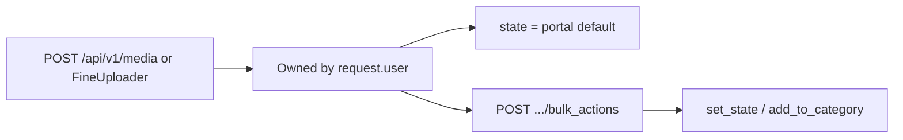
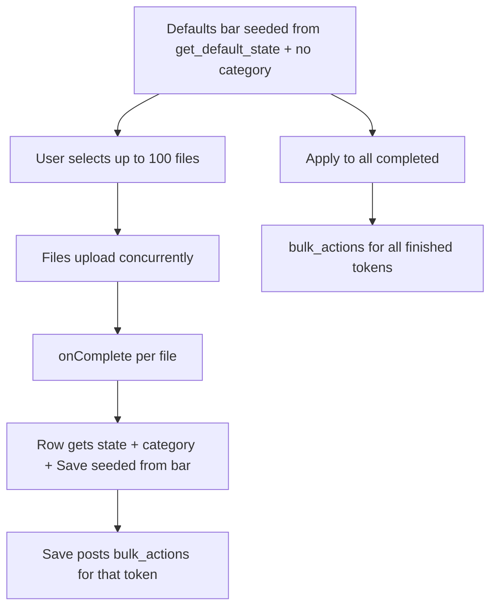

# API upload metadata, ownership, and light upload-queue UI

## Current behavior (answers)

**Category / public-private on upload?** No. `POST /api/v1/media` only documents and effectively accepts `media_file` (required), plus optional `title` and `description` ([`files/views/media.py`](files/views/media.py) ~310–332, [`docs/developers_docs.md`](docs/developers_docs.md)).

In [`MediaSerializer`](files/serializers.py):
- `state` is **read-only**
- `category` is **commented out** of `fields`
- `user` is **read-only**; create always does `serializer.save(user=request.user, ...)`

Browser upload (`/upload`) uses FineUploader → [`uploader/views.py`](uploader/views.py) and creates media with filename as title + portal default state. Queue today only shows progress and a “View media” link ([`templates/cms/add-media.html`](templates/cms/add-media.html)).

Default visibility comes from `PORTAL_WORKFLOW` via `Media.save()` → `helpers.get_default_state()`.

**Workaround today (two-step):** after upload, call `POST /api/v1/media/user/bulk_actions` with the new `friendly_token`:
- `set_state` + `state`: `private` | `public` | `unlisted`
- `add_to_category` + `category_uids`
- `add_tags` + `tag_titles`
- `change_owner` + `owner` — **only for media you already own**

**Superuser force-owner on upload?** No. No `owner` write path on create; bulk `change_owner` cannot reassign someone else’s media.

## Useful API fields to enable

Match HTML publish/edit flows, same permission rules as bulk actions:

- `state` — public/private/unlisted (public gated for non-editors when workflow is not `public`)
- `category_uids` — same contributor/RBAC checks as `add_to_category`
- `tag_titles` — parity with edit form / bulk
- `enable_comments`, `allow_download` — common publish toggles
- `owner` (username) — **editors/superusers only** on create (and optionally PUT)

Leave `featured` / `is_reviewed` alone unless explicitly editor-gated; do not make counters writable.

## Frontend: batch defaults + post-upload per-item controls

Agree with the feasibility concern: with up to 100 concurrent uploads, editing fields *while* files are still uploading is a poor fit. Chosen approach is **minimal**: a page-level defaults bar plus per-item controls that appear only after each file completes.

**Do not** add a full pre-upload form or force users through `/publish` for every file.

### Batch defaults bar (all completed files)

Above the FineUploader queue, add a compact defaults bar:

- Visibility select + Category select + **Apply to all completed**
- **Seeded from MediaCMS defaults**, not blank/arbitrary:
  - **State** = `helpers.get_default_state(request.user)` (same as `Media.save()` / `PORTAL_WORKFLOW`: typically `public`, `unlisted`, or `private`; for `private_verified`, unlisted only if `user.advancedUser`)
  - **Category** = none (MediaCMS does not assign categories on create today)
- Expose the default state to the template via the upload page context (or a small inline value next to existing `UPLOAD_MAX_*` context), so the bar and each new completed row start aligned with server defaults
- **Apply to all completed** collects every finished item’s `friendly_token` and one-shots `bulk_actions` (`set_state` for all; `add_to_category` only if a category is selected)
- Applying also syncs each per-item dropdown to the bar’s values so the UI stays consistent
- New files that complete after Apply still seed from the **current bar values** (so changing the bar before more finishes acts as “defaults for upcoming completions” without rewriting in-flight uploads)

### Per-completed-item strip

After each file succeeds, that queue row shows:

- Visibility dropdown (`private` / `unlisted` / `public` — choices filtered like publish form / portal workflow)
- Category dropdown (compact select from existing categories API / contributor list; RBAC-aware)
- **Save** for that token only (`set_state`, then `add_to_category` if chosen)
- Keep “View media”; optionally add “Publish” → `/publish?m=...` for full sharing UI
- Initial select values = current batch-bar values (which start as MediaCMS defaults)

### Implementation notes (FE)

- Touch primarily [`templates/cms/add-media.html`](templates/cms/add-media.html) (defaults bar + qq item template + `onComplete`) and light styles in [`frontend/src/static/css/AddMediaPage.scss`](frontend/src/static/css/AddMediaPage.scss) / related CSS. No React upload rewrite.
- Return `friendly_token` from FineUploader success response (today only `media_url`) so Save/Apply do not need to parse URLs.
- Prefetch category options once on page load (same sources as publish/bulk category UI).
- Track completed tokens in a small JS array as `onComplete` fires.
- **Single-file uploads** currently auto-redirect to `/view` after 500ms — stay on the queue so defaults/Save are usable. Multi-file: stop whole-row click-navigate so controls remain usable (keep explicit “View media”).
- LMS embed mode stays as today — no metadata bar/strip.
- Owner override stays **API-only** (not on the upload form).

This FE path works against today’s `bulk_actions` even before serializer create fields land. API work still helps scripted clients.

## API implementation approach

1. **Extend [`MediaSerializer`](files/serializers.py)** (or create-focused subclass for `MediaList.post` / `MediaDetail.put`): writable `state`, `enable_comments`, `allow_download`; write-only `category_uids`, `tag_titles`, `owner`; validate like bulk/publish.

2. **Create-time state:** `Media.save()` always resets `state` on create. After save, if client sent `state`, apply with the same listable logic as bulk `set_state` (keep FineUploader default path unchanged unless params are added later).

3. **Ownership on create** in `MediaList.post`: default `request.user`; if `owner` present and editor/superuser, resolve username; else 403.

4. **Bulk `change_owner`:** editors/superusers may target any media by token; normal users stay scoped to `user=request.user`.

5. **Docs + swagger** + API tests for metadata, permission gates, and editor ownership.

## Out of scope

- Major React redesign of upload
- Owner picker on the browser upload form
- Password / sharing permissions on create (still via bulk `set_ownership` or `/publish`)
- Management `/api/v1/manage_media` create/update
- Auto-applying defaults on every `onComplete` without user action (Apply is explicit; new rows only *seed* from the bar)
