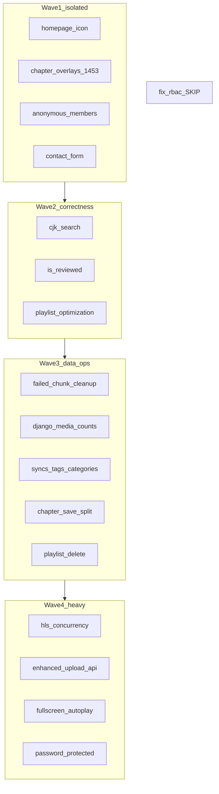

# Branch merge audit and order for `mediacms-next`

## Method (locked)

- **Leave all 17 branch refs untouched** (still used elsewhere). Integrate **into** `mediacms-next` only.
- **Do not merge branch tips wholesale.** Tips are ~87 commits behind next, still on flat `docs/*.md`, and some tips **lost** their fix via upstream merges.
- **Integrate via cherry-pick of unique non-merge commits** (`git cherry-pick -x <sha>`), or **surgical re-apply** when the tip wiped the fix or three-dot noise is mostly lockfiles/static bundles.
- After each wave: `TESTING=True` pytest for touched areas, frontend/Jest where UI changed, `make build-frontend` / video-js or chapters-editor rebuild as needed. Update [`docs/_shared/fork-whats-new.md`](docs/_shared/fork-whats-new.md) only (never hand-edit upstream `CHANGELOG.md`). Port any flat-doc edits into [`docs/en/`](docs/en/).
- Reject committed `static/js/*` / `static/video_js/*` / lockfile churn from branches; rebuild on next instead.

## Already on next / special cases

| Branch | On next? | Notes |
|--------|----------|--------|
| Unique commits (patch-id) | **None** match next | Confirmed for UI/fix set; features also absent |
| `fix-rbac-for-playlists` | **Skip — behavior already on next** | Tip empty vs merge-base (upstream merge wiped `7eb661d`). Current [`files/views/playlists.py`](files/views/playlists.py) already ORs `state` public/unlisted + owner + `MediaPermission` + RBAC categories (and editors see all). Do **not** re-apply listable-only helper. Optional: add a regression test when landing playlist work |
| `feat/password-protected-media` | **Model field only** | `Media.password` exists; no hash/unlock/UI/`test_media_password.py`. On port: consider widening `max_length` (100 is tight for hashed passwords), translations, unlock logging, MkDocs/scenario |
| `fix/is-reviewed-consistency` | **Partial** | Next uses `set_media_reviewed` but still `if result is False` — string `"false"` still marks reviewed (`bool("false")` is True). Port string coercion + multipart test |
| `fix/syncs-for-tags-categories` | **Partial** | Next has a generic M2M receiver + logging; still needs `pk_set`-aware tag/category count + search-vector updates from `3cd4f5b`/`5260bff` |
| `fix/homepage-icon-light` | **Partial** | Next strips trailing slash on `currentHostPath` only; still need item-URL strip from `47f8bdd` |

## Ordered integration waves

### Wave 1 — Isolated / low conflict

1. **`fix/homepage-icon-light`** — cherry-pick `47f8bdd`. Trailing-slash normalize in [`SidebarNavigationMenu.jsx`](frontend/src/static/js/components/page-layout/sidebar/SidebarNavigationMenu.jsx) + test. Tip three-dot looks large because next refactored sidebar; take commit only.
2. **`fix/1453-chapter-overlays`** — cherry-pick `ac39e77` only (skip merge commits). One file: `CustomChaptersOverlay.js`. Rebuild video-js.
3. **`feat/anonymous-member-page-views`** — cherry-pick `45e8101`, `02da83e`. Add `CAN_SEE_MEMBERS_PAGE="anonymous"` in [`cms/settings.py`](cms/settings.py) + [`files/context_processors.py`](files/context_processors.py). **Drop** `docs/admins_docs.md`; document in [`docs/en/guides/admin/settings.md`](docs/en/guides/admin/settings.md). Keep/adapt tests.
4. **`fix/contact-form`** — cherry-pick `0c91727`. Expect conflicts in `settings.py`, `files/methods.py`, `pages.py`, users adapter/views. Port `EMAIL_TIMEOUT` / SSL notes to MkDocs settings. Expect logging already present on next — preserve both.

### Wave 2 — Correctness (starts touching `media.py` / playlists)

5. **`fix/cjk-search`** — cherry-pick `1c83d88` (`prepare_media_search_filter` / `contains_cjk` in helpers + media/feeds + tests). merge-tree clean vs next.
6. **`fix/is-reviewed-consistency`** — cherry-pick `abc7c75` then **adapt** to call `set_media_reviewed` after normalizing string `"false"`/`"0"`/`"no"`. Add multipart false test from branch into [`tests/api/test_api_media_detail.py`](tests/api/test_api_media_detail.py).
7. **`fix/playlist-optimization`** — cherry-pick `39e16cd`, `bad2435`, `c9d1c6f`. Adds `MediaPlaylistMembership` + lazy Save-button load (#1487). Additive to `media.py`/urls; resolve any export/`__init__.py` drift. Prefer adding a backend API test for the new endpoint (branch only has FE tests).

**Skipped:** **`fix-rbac-for-playlists`** — leave branch ref as-is elsewhere; do not cherry-pick or merge into next.

### Wave 3 — Data model / ops / playlist UX

8. **`fix/failed-chunk-cleanup`** — cherry-pick `558113d` (cleanest backend ops merge). Port task + `ENCODING_CHUNKS_RETENTION_HOURS` + beat; add `logger.info` counts to match next logging; document in MkDocs settings + fork-whats-new.
9. **`fix/django-media-counts`** — cherry-pick `fe092dd`. Removes `User.media_count` + migration `0003_remove_user_media_count`. Rewrite admin against next’s `optional_list_columns` / annotate pattern. Confirm no fork callers.
10. **`fix/syncs-for-tags-categories`** — cherry-pick `3cd4f5b`, `1cfed1c`, `5260bff` (skip whitespace-only if empty). Merge into existing M2M receivers in [`files/models/media.py`](files/models/media.py) **without** dropping next’s logging; keep no `refresh_from_db()` per `5260bff`. Add backend tests for remove-count / search vector.
11. **`fix/chapter-save-after-split`** — **surgical port** of hunks from `83a6e26` in chapters-editor `useVideoChapters.tsx` / `TimelineControls.*` only. **Skip** package-lock/yarn.lock/sample-video deletion/static rebuilds from branch; rebuild chapters-editor on next.
12. **`fix/playlist-delete`** — cherry-pick `e9f7da5`, `4e4996d`. Align list annotations / `playlist_media_accessible_q` with **next’s existing** detail filter (`state` + owner + permissions + RBAC), not the wiped `7eb661d` helper. Optionally add RBAC-in-playlist regression test here. Rebuild frontend; translation workflow if new strings.

### Wave 4 — Heavy / high conflict (last)

13. **`fix/hls-concurrency`** — cherry-pick `d26e32f` into current encoding/HLS path in [`files/tasks.py`](files/tasks.py) + media model. Fold incremental helpers into next’s logged `create_hls`; full `tests/pipeline/` + note aarch64 `mp4hls` env caveat. Document in admin processing docs.
14. **`feat/enhanced-upload-api`** — cherry-pick `8dba922`. Serializer write fields, FineUploader response, add-media UI. Conflicts in `media.py`/`pages.py`/tests. Port `docs/developers_docs.md` → developer MkDocs; fork-whats-new; optional scenario for upload metadata.
15. **`fix/fullscreen-autoplay`** — cherry-pick `dcf79ca` with manual resolve on Video.js + MediaPageStore. Rebuild video-js + frontend. Manual QA next/prev autoplay.
16. **`feat/password-protected-media`** — cherry-pick `17fc83e` last (overlaps `media.py`, `pages.py`, MediaPageStore/Actions with upload + fullscreen). Drop static bundle deltas; rebuild. **Mandatory:** widen password field if hashes need >100 chars + migration; translations (`process_translations`); MkDocs operator/admin + scenario; `test_media_password.py`; unlock success/fail logging (no password values); wire into existing `media_auth` carefully.

## Per-integration checklist (every branch)

- Resolve conflicts preserving **next** patterns (logging, `_pending_library_block`, MkDocs, admin dashboard).
- Tests: `docker compose … exec --env TESTING=True -T web pytest <touched>`; frontend Jest for UI commits.
- Docs: MkDocs only; flat `docs/*.md` from branches discarded after porting substance.
- Changelog: Conventional Commits bullets in [`docs/_shared/fork-whats-new.md`](docs/_shared/fork-whats-new.md) from **final** diff on next.
- Logging: new ops paths use `logging.getLogger(__name__)`; no silent failures on mail/unlock/cleanup.
- Do **not** rewrite, force-push, or delete the 17 source branches.

## Conflict / concern summary

| Hub | Contended by | Mitigation |
|-----|--------------|------------|
| [`files/views/media.py`](files/views/media.py) | cjk, is-reviewed, playlist-optimization, syncs, enhanced-upload, password | Wave order above; one feature per commit on next |
| [`files/views/playlists.py`](files/views/playlists.py) | playlist-delete only (RBAC skipped) | Keep next’s accessible Q; extend for list annotations |
| [`files/tasks.py`](files/tasks.py) | chunk-cleanup, hls-concurrency | After logging merge already on next; resolve carefully |
| [`files/models/media.py`](files/models/media.py) | counts, syncs, hls | Signal merge with existing receivers |
| Media page JS store | fullscreen, password | fullscreen then password |
| Docs tree | contact, anonymous, upload | Always port → `docs/en/`, never merge flat docs |

## Out of scope for this plan

- Pushing remotes, opening PRs, or rewriting the 17 branch histories.
- Finishing the blocked 1Password-signed enhanced-logging commit (already on working next tip per audit).
