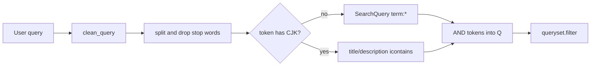

# Fix CJK media search (#1474)

## Root cause

Media search is Postgres full-text search with a trailing prefix operator only:

```1188:1199:files/views/media.py
        if query:
            # move this processing to a prepare_query function
            query = helpers.clean_query(query)
            q_parts = [q_part.rstrip("y") for q_part in query.split() if q_part not in STOP_WORDS]
            if q_parts:
                query = SearchQuery(q_parts[0] + ":*", search_type="raw")
                for part in q_parts[1:]:
                    query &= SearchQuery(part + ":*", search_type="raw")
```

That logic is duplicated in three places: [`MediaList.get`](files/views/media.py), [`MediaSearch.get`](files/views/media.py), and [`SearchRSSFeed.get_object`](files/feeds.py). Indexing uses `to_tsvector('simple', ...)` in [`Media.update_search_vector`](files/models/media.py).

With the `simple` config and no spaces, a CJK title is typically one lexeme. `京都:*` does not match `東京都庁` because Postgres FTS `:*` is prefix-only and **does not support leading wildcards**. Adding `*term` to tsquery is not a viable fix.



## Chosen approach

Keep Latin behavior identical. For tokens that contain CJK characters, match with `title__icontains` / `description__icontains` instead of FTS prefix. That gives the effective “leading + trailing wildcard” behavior the issue asks for, scoped to titles/summaries, without changing English/Spanish prefix search, stop-word handling, or ranking assumptions.

Defaults locked in:
- CJK-only substring path (not all languages) to avoid Latin regressions from short substring hits.
- Fields: `title` and `description` only (matches the issue; avoids broader accidental matches).
- No DB migration / `pg_trgm` / search-vector reindex in this change.

## Implementation

### 1. Shared helper in [`files/helpers.py`](files/helpers.py)

Add next to `clean_query`:

- `contains_cjk(text)` — Unicode ranges for Hiragana, Katakana, CJK Unified Ideographs (incl. extensions commonly used), Hangul syllables/jamo.
- `prepare_media_search_filter(raw_query) -> Q | None` that:
  1. Runs existing `clean_query`
  2. Splits on whitespace, drops `STOP_WORDS`, applies existing `rstrip("y")`
  3. Returns `None` if no tokens remain (preserves current “skip search filter” behavior)
  4. For each token:
     - **CJK present:** `Q(title__icontains=token) | Q(description__icontains=token)`
     - **Otherwise:** `Q(search=SearchQuery(token + ":*", search_type="raw"))`
  5. AND-combines per-token `Q`s

Import `STOP_WORDS` inside the helper (or pass through) so views/feeds stop duplicating tokenization.

### 2. Replace the three duplicated blocks

In each call site, replace the clean/split/`SearchQuery` block with:

```python
search_filter = helpers.prepare_media_search_filter(query)
if search_filter:
    media = media.filter(search_filter)
```

Call sites:
- [`files/views/media.py`](files/views/media.py) — `MediaList.get` (~221–231) and `MediaSearch.get` (~1188–1199)
- [`files/feeds.py`](files/feeds.py) — `SearchRSSFeed.get_object` (~122–133)

Remove now-unused local `SearchQuery` imports if nothing else in the file needs them.

### 3. Tests (regression-first)

Extend [`tests/api/test_api_media_upload_search.py`](tests/api/test_api_media_upload_search.py) (`MediaSearchEdgeCasesTest`) and/or add focused helper unit tests in [`tests/helpers/test_helpers_files.py`](tests/helpers/test_helpers_files.py):

- **CJK infix:** title `東京都庁` is found by `q=京都`
- **CJK prefix still works:** title `京都観光` found by `q=京都`
- **Description CJK:** description containing mid-string CJK is found
- **Latin unchanged:** existing `ancie` → `Zebra ancient` still passes
- **Multi-word Latin AND** still passes
- **Mixed query:** e.g. CJK token + Latin token ANDed
- **Operator stripping:** `clean_query` / helper still rejects tsquery metacharacters
- Optional RSS smoke: same CJK query works through the search feed path if easy to add beside [`tests/pages/test_feeds_rss.py`](tests/pages/test_feeds_rss.py)

## Out of scope (intentionally)

- Character n-gram indexing into `search` / `pg_trgm` GIN (better at scale; needs migration + reindex)
- Changing user/category/tag search
- Changing tokenization for space-separated CJK (rare; users can still search contiguous substrings)

## Risk notes

- `icontains` is unindexed; fine for typical MediaCMS sizes. If this becomes hot later, add `pg_trgm` on `title`/`description` without changing the query API.
- CJK tokens skip FTS, so they will not match tag/category/username-only hits unless those strings also appear in title/description. That matches the issue scope and avoids accidental Latin-path changes.
