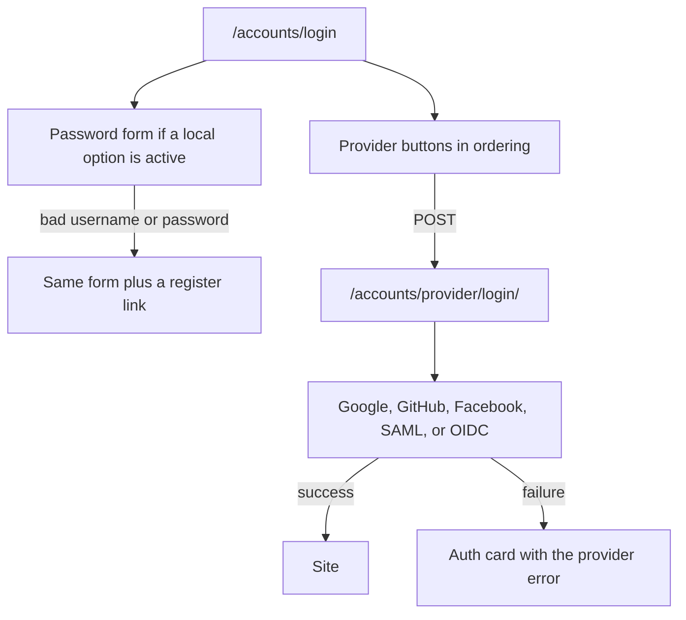

# Combined login and templated identity providers

No new fields and no migrations. Icons, login URLs, and which form fields a provider needs are derived in code from the existing `SocialApp` and `LoginOption` rows.

## What fits allauth, and what does not

django-allauth 65.19.7 already ships these. They get registered in [`cms/settings.py`](cms/settings.py) and [`cms/dev_settings.py`](cms/dev_settings.py) so `/accounts/<provider>/login/` exists (the same gap that made GitHub 404 until the app was installed):

- **Google, GitHub, Facebook** — client id and client secret on `SocialApp` (`secret` already exists; the ID Provider form currently omits it).
- **SAML** — already installed. Stays the path for Entra ID / AD FS. GitHub SAML and GitHub OAuth remain two separate buttons.
- **OpenID Connect** — the generic “another provider” template: client id, secret, and the issuer URL stored in the existing `SocialApp.settings` JSON. Covers Okta, Azure AD OIDC, and similar without a new model.
- **Email sign-in code** — allauth’s built-in login-by-code (email a code, not a new table). Off unless `ACCOUNT_LOGIN_BY_CODE_ENABLED` is set. The combined form shows “Email me a sign-in code” only then.

**LDAP/AD is not an allauth provider.** `django-auth-ldap` would be a new dependency and a separate backend, not a SocialApp template. Directory login stays on SAML for this work.

`LoginOption.ordering` stays a display sort only. The admin label says that. The field definition is left alone so Django does not ask for a migration.

## Sign-in page

[`files/views/auth.py`](files/views/auth.py) `custom_login_view` keeps listing active `LoginOption` rows, ordered by `ordering`. A local option (URL containing `/accounts/login_system`) becomes the username/password form. Every other option becomes a full-width button that POSTs to its URL, which is what allauth expects. `next` is preserved.

The dropdown template [`templates/account/custom_login_selector.html`](templates/account/custom_login_selector.html) is replaced by the existing auth card ([`templates/account/auth_card.html`](templates/account/auth_card.html) / [`templates/account/login.html`](templates/account/login.html)). The allauth login view (`/accounts/login_system`) uses that same template, so a failed password redisplays the password fields and the provider buttons together. Buttons use inline SVGs chosen from the URL (`google`, `github`, `facebook`, `saml`, `oidc`, otherwise a key). Icons are about 32px inside a tall button. Styles go in [`frontend/src/static/css/styles.scss`](frontend/src/static/css/styles.scss), then the frontend is built so port 80 serves them.

## ID Provider admin is a catalog

A small catalog module maps each provider id to its label, allauth app, required fields, and login path (`reverse` of the provider URL, not a hand-typed path).

[`identity_providers/admin.py`](identity_providers/admin.py) `CustomSocialAppAdmin` uses that catalog:

- Provider choices are the catalog, not a free-text protocol.
- OAuth shows name, client id, and client secret. SAML keeps the current SAML configuration and role/group tabs, and those inlines stay hidden for OAuth. OpenID Connect adds the issuer URL.
- `provider_id` is filled from the provider slug when the admin leaves it blank. SAML keeps a unique id per IdP.
- Saving a provider creates a `LoginOption` for its login URL if one does not exist. Title defaults to the provider name. An existing option keeps its title and ordering. Changing a SAML client id updates the matching option’s URL. Deleting the provider removes the option with that exact URL.
- There is still no foreign key. Matching is by URL.

## Login Options changelist

[`LoginOptionAdmin`](identity_providers/admin.py) follows the other configuration changelists (search, filter, `list_display_links` on the title, `list_editable` for ordering and active, tabbed fieldsets on the change form). Columns are title, derived provider, URL, ordering, and active. Header icons for those columns are added to `CHANGELIST_COLUMN_ICONS` in [`files/templatetags/custom_filters.py`](files/templatetags/custom_filters.py) so the changelist legend matches the other lists.

## Errors

Override allauth’s `socialaccount/authentication_error.html` with the auth card. Show the provider name and `auth_error` (code and exception message), plus a link back to sign-in. The sign-in view also renders Django messages, so a failure that returns to `/accounts/login` is visible there.

A wrong username or password keeps the user on that form and adds a registration suggestion under the credential error. The suggestion is the same whether or not an account with that username already exists: the view does not look the user up to change the copy. The link is the existing signup URL, and it is shown only when `USERS_CAN_SELF_REGISTER` is on (`MyAccountAdapter.is_open_for_signup`). When self-registration is closed, the credential error stays and the register link is omitted.

New strings go through `files/frontend_translations/en.py` and `process_translations`.

## Tests

Extend [`tests/api/test_api_misc_views.py`](tests/api/test_api_misc_views.py): active options render as buttons in `ordering`, the local option is the password form, inactive options stay hidden. Add coverage that saving a catalog `SocialApp` creates one login option, a second save does not reset ordering, and the error template includes the provider message. A failed local login, for both an unknown username and an existing user with the wrong password, redisplays the form with the same register link when self-registration is open, and omits that link when `USERS_CAN_SELF_REGISTER` is false.
