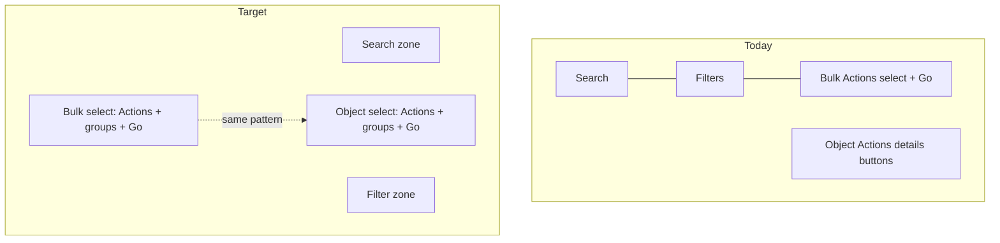

# Enhanced dashboard translation + admin Actions UX

## Problem

1. Dashboard copy uses Django ``, which does not connect to MediaCMS [`files/frontend_translations/`](files/frontend_translations/en.py) / [`custom_translate`](files/templatetags/custom_filters.py).
2. Delete-original confirmation uses fixed phrase `I am sure`.
3. RTL locales need direction-safe markup.
4. **Actions are hard to scan:** Media changelist bulk Actions and change-form object Actions ([`change_form_with_object_actions.html`](templates/admin/change_form_with_object_actions.html)) show a long flat list. Object Actions use a `<details>` button list; bulk Actions use a select — behavior differs. Search, filters, and Actions/Go sit in one visual band and are hard to distinguish.



## Approach summary

| Area | Decision |
|------|----------|
| Translations | `custom_translate` + STE English keys + `process_translations` |
| Delete confirm | Case-sensitive `friendly_token` (copy-paste); multi = one token per line |
| RTL | Page `dir` from Jazzmin; isolate IDs/tokens as LTR |
| Actions | Keep dropdown; blank default short label; groups split by `---------`; same select+Go for bulk and object |
| Changelist chrome | CSS zones so search / filters / Actions are distinguishable |

**Out of scope:** hand-translating every language; rewriting all Jazzmin package CSS; unrelated ModelAdmin metadata beyond Actions dropdown UX.

---

## A. Translations, STE strings, friendly_token, RTL

(Unchanged in substance from prior plan revision.)

- Convert [`templates/admin/index.html`](templates/admin/index.html) and confirmation templates to `custom_translate` with STE keys (see rewrite map below).
- Delete-original: exact `friendly_token` match; show copyable `<code dir="ltr">`; update [`files/admin.py`](files/admin.py) + [`tests/admin/test_admin_files.py`](tests/admin/test_admin_files.py).
- Register keys in [`files/frontend_translations/en.py`](files/frontend_translations/en.py); run `process_translations`.
- Logical spacing + LTR isolate for tokens; full-sentence translation keys.

### STE rewrite map (dashboard / confirmations)

Keep prior map: Moderation, Reported media, Open reports, Reports cleared (7 days), Cancel, Delete original files, multi-sentence delete warning, etc. (full table remains the implementation checklist during coding).

### STE short labels for Actions (dropdown text)

| Current description | STE short label |
|---------------------|-----------------|
| Generate missing encoding(s) | Generate missing encodings |
| Force re-encode | Force re-encode |
| Regenerate thumbnails | Regenerate thumbnails |
| Regenerate sprites | Regenerate sprites |
| Regenerate preview | Regenerate preview |
| Regenerate HLS | Regenerate HLS |
| Refresh derivatives (thumbs/sprites/preview/HLS) | Refresh all derivatives |
| Mark as reviewed | Mark as reviewed |
| Mark as unreviewed | Mark as not reviewed |
| Clear reports | Clear reports |
| Confirm reports: set private | Confirm reports and set private |
| Clear reports, keep private | Clear reports and keep private |
| Clear reports, set public | Clear reports and set public |
| Set state: public / private / unlisted | Set public / Set private / Set unlisted |
| Enable/Disable download | Enable download / Disable download |
| Enable/Disable comments | Enable comments / Disable comments |
| Feature selected / Unfeature selected | Feature / Unfeature |
| Delete original media file | Delete original file |
| Change owner | Change owner |
| Approve/Unapprove/Deactivate/Reactivate selected users | Approve users / Unapprove users / Deactivate users / Reactivate users |
| Retry failed encodings | Retry failed encodings |

These labels stay as Python `description=` strings (admin metadata). They are **not** required in `frontend_translations` unless later wrapped for i18n; STE clarity is the goal here.

---

## B. Actions dropdown UX (bulk + object, same pattern)

### Goals

- Keep a **dropdown** (no long button wall).
- Default option: **non-value**, short description — `Actions` (empty `value=""`).
- Logical groups separated by disabled hyphen rows: `---------` (classic Django admin separator).
- Object change-form Actions behave like bulk Actions: `<select>` + **Go**, not `<details>` + per-action buttons.
- Grouping defined once and reused for both surfaces.

### Shared helper

Add something like [`admin_customizations/action_choices.py`](admin_customizations/action_choices.py) (or helpers next to [`object_actions.py`](admin_customizations/object_actions.py)):

```python
ACTIONS_PLACEHOLDER = ("", "Actions")
GROUP_SEPARATOR = ("", "---------")  # disabled / non-submittable in template

def build_grouped_action_choices(actions_dict, group_order):
    """
    actions_dict: name -> (func, name, description) from get_actions()
    group_order: [(group_key, [action_name, ...]), ...]
    Returns list of (value, label, disabled) suitable for <select>.
    """
```

- Leading choice: `("", "Actions")`.
- Between groups: insert `("", "---------")` marked disabled.
- Skip unknown/missing actions; never show `delete_selected` on object form (existing `EXCLUDED_ACTIONS`).
- Ungrouped leftover actions (if any) go in a final group after a separator.

### MediaAdmin groups

In [`files/admin.py`](files/admin.py), declare order + groups explicitly, e.g.:

1. **Encoding** — generate missing, force re-encode, regenerate thumbnails/sprites/preview/HLS, refresh derivatives
2. **Moderation** — mark reviewed / not reviewed, clear/confirm reports variants
3. **State** — set public / private / unlisted
4. **Access** — enable/disable download, enable/disable comments, feature / unfeature
5. **Owner and files** — change owner, delete original file

Wire via `get_action_choices()` override (bulk) so Jazzmin’s `.actions select` + select2 picks up the same list.

### Object Actions template

Rewrite [`templates/admin/change_form_with_object_actions.html`](templates/admin/change_form_with_object_actions.html):

- Replace `<details>` button list with one form: `<select name="action">` + Go submit (mirror changelist).
- Options: placeholder `Actions`, then grouped options with disabled `---------` separators.
- Context from [`object_actions.py`](admin_customizations/object_actions.py): pass **grouped choices** (not a flat list), built with the same helper + per-ModelAdmin `action_groups` when present.
- Fallback for models without `action_groups`: placeholder + flat list (still a select+Go).

### UserAdmin / EncodingAdmin

Apply the same blank default; optional small groups (e.g. Users: approval vs account status). Encoding: single action stays placeholder + one option.

### select2 note

Jazzmin enhances `.actions select` with select2 ([`static/jazzmin/js/change_list.js`](static/jazzmin/js/change_list.js)). Disabled separator options generally work; verify separators are not selectable. Object-form select should use the same `form-control` class; enhance with select2 only if changelist already does and it does not break disabled separators — prefer parity, fall back to native `<select>` if select2 eats separators.

---

## C. Distinguish search / filters / bulk Actions

Changelist toolbar currently blends into one band. Add CSS in [`static/jazzmin/css/main.css`](static/jazzmin/css/main.css) (and markup hooks only if needed):

1. **Search** — keep `#changelist-search` as its own strip (existing).
2. **Bulk Actions** — style `.actions` as a distinct bar: light background, border-block, padding, clear gap from search; ensure select + Go read as one control group (`display: inline-flex; gap: …` with logical properties).
3. **Filters** — ensure `#changelist-filter` / sidebar remains a separate column visually (border-inline-start, heading weight); do not merge into the actions bar.
4. **Object Actions** — style the change-form Actions select+Go to match the bulk Actions control group (same heights, button class, spacing) so muscle memory transfers.

Avoid large redesign; goal is **scannable zones**, not a new layout system.

---

## D. Verify

- Media changelist: Actions shows `Actions` default; groups separated by `---------`; Go runs selected action.
- Media change form: same dropdown pattern and groupings; single-object run still works (including intermediate confirm views).
- Search / filters / Actions visually distinct.
- Translations + RTL + friendly_token confirm as before.
- Tests: existing admin action/smoke tests; extend object-actions / confirmation tests as needed.

## File touch list

- [`templates/admin/index.html`](templates/admin/index.html), confirmation templates — translations + STE + RTL
- [`templates/admin/change_form_with_object_actions.html`](templates/admin/change_form_with_object_actions.html) — select+Go + groups
- [`admin_customizations/object_actions.py`](admin_customizations/object_actions.py) (+ new action_choices helper) — shared grouped choices
- [`files/admin.py`](files/admin.py) — STE action labels, `action_groups` / `get_action_choices`, friendly_token confirm
- [`users/admin.py`](users/admin.py) — STE labels + optional groups
- [`static/jazzmin/css/main.css`](static/jazzmin/css/main.css) — toolbar zones, Actions parity, RTL helpers
- [`tests/admin/test_admin_files.py`](tests/admin/test_admin_files.py) (+ object-actions tests if present)
- [`files/frontend_translations/en.py`](files/frontend_translations/en.py) + lang sync via `process_translations`
