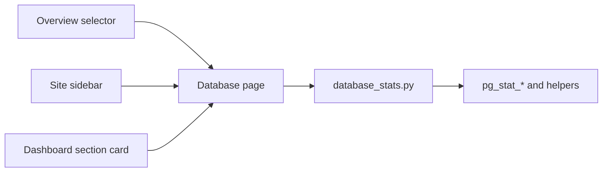

# Database status overview

Add a **Database** admin status page for the current PostgreSQL database. It reports live and cumulative server health counters. It does not list tables, indexes, sessions, or query text, and it does not add Django model totals.

Place it immediately after **System** in both navigation lists, so they stay aligned:

- Site sidebar in [`admin_customizations/sidebar.py`](admin_customizations/sidebar.py): Overview, Health, Configuration, System, **Database**, then model links
- Overview selector in [`templates/admin/dashboard/_section_nav.html`](templates/admin/dashboard/_section_nav.html): … Site, Health, Configuration, System, **Database**

Also add a matching section card on the main dashboard in [`templates/admin/index.html`](templates/admin/index.html), after the existing System card in that status cluster.

## Metrics

New collector [`admin_customizations/database_stats.py`](admin_customizations/database_stats.py), called from `calculate_statistics()` in [`admin_customizations/admin.py`](admin_customizations/admin.py). Bump `DASHBOARD_STATS_CACHE_KEY` so the 60-second cache does not serve the old payload. One snapshot per refresh is enough; counters stay cumulative and the page shows `stats_reset` so that is obvious. No background sampler.

Query only the current database, each statement isolated so a missing privilege or missing view becomes "Unavailable" instead of a 500:

- Server: short server version, uptime (`now() - pg_postmaster_start_time()`), `pg_database_size`, transaction ID age
- Connections: total, active, idle, idle in transaction, `max_connections`, percent used, and a count of non-idle sessions longer than 5 minutes (count only)
- Activity: commits, rollbacks, deadlocks, temp files, temp bytes, cache hit percent, blocks hit, blocks read
- Checkpoints: timed vs requested from `pg_stat_checkpointer` (PostgreSQL 17), falling back to `pg_stat_bgwriter`
- Replication: replica count and longest `replay_lag`, or "No replicas"

Skip per-table dead tuples, index lists, lock lists, `pg_stat_statements`, and query text.

Color only point-in-time signals: connection use (warn at 70%, fail at 90%), transaction ID age (warn at 200 million), and idle-in-transaction count above zero. Cache hit is shown as a number. On a small or freshly reset database it is not treated as a failure.

If the connection is not PostgreSQL, or the stats views cannot be read, the page still renders with a single unavailable message.

## Page and wiring

- Register `database` in `DASHBOARD_SECTIONS` in [`admin_customizations/views.py`](admin_customizations/views.py) (`fas fa-database`)
- Templates [`templates/admin/dashboard/database.html`](templates/admin/dashboard/database.html) and [`templates/admin/dashboard/_database.html`](templates/admin/dashboard/_database.html): one grouped name/value table, same copy tools as System
- Index card shows connections used, cache hit, database size, and transaction ID age
- Append the same rows to the support bundle in [`admin_customizations/support_bundle.py`](admin_customizations/support_bundle.py). No secrets and no SQL text

## Database backup download

On the Database page, a **Download a database backup** button for superusers. Next to it, a visible limitation note covering every exclusion below: non-audit media actions (watch, like, dislike, and similar) are omitted and only reports and audit records are exported; failed encodings, trim requests, and caption requests are omitted; sessions, notifications, and operational logs are omitted.

The download name uses the local date and time, matching the support bundle: `mediacms-database-backup-YYYY-MM-DD-HHMM.json.gz` (for example `mediacms-database-backup-2026-11-13-1325.json.gz`). The `Content-Disposition` filename is that stamp. The body is a gzipped Django JSON fixture, streamed so the database is not held in memory.

Included content is the library and its configuration: media, categories, tags, playlists, pages, users, captions (`Subtitle`), successful and in-progress encodings, and the other content models. These rows are left out:

- `MediaAction` except `report` and `MODERATION_MEDIA_ACTIONS` (report cleared/confirmed, media reviewed/unreviewed, original deleted, metadata refresh, integrity warning). `like`, `dislike`, `watch`, and `rate` are omitted. The allowlist lives next to those constants in [`actions/models.py`](actions/models.py).
- `Encoding` rows with `status="fail"`. Pending, running, and successful encodings stay, including chunks that have not failed.
- All `VideoTrimRequest` rows (trim requests).
- All `TranscriptionRequest` rows (caption requests). Finished caption files on `Subtitle` stay.
- Operational tables: `Session`, admin `LogEntry`, `Notification`, `IdentityProviderUserLog`, and `LTILaunchLog`.

Uploaded media files are not in the file; file fields stay as stored paths. Restore with `loaddata` after migrations. The route follows the support-bundle download in [`admin_customizations/apps.py`](admin_customizations/apps.py) and returns 403 for non-superusers. The metrics page itself stays available to staff.

## Translations and tests

Add new labels to [`files/frontend_translations/en.py`](files/frontend_translations/en.py), reusing keys that already exist, then run `process_translations` so every language file receives the keys.

Update [`tests/admin/test_admin_sidebar.py`](tests/admin/test_admin_sidebar.py) so Site order is `SiteOverview`, `SiteHealth`, `SiteConfiguration`, `SiteSystem`, `SiteDatabase`, then `Page`. Add a collector test and a dashboard test that the Database page returns 200, shows the limitation note, and that the selector lists System before Database. The backup test creates a like, a watch, a report, an audit action, a failed encoding, a successful encoding, a trim request, and a caption request. It asserts the dated `mediacms-database-backup-YYYY-MM-DD-HHMM.json.gz` name, that the report, audit row, and successful encoding are present, and that the like, watch, failed encoding, trim request, and caption request are absent. A non-superuser receives 403. Verify the page, selector, sidebar, and backup button in the browser after the dev stack is up.
