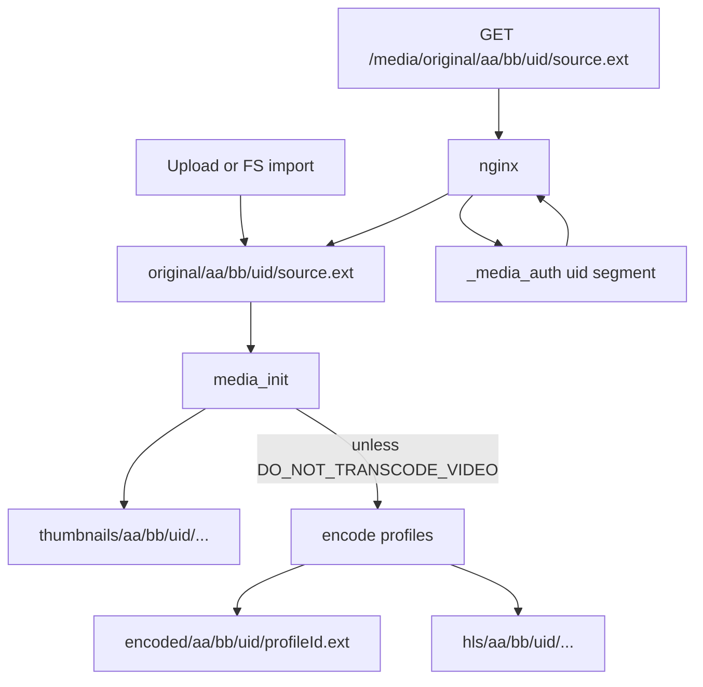
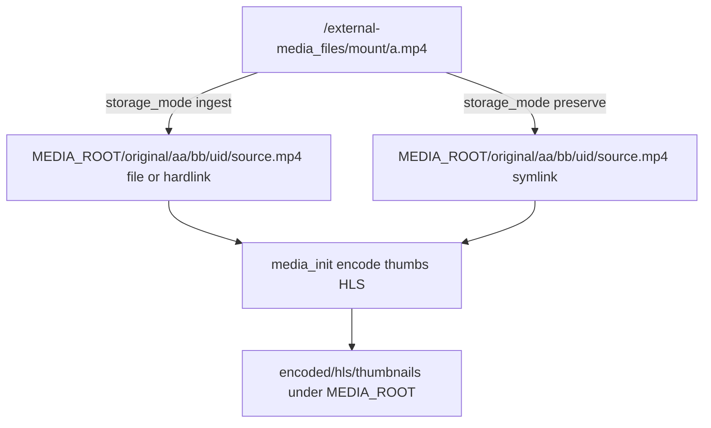
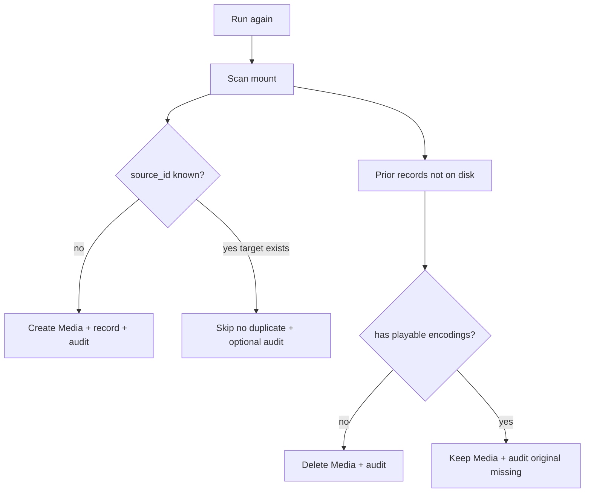
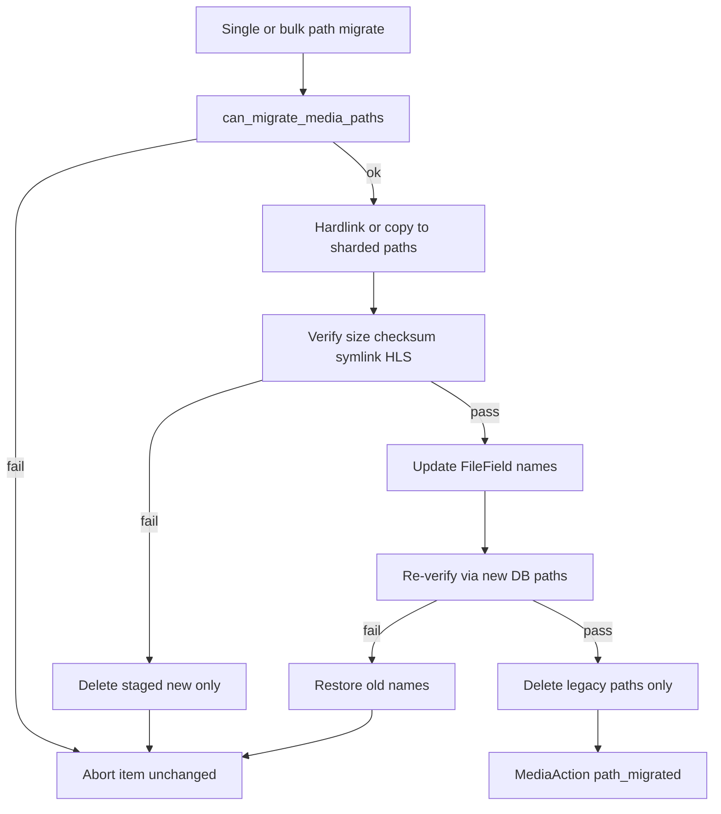

# Filesystem import + standardized media paths

## Audit: current path inconsistency

Helpers in [`files/models/utils.py`](files/models/utils.py) and settings mix several conventions:

| Kind | Current relative path | Auth how uid is found |
|------|----------------------|------------------------|
| Original | `original/user/<username>/<uid.hex>.<client_filename>` | uid prefix on filename |
| Encoding | `encoded/<profile_id>/<username>/<uid.hex>.<name>` | uid prefix on filename |
| Thumbnails | `original/thumbnails/user/<username>/<arbitrary>` | DB lookup by stored path |
| Subtitles | `original/subtitles/user/<username>/<arbitrary>` | DB lookup by stored path |
| HLS | `hls/<uid.hex>/…` | second path segment |
| Categories | `original/categories/<uid>.<name>` | separate |

Problems: username in paths (rename/leak), client filenames in public URLs, auth logic differs by family, imports would otherwise invent a third style (`imported/…`).

## Standardized layout (all new writes)

One rule: **media-owned files are keyed by `Media.uid.hex`; basenames are fixed and opaque; no username; no mount/folder/client filename.**

### Shard fan-out (large library performance)

A flat `original/<uid.hex>/` (or millions of files in one directory) becomes slow to list, backup, and navigate on typical filesystems. All **new** media-owned trees use a **two-level hex prefix** from the uid (256×256 = 65 536 leaf buckets):

```text
# uid.hex example: a1b2c3d4e5f6... (32 hex chars)
# shard1 = uid[0:2]  → a1
# shard2 = uid[2:4]  → b2

original/<aa>/<bb>/<uid.hex>/source.<ext>
encoded/<aa>/<bb>/<uid.hex>/<profile_id>.<ext>     # includes preview gif profile output
hls/<aa>/<bb>/<uid.hex>/…
thumbnails/<aa>/<bb>/<uid.hex>/poster.jpg          # Media.poster / uploaded_poster
thumbnails/<aa>/<bb>/<uid.hex>/listing.jpg         # Media.thumbnail / uploaded_thumbnail
thumbnails/<aa>/<bb>/<uid.hex>/sprites.jpg         # Media.sprites
thumbnails/<aa>/<bb>/<uid.hex>/chapters/…          # video_chapters_folder (was username/token path)
subtitles/<aa>/<bb>/<uid.hex>/<lang>.<ext>         # captions: Subtitle.subtitle_file (.srt/.vtt)
categories/<aa>/<bb>/<category_uid>.<ext>          # Category.thumbnail (not under original/)
```

Shared helper, e.g. `media_uid_shard_path(uid) -> "<aa>/<bb>/<uid.hex>"`, used by every `upload_to` / path builder so sharding cannot drift.

**Captions = subtitles.** There is no separate captions tree: Whisper and uploaded captions both use [`Subtitle.subtitle_file`](files/models/subtitle.py) → `subtitles_file_path`. Sidecar import from filesystem sync writes into this same layout.

### Complete inventory (nothing media-owned left ambiguous)

| Kind | Model / field today | New relative path | In path-migrate? |
|------|---------------------|-------------------|------------------|
| Original | `Media.media_file` | `original/aa/bb/uid/source.ext` | Yes |
| Encode outputs | `Encoding.media_file` | `encoded/aa/bb/uid/<profile_id>.ext` | Yes |
| Preview | `Media.preview_file_path` (usually an encoding path) | Same as that encoding under `encoded/…` | Yes (update CharField) |
| HLS tree | `Media.hls_file` + dir | `hls/aa/bb/uid/…` | Yes |
| Poster | `poster`, `uploaded_poster` | `thumbnails/aa/bb/uid/poster.jpg` | Yes |
| Listing thumb | `thumbnail`, `uploaded_thumbnail` | `thumbnails/aa/bb/uid/listing.jpg` | Yes |
| Sprites | `sprites` | `thumbnails/aa/bb/uid/sprites.jpg` | Yes |
| **Captions** | `Subtitle.subtitle_file` | `subtitles/aa/bb/uid/<lang>.vtt` (or `.srt`) | Yes |
| Chapter assets | `video_chapters_folder` | `thumbnails/aa/bb/uid/chapters/…` | Yes |
| Category thumb | `Category.thumbnail` | `categories/aa/bb/<category_uid>.ext` | Yes (category action or same helper when touched) |
| Encode chunks | `Encoding.chunk_file_path` / temp under `chunks/` | Keep under `chunks/` (or `TEMP_DIRECTORY`); **ephemeral**, cleaned by beat—shard by uid if retained > hours, but **not** part of durable layout or path-migrate | No (transient) |
| Upload tus/fineuploader | `UPLOAD_DIR` / `CHUNKS_DIR` | Unchanged ephemeral upload staging | No |
| User logos | user logo fields | Out of scope (not Media library) | No |
| TinyMCE page media | `tinymce_media/` | Out of scope | No |

Also update `X_ACCEL_PROTECTED_PATHS` (today `encoded`, `hls`, `original`) to include **`thumbnails`** and **`subtitles`** (and `categories` if gated the same way).

Public URL examples:

```text
/media/original/a1/b2/<uid>/source.mp4
/media/encoded/a1/b2/<uid>/3.mp4
/media/hls/a1/b2/<uid>/…
/media/thumbnails/a1/b2/<uid>/poster.jpg
/media/subtitles/a1/b2/<uid>/en.vtt
/media/categories/a1/b2/<category_uid>.jpg
```

Why two-level shards: keeps directory entry counts small at multi-million scale. Do not keep new encodes under `encoded/<profile_id>/<username>/` (concentrates by profile).

### Code changes for the standard

- Centralize sharding in [`files/models/utils.py`](files/models/utils.py); replace `original_media_file_path`, `encoding_media_file_path`, `original_thumbnail_file_path`, `subtitles_file_path`, and HLS path construction in tasks.
- Settings: keep `MEDIA_UPLOAD_DIR` / `MEDIA_ENCODING_DIR`; set `THUMBNAIL_UPLOAD_DIR = "thumbnails/"`, `SUBTITLES_UPLOAD_DIR = "subtitles/"`; optional `MEDIA_PATH_SHARD_DEPTH = 2` (fixed at 2 for v1—document, don’t make runtime-variable without a migration story).
- [`files/views/media_auth.py`](files/views/media_auth.py): resolve uid by finding the path segment matching `UID_RE` (32 hex) under known kind prefixes—not “second segment” alone (shards occupy segments 1–2). Keep **legacy** resolvers for `original/user/…`, `encoded/<profile>/<user>/…`, unsharded `hls/<uid>/…`, etc.
- nginx: locations for `/media/original/`, `/media/encoded/`, `/media/hls/`, `/media/thumbnails/`, `/media/subtitles/`, `/media/categories/` with `auth_request` as appropriate. Extend `X_ACCEL_PROTECTED_PATHS`. Sharding sits under those aliases—no per-shard locations.
- Delete / GC: remove the whole `<uid.hex>/` directory under the shard path; do not `listdir` giant parent trees in hot paths.
- Helpers/tests: never `os.listdir` a kind root in request/sync code; scans for reconcile stay on `/external-media_files` (operator tree), not on `MEDIA_ROOT` fan-out.
- Existing libraries stay on legacy paths until an operator runs the **path migrate** action below (not automatic on upgrade).



## Mount model (filesystem provider)

```text
/external-media_files/     # FILESYSTEM_IMPORT_ROOT — scan only, never nginx-published
  archive-a/
  lecture-drop/
```

- Connection: mount name (+ optional subpath). Same binds on web + celery_worker.
- Public URLs always use the standardized opaque path under `/media/original/<uid>/…`. External mount names never appear in responses.

## Storage mode (per migration option)

Configurable on the filesystem migration as `options.storage_mode`:

| Mode | Default? | What happens to the original bytes | Public path |
|------|----------|--------------------------------------|-------------|
| `ingest` | **Yes** | Prefer `os.link` into sharded `original/<aa>/<bb>/<uid>/source.<ext>`; if cross-device / fails, `shutil.copy2`. | Opaque `/media/original/aa/bb/<uid>/source.<ext>` under `MEDIA_ROOT` |
| `preserve` | No | Symlink at that same sharded path → absolute path under `FILESYSTEM_IMPORT_ROOT`. Bytes stay on the external mount. | Same opaque URL; reads follow the symlink |

Rules for both modes:

- Encoded/HLS/thumbnails/subtitles always written under the standardized trees in `MEDIA_ROOT` (derived assets are never left only on the external mount).
- Encode/ffprobe read `media.media_file.path` (follows symlink in preserve mode).
- **Delete safety:** `helpers.rm_file` / `post_delete` must remove only the MediaCMS path. `os.remove` on a symlink removes the link, not the target — keep that behavior and add an explicit `os.path.islink` guard + log line so preserve archives are never unlinked even if helpers change. For `ingest` hardlinks, unlinking the MediaCMS name leaves the archive inode when `nlink > 1`; for copies, only the copy is deleted.
- `preserve` requires the external path to remain mounted at the same location for the life of the media; `check_connection` / docs warn that remounts or path moves break playback. Prefer **not** `:ro` only if operators need hardlink ingest; preserve works with `:ro` external mounts (symlink target is readable).
- Reject `preserve` if the resolved source escapes `FILESYSTEM_IMPORT_ROOT` or is itself a symlink that escapes the root.
- UI: radio or select — “Copy into MediaCMS storage” (`ingest`) vs “Keep files on external mount” (`preserve`), with short help text.



## Encoding behavior (filesystem)

- Default: normal `media_init` → thumbnails, sprites, encode, preview, HLS. **No** `_do_not_transcode`, **no** per-migration skip option.
- Skip encode only when `DO_NOT_TRANSCODE_VIDEO` is true in settings (`media_init` already branches).
- Independent of `storage_mode`: preserve still encodes into `MEDIA_ROOT` unless the global setting disables it.

## Ownership

Filesystem sources have no account catalogue (unlike Kaltura/Panopto). **v1: one MediaCMS user owns every imported item**, same pattern as YouTube.

- Required **Owner** at migration create/edit time — an existing MediaCMS user (picker like YouTube). Stored as `options.fallback_username` (or equivalent) and resolved at import time.
- **No autofill** with the creating superuser (or any other default). The field starts empty; Save / Save and start is refused until an owner is selected. Serializer validation rejects a missing owner.
- All `Media.user` (and category ownership where applicable) use that account. Listing/state still follow `PORTAL_WORKFLOW` / `MEDIA_IS_REVIEWED`.
- `initiated_by` may still record who started the migration for the log; it is not the media owner.
- **Not in v1:** mapping mount subfolders to usernames, or auto-creating users from directory names.

## Library sync (re-runnable, not one-shot)

Primary use case: the owner keeps their library under `/external-media_files/<mount>/…` and **re-runs the same migration** when they want MediaCMS to catch up. Framing in UI/docs: “Filesystem library sync”, with **Run again** as the normal ops loop (existing Migrations control).

### Idempotency (no duplicates)

- `source_id` = path relative to the mount (stable).
- `MigrationRecord` + `already_migrated(source_system, …)` remain the dedupe keys (same as other providers).
- On re-run, if a success/skipped record’s target `Media` still exists → **do not create another Media**; count as skipped/unchanged.
- If the Media was deleted in MediaCMS but the file is still on disk → import again (new Media + new record outcome), same as today’s “deleted target is imported again” behavior elsewhere.

### Sync algorithm (filesystem-specific phases)

Default orchestrator only walks what the provider `list_page` returns (present files). Filesystem needs an extra **reconcile** pass over prior success records for this `source_system` / service:

1. **Scan** current tree under the selected mount/subpath → `present` set of `source_id`s.
2. **Import / skip** each present id (new → create; existing target → skip).
3. **Reconcile missing:** for each prior successful media `MigrationRecord` whose `source_id` is not in `present` (and still under this migration’s selection): apply prune policy below.
4. Finish with totals: discovered, migrated (new), skipped (unchanged), pruned, kept_missing_original, failed.

Wire as `PROVIDER_PHASES["filesystem"]` including a terminal reconcile step (e.g. phases `categories`, `media`, `reconcile`) or run reconcile after media phase inside the filesystem importer/orchestrator hook—whichever stays clearest next to existing `migrate_item` skip logic.

### Prune policy (source file removed)

When the original path is gone from the mount:

| Condition | Action |
|-----------|--------|
| Media has **no** successful playable encodings (same notion as integrity: non-chunk mp4/webm excluding preview; or no encodings at all for non-video) | **Delete** the Media (and MediaCMS-owned files/symlink only). Update/clear `MigrationRecord` appropriately so a later reappearance can re-import. |
| Media **has** one or more successful playable encodings | **Keep** the Media. Do not delete. For `preserve`, remove or replace a dangling symlink carefully so delete of Media later still won’t touch the archive; log that the original is missing. Encodings/HLS remain playable. |

Never cascade-delete MediaCMS media merely because the archive file vanished if encodings exist.

Content change detection (same path, different md5) is **out of scope for v1** unless cheap: optional log-only note; no automatic re-encode.



## Path migrate action (legacy → sharded layout)

Operators need an explicit, **gated** way to move one media or many from the old layout into the new sharded layout. Mirror the spirit of [`can_delete_original_media_file` / `delete_original_media_file`](files/methods.py): eligibility checks, no destructive step until verification passes.

### Surfaces

- **Single:** Manage media / admin object action (and API) on one `friendly_token`.
- **Bulk:** Manage media bulk action + Celery task per item (or small batches) so large libraries do not block a request. Progress via task results / admin log; failures leave that item on the old layout.
- ACL: managers/superusers (or same gate as other destructive media admin actions)—not end users.

### Per-media algorithm (atomic per item; fail closed)

For each Media (and its Encoding rows, poster/listing/uploaded thumbs, sprites, **caption/subtitle files**, chapters folder, HLS dir, `preview_file_path`):

1. **Eligibility (`can_migrate_media_paths`)**
   - Collect every on-disk path the row still references.
   - Skip with reason if already fully on the new sharded layout.
   - Fail if any referenced path is missing, unreadable, or outside `MEDIA_ROOT` (except intentional preserve symlinks whose **link path** is under `MEDIA_ROOT`).
   - Fail if an encode/HLS job is `pending`/`running` for this media (avoid racing writers).

2. **Stage (no DB change yet)**
   - Compute destination paths via the shared shard helpers.
   - Prefer `os.link` within `MEDIA_ROOT`; else copy. For existing symlinks (preserve imports already on old layout), recreate symlink at the new path with the **same target** (do not copy through the link unless ingest mode requires a real file).
   - Leave all **old** paths untouched.

3. **Verify staged files (100% before any cutover)**
   For every staged artifact vs its source:
   - Path exists and is the expected type (file / symlink / directory tree for HLS).
   - Symlink: `os.path.samefile` or identical `readlink` target.
   - Regular file: size equal **and** checksum equal (md5 or blake2 of full file; reuse media `md5sum` when it is the original and still valid).
   - HLS: every file under the old tree has a counterpart under the new tree with matching size (and checksum for small playlists; segment checksums required for v1 completeness—or size+count+master playlist hash as a documented minimum, preferring full file checksums where practical).
   - If **any** check fails: delete only the **staged new** paths, leave DB and old layout unchanged, record failure reason (no `path_migrated` success).

4. **Cutover DB**
   - Update `media_file`, encoding `media_file`, thumbnail/poster/sprites/subtitle fields, `hls_file`, `preview_file_path` to the new relative names in one transaction where possible.
   - Invalidate xaccel caches for the uid (`xaccel:state:…`, path keys).

5. **Re-verify through DB**
   - Re-open each field’s `.path`, confirm exists + checksum/symlink target again **via the new names**.
   - Optional: `media_auth` uid resolution on the new relative URL path succeeds for this uid.
   - If re-verify fails: **do not delete old files**; attempt to roll DB names back to the old relative paths; leave staged new files for manual cleanup or a compensating delete-of-new-only. Emit failure log / integrity-style warning—not success.

6. **Remove old layout (only after step 5 passes)**
   - Delete old files/dirs that are no longer referenced and were part of this media’s legacy set.
   - Never delete a path still referenced by another Media.
   - Never follow a symlink to delete an external preserve target—only unlink MediaCMS-side paths.

7. **Audit**
   - `record_moderation_action(user, media, "path_migrated", extra_info=…)` summarizing what moved (old→new roots, counts).
   - On failure after staging: migration log / optional `integrity_warning` with reason; no success action.



Idempotent: second run on already-migrated media returns skipped/already normalized.

## MediaAction audit events

Extend [`MODERATION_MEDIA_ACTIONS`](actions/models.py) (`max_length=20`) and use [`record_moderation_action`](files/methods.py).

| Action key | When |
|------------|------|
| `fs_imported` | New Media created from a filesystem sync |
| `fs_original_gone` | Sync source missing; Media kept (has encodings) |
| `fs_pruned` | Sync source missing; Media deleted (no encodings)—record before delete |
| `path_migrated` | Legacy paths successfully moved to sharded layout after full verify |

Do **not** emit per-item unchanged sync noise. Django migration for action choices; translations/admin audit copy. Not creatable via public user action API.

## Provider / UI / ACL

## Provider / UI / ACL

- New `filesystem` provider; mount picker + **storage_mode** + required **Owner**.
- Detail page copy: re-run syncs the library; does not duplicate; explains prune rule.
- `source_system` = `filesystem:<mount>`; `source_id` = relative path.

## Show-stoppers / concerns

- **Legacy dual-read** required until operators finish path migrate; media_auth must accept both layouts forever for any stragglers.
- Path migrate must never delete old until **both** staged verify and post-DB re-verify pass; disk full during stage must scrub new only.
- Bulk migrate on huge libraries: Celery + rate limits; document running off-peak; Site Health can later count “legacy path” items.
- Reconcile must not mass-prune on empty/unmounted scan—abort instead.
- Never nginx-alias `/external-media_files` publicly.

## Implementation map

1. Path standard + nginx/media_auth dual support
2. Path migrate helpers + single/bulk actions + `path_migrated`
3. Filesystem provider + storage_mode + sync/reconcile + fs_* actions
4. Frontend + docs + tests

## Database migrations

- Optional `MigrationService.provider` choices `AlterField`
- **Required:** `MediaAction.action` choices for `fs_imported`, `fs_original_gone`, `fs_pruned`, `path_migrated`
- No new Media columns for v1

## Explicit non-goals (v1)

- Publishing `/external-media_files` via nginx
- Absolute external `media_file` with no MediaCMS-side path/symlink
- Automatic path rewrite on upgrade/deploy without the gated action
- Per-migration skip-transcoding
- Continuous/inotify watching (re-run / schedule only)
- Auto re-encode when file bytes change at the same path

## Rollout order

1. Path helpers + media_auth/nginx (new writes sharded; legacy still served)
2. Path migrate single + bulk with verify-before-delete + tests
3. Filesystem sync provider + reconcile/prune + fs_* actions
4. Frontend + docs
5. Manual drill: migrate one legacy item, bulk migrate, force verify failure (old intact), sync re-run/prune cases
