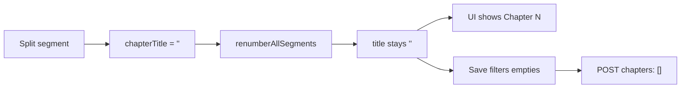

# Fix chapters editor empty titles after Split (#1568)

## Applicability

**Still applicable.** [Issue #1568](https://github.com/mediacms-io/mediacms/issues/1568) is open; the reported root cause is unchanged in this tree.

After Split via the `split-segment` path, segments are created with `chapterTitle: ''` and `renumberAllSegments` only rewrites titles that already match `/^Chapter \d+$/`, so empties stay empty. Manual save then filters those out → confirmation says “0 chapters” and the API stores `[]`. The list/timeline UI still shows “Chapter N” via fallbacks, which hides the bug.



## Root cause (current code)

In [`frontend-tools/chapters-editor/client/src/hooks/useVideoChapters.tsx`](frontend-tools/chapters-editor/client/src/hooks/useVideoChapters.tsx):

- Split halves use `chapterTitle: ''` with a comment that renumbering will fill them (around lines 675–691).
- `renumberAllSegments` (lines 28–43) does **not** treat empty/whitespace as a default title:

```ts
const isDefaultTitle = /^Chapter \d+$/.test(currentTitle);
// '' does not match → stays ''
```

In [`frontend-tools/chapters-editor/client/src/components/TimelineControls.tsx`](frontend-tools/chapters-editor/client/src/components/TimelineControls.tsx):

- Save payload and confirm copy both count only segments with trimmed `chapterTitle` (lines ~506–513 and ~4008).

Related: Safari init also creates a default segment with `chapterTitle: ''` (same hook, ~298–303) and never runs renumbering.

## Implementation

### 1. Fix `renumberAllSegments` (primary)

In [`useVideoChapters.tsx`](frontend-tools/chapters-editor/client/src/hooks/useVideoChapters.tsx), treat empty/whitespace titles as default titles (issue’s suggested fix):

```ts
const currentTitle = (segment.chapterTitle || '').trim();
const isDefaultTitle = !currentTitle || /^Chapter \d+$/.test(currentTitle);
return {
  ...segment,
  chapterTitle: isDefaultTitle ? `Chapter ${index + 1}` : currentTitle,
};
```

Custom titles (anything other than empty or `Chapter N`) stay preserved.

### 2. Fix Safari default segment

In the same file (~300), set `chapterTitle: 'Chapter 1'` instead of `''` when creating the Safari fallback segment so a single unedited chapter can also be saved.

### 3. Align save confirm + payload with displayed chapters

In [`TimelineControls.tsx`](frontend-tools/chapters-editor/client/src/components/TimelineControls.tsx):

- Stop filtering out empty titles when building the save payload.
- Map each segment to `chapterTitle: segment.chapterTitle?.trim() || \`Chapter ${index + 1}\`` (after chronological sort).
- Use `clipSegments.length` (not the empty-title filter) for the confirmation message count.
- Keep “clear all chapters” only when `clipSegments.length === 0`.

That makes confirmation count match what the UI shows and adds defense in depth if another path leaves an empty title.

### 4. Rebuild Django static assets

Chapters editor is served from `static/chapters_editor` via:

```bash
cd frontend-tools/chapters-editor && npm run build:django
```

Rebuild after the source change so Docker/production serving picks up the fix.

## Verification

Manual check matching the issue repro:

1. Open `/edit_chapters?m=<token>`.
2. Split into ≥2 segments without typing titles.
3. Confirm list shows Chapter 1 / Chapter 2 and segment state has real titles (not `''`).
4. Save → confirmation says **2** (not 0).
5. POST body includes both chapters; reload media page → chapter markers present.
6. Regression: rename one segment to a custom title, split/renumber elsewhere → custom title preserved; Safari path (if available) still creates a savable Chapter 1.

No chapters-editor unit tests exist today; do not add a new test harness for this fix unless you want that as follow-up.

## Out of scope

- Backend chapters API (already accepts/persists valid payloads).
- Timeline hardcoded `Chapter {index + 1}` label display (cosmetic; not required once state titles are filled).
- Closing the GitHub issue (do after the fix lands).
