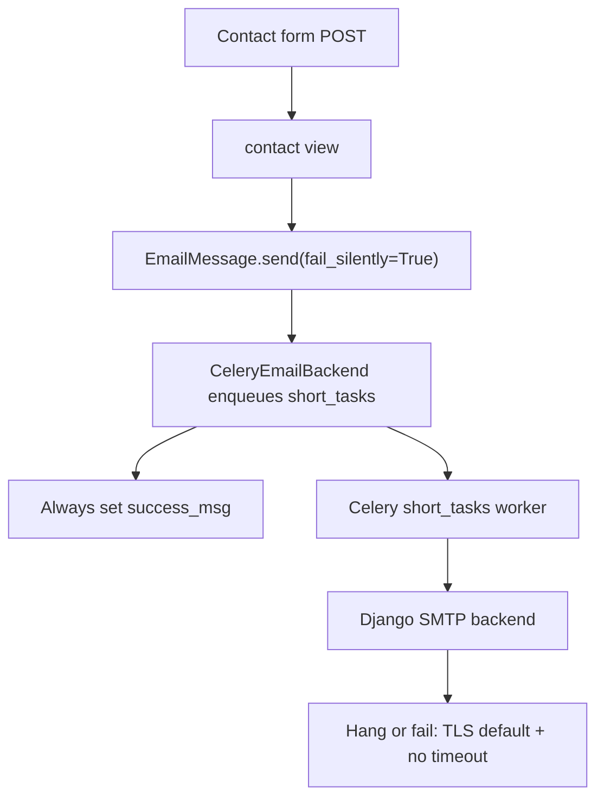

# Fix contact form / email delivery (#1626)

## Root cause

Three stacked defects explain the reporter’s symptoms:



1. **Fake success (confirmed in code)** — [`files/views/pages.py`](files/views/pages.py) always sets `success_msg` after `email.send(fail_silently=True)`:

```255:264:files/views/pages.py
            email = EmailMessage(
                title,
                msg,
                settings.DEFAULT_FROM_EMAIL,
                settings.ADMIN_EMAIL_LIST,
                reply_to=[from_email],
            )
            email.send(fail_silently=True)
            success_msg = "Message was sent! Thanks for contacting"
            context["success_msg"] = success_msg
```

   Production [`EMAIL_BACKEND`](cms/settings.py) is `djcelery_email.backends.CeleryEmailBackend`, so `send()` only enqueues on `short_tasks`. The browser never sees SMTP success/failure. Reported-media mail in [`files/methods.py`](files/methods.py) uses the same pattern.

2. **TLS/SSL misconfiguration trap** — Defaults are STARTTLS-oriented:

```67:75:cms/settings.py
DEFAULT_FROM_EMAIL = "info@mediacms.io"
...
EMAIL_USE_TLS = True
...
EMAIL_PORT = 587
```

   `EMAIL_USE_SSL` is unset (Django default `False`). Admins using port **465** often set `EMAIL_USE_SSL = True` but leave `EMAIL_USE_TLS = True`. Django 5.2 treats those as mutually exclusive (`ValueError`). Connecting to 465 with plain SMTP + STARTTLS instead waits forever for an SMTP banner that never comes (matches the reporter’s hang + working `openssl s_client` on 465).

3. **No socket timeout** — `EMAIL_TIMEOUT` is unset (`None`). Django only passes `timeout` to `smtplib` when set, so a bad handshake hangs indefinitely.

Docs in [`docs/admins_docs.md`](docs/admins_docs.md) §5.12 only show the TLS/587 example and never mention SSL/465, mutual exclusion, timeout, or Celery.

## All email flows — impact review

Every outbound mail path uses `EmailMessage` / adapter `msg.send(...)` through the shared Celery SMTP stack, so **TLS/SSL misconfig + missing timeout affect all of them**. They differ in whether the user is lied to about success.

| Flow | Location | Interactive? | Current behavior | Needs |
|------|----------|--------------|------------------|-------|
| Site contact form | [`files/views/pages.py`](files/views/pages.py) `contact()` | Yes | Always success after `fail_silently=True` | Sync send + error UI |
| Profile “Contact user” | [`users/views.py`](users/views.py) `contact_user` + [`ProfileAboutPage.js`](frontend/src/static/js/pages/ProfileAboutPage.js) | Yes | Always HTTP 204 after silent send; frontend treats that as success | Sync send + non-2xx on failure |
| Allauth (password reset, email confirm, etc.) | [`users/adapter.py`](users/adapter.py) `MyAccountAdapter.send_mail` | Yes | Overrides allauth with `fail_silently=True`, so auth UI can claim mail was sent when it was not | Sync send + `fail_silently=False` |
| Media reported / media added | [`files/methods.py`](files/methods.py) `notify_users` | No | Silent Celery enqueue; returns `True` even if SMTP later fails | Timeout + docs only (keep Celery) |
| Comment on your media | [`files/methods.py`](files/methods.py) `notify_user_on_comment` | No | Same | Timeout + docs only |
| @mention in comment | [`files/methods.py`](files/methods.py) `notify_user_on_mention` | No | Same | Timeout + docs only |
| New user → admins | [`users/models.py`](users/models.py) `post_user_create` | No | Same | Timeout + docs only |

Shared infrastructure bugs (hit every row above):

- `EMAIL_BACKEND = CeleryEmailBackend` → enqueue ≠ delivery
- Default `EMAIL_USE_TLS = True` with no SSL/465 guidance
- No `EMAIL_TIMEOUT`

`MEDIA_ENCODED` notification flags exist in settings but are **not implemented** — no code path to review.

## Proposed fix

### 1. Interactive flows: sync send + real success/failure

Add a small helper (e.g. in [`files/methods.py`](files/methods.py)) that returns a non-Celery connection for user-facing sends:

- If `EMAIL_BACKEND` is `djcelery_email.backends.CeleryEmailBackend`, use `django.core.mail.backends.smtp.EmailBackend`.
- Otherwise use the configured backend (so Django tests keep using locmem/`mail.outbox`).
- Always `fail_silently=False`.

**Site contact** — update [`files/views/pages.py`](files/views/pages.py) `contact()`:
- Send via that connection.
- On success (`sent > 0`), set `success_msg`.
- On `OSError` / `smtplib.SMTPException` / `ValueError`, set an `error_msg` (generic user-facing text; log the exception).
- Always put `form` back in context so invalid/error POSTs still render the form.
- Fix the malformed `</h1>` in [`templates/cms/contact.html`](templates/cms/contact.html) and show `error_msg`.

**Profile contact** — update [`users/views.py`](users/views.py) `contact_user`:
- Same sync connection.
- On send failure return `502` with a detail message instead of always `204`.
- Frontend already has `onSubmitFail`; no JS change required if status is non-2xx.

**Allauth** — update [`users/adapter.py`](users/adapter.py) `MyAccountAdapter.send_mail`:
- Send via the same interactive connection with `fail_silently=False`.
- Let exceptions propagate so allauth can show failure instead of a false “check your email” state.

### 2. Background notifications: keep Celery, inherit infra fixes

Leave `notify_users`, comment/mention, and `post_user_create` on Celery with `fail_silently=True`. They are fire-and-forget admin/user alerts; making them sync would couple request latency to SMTP. They are fixed by `EMAIL_TIMEOUT` + correct TLS/SSL docs (and workers no longer hanging forever on bad config).

### 3. Settings: default SMTP timeout

In [`cms/settings.py`](cms/settings.py) add:

```python
EMAIL_TIMEOUT = 10  # seconds; avoid indefinite SMTP hangs
```

Django’s SMTP backend already honors this when opening the connection.

### 4. Documentation

Update [`docs/admins_docs.md`](docs/admins_docs.md) §5.12:
- Keep the existing STARTTLS / port 587 example.
- Add an SSL / port 465 example with **both** `EMAIL_USE_SSL = True` and `EMAIL_USE_TLS = False`.
- State they are mutually exclusive.
- Document `EMAIL_TIMEOUT`.
- Note that interactive contact/auth mail sends synchronously, while notification mail still queues on Celery `short_tasks`.

Update §15 debugging notes to mention the SSL vs TLS pitfall and timeout.

### 5. Tests

Extend [`tests/forms/test_forms_contact.py`](tests/forms/test_forms_contact.py):
- Existing happy-path/`mail.outbox` tests should still pass (locmem backend).
- Add a test that patches send to raise / return `0` and asserts `error_msg` and no success.
- Add coverage that invalid POST still includes `form` in context.

Add coverage for `contact_user` failure status and for adapter `send_mail` not swallowing exceptions.
Add a focused unit test for the connection helper (Celery backend → smtp; other backend unchanged).

## Out of scope

- Making background notification mail synchronous.
- Broader email refactor / new mail service layer beyond a small shared helper.
- Implementing the unused `MEDIA_ENCODED` notification flags.
