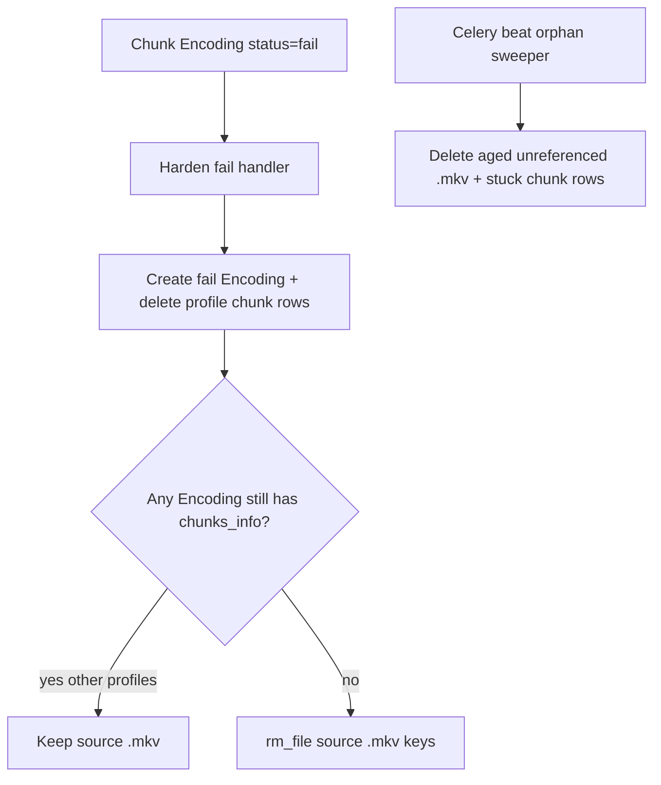

# Resolve issue #942: clean up encoding chunks on failure

## Applicability

**Still applicable.** Open issue ([#942](https://github.com/mediacms-io/mediacms/issues/942)); maintainer comment (2025-08-17) and in-repo TODOs confirm it was never fixed.

Encoding segments for long videos are created next to the original under `original/` as `{NN}_{token}_{name}.mkv` by [`chunkize_media`](files/tasks.py) — not upload chunks in `CHUNKS_DIR`.

| Path | Behavior today |
|------|----------------|
| Success | Concatenate → delete profile chunk rows → delete source `.mkv` **only if** no `Encoding` still has that `chunks_info` ([`encoding.py:248-255`](files/models/encoding.py)) |
| Fail | Attempt to create one fail `Encoding` and delete siblings ([`encoding.py:258-277`](files/models/encoding.py)), but **never** deletes source `.mkv`; and `chunks_paths = [f.media_file.path for f in chunks]` raises `ValueError` when a failed chunk has no `media_file`, aborting cleanup before `who.delete()` |

That matches the repro (kill one chunk ffmpeg → chunk rows/files left). Explicit TODOs remain in [`files/tasks.py:1195-1201`](files/tasks.py) and [`cms/settings.py:473-474`](cms/settings.py). No beat task or management command cleans encoding segments. Happy-path tests exist; **no fail-path cleanup tests**.

Related [#970](https://github.com/mediacms-io/mediacms/issues/970) (orphan HLS temp dirs) was closed in favor of #942 but is a separate leak in [`create_hls`](files/tasks.py) — **out of scope** for this plan.

## Approach

Two layers, matching the maintainer’s shared-chunks constraint:



**Do not** delete shared source segments when another resolution still references the same `chunks_info`.

## Implementation

### 1. Harden fail handler in [`files/models/encoding.py`](files/models/encoding.py)

In `encoding_file_save` fail branch (`elif instance.chunk and instance.status == "fail"`):

- Scope chunk query to **this profile** (mirror success path) when collecting logs/workers/timestamps.
- Collect `media_file` paths safely — skip encodings with no file (avoid `ValueError`).
- After creating the aggregate fail `Encoding` and `who.delete()`, apply the **same gate as success**:
  ```python
  if not Encoding.objects.filter(chunks_info=instance.chunks_info):
      for chunk in json.loads(instance.chunks_info).keys():
          helpers.rm_file(chunk)
  ```
- Keep `chunks_info` on the fail Encoding briefly if needed for debugging, or store segment paths in `logs` only (current pattern already logs paths) — prefer not leaving a live `chunks_info` row that would block the gate; the new fail row is non-chunk and currently has empty `chunks_info`, which is correct for the gate.

### 2. Celery beat orphan sweeper in [`files/tasks.py`](files/tasks.py)

Add `cleanup_encoding_chunks` (name flexible) that periodically:

1. Finds source segment paths that appear only in completed work: media with no remaining `Encoding` rows that have that `chunks_info` **and** no `chunk=True` / pending|running encodings for those paths; delete orphan `.mkv` files older than a retention window (default **24 hours** via a new setting, e.g. `ENCODING_CHUNKS_RETENTION_HOURS`).
2. Collapses stuck state: if a profile already has a non-chunk `fail`/`success` Encoding but `chunk=True` rows remain for that media+profile, delete the leftover chunk rows (their `media_file` removed via existing `encoding_file_delete`).
3. Optionally scan media original dirs for aged `*_*.mkv` segment-name patterns with no DB reference (defense for rows deleted without file cleanup).

Register in [`CELERY_BEAT_SCHEDULE`](cms/settings.py) (e.g. daily) and clear the related TODOs in `tasks.py` / `settings.py`.

Keep scope to **encoding** segments; do not expand into upload `CHUNKS_DIR` cleanup in this change.

### 3. Tests in [`tests/pipeline/test_pipeline_encoding.py`](tests/pipeline/test_pipeline_encoding.py)

Add coverage for:

- One chunk saved as `fail` with empty `media_file` → one non-chunk `fail` Encoding for that profile; no `chunk=True` rows left for that profile; logs still saved without crashing.
- When all profiles for a `chunks_info` are terminal fail (or no encodings left with that `chunks_info`), source `.mkv` files are removed.
- When another profile still has chunk encodings for the same `chunks_info`, source `.mkv` files remain.
- Beat task deletes aged unreferenced segment files and leaves in-use ones alone.

Reuse patterns from existing `test_chunkize_media_encodes_segments_and_joins_them_into_one_rendition`.

## Out of scope

- Orphan HLS temp directories from #970 (`HLS_DIR/{md5}{token}`)
- Upload FineUploader `CHUNKS_DIR` retention (separate settings TODO)
- Remote-worker chunk deletion (existing TODO for `remove_media_file.delay`)
