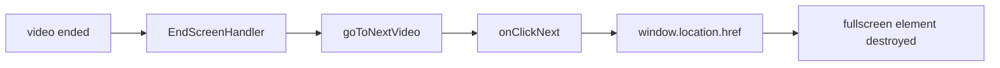

# Resolve #1051: Keep fullscreen across autoplay next

## Applicability

**Still applicable.** [#1051](https://github.com/mediacms-io/mediacms/issues/1051) is open (updated 2026-11-07). There is no fullscreen-preservation logic on the next-video path.

Root cause: when a video ends with autoplay on, the player calls into page navigation that does a full document load:

```264:279:frontend/src/static/js/components/media-viewer/VideoViewer/index.js
    onClickNext() {
        // ... resolve nextLink ...
        window.location.href = nextLink;
    }
```

Call chain:



Browsers exit fullscreen when the fullscreen element is removed / the document navigates. Restoring fullscreen after reload with `requestFullscreen()` is unreliable (needs a user gesture). The durable fix is to **never leave** the current fullscreen element.

## Approach

Implement **in-place next/previous soft navigation** for the `/view` Video.js player:

1. Keep the same Video.js instance and `.video-js` DOM node (the fullscreen target).
2. Fetch next media via the existing media API.
3. Call `player.src(...)` / update poster & tracks / `play()`.
4. `history.pushState` the new `/view?m=...` URL and refresh page chrome (title, info, sidebar, related) from store data.
5. Fall back to hard navigation only if soft load is impossible (missing link, non-video/audio next item, API error, no live player).

Do this for **all** next/previous transitions (autoplay countdown, playlist immediate next, Next button), not only when already fullscreen — same code path, correct YouTube-like behavior, fewer special cases.

## Key files

| Role | File |
|------|------|
| Hard nav (change here) | [frontend/src/static/js/components/media-viewer/VideoViewer/index.js](frontend/src/static/js/components/media-viewer/VideoViewer/index.js) |
| Media reload / store | [frontend/src/static/js/utils/stores/MediaPageStore.js](frontend/src/static/js/utils/stores/MediaPageStore.js), [frontend/src/static/js/utils/actions/MediaPageActions.js](frontend/src/static/js/utils/actions/MediaPageActions.js) |
| Embed bridge / `MEDIA_DATA` | [frontend/src/static/js/components/VideoJS/VideoJSEmbed.jsx](frontend/src/static/js/components/VideoJS/VideoJSEmbed.jsx) |
| Player instance + next callback | [frontend-tools/video-js/src/components/video-player/VideoJSPlayer.jsx](frontend-tools/video-js/src/components/video-player/VideoJSPlayer.jsx) |
| Autoplay ended path | [frontend-tools/video-js/src/utils/EndScreenHandler.js](frontend-tools/video-js/src/utils/EndScreenHandler.js) |
| Page chrome listeners | [frontend/src/static/js/pages/_VideoMediaPage.js](frontend/src/static/js/pages/_VideoMediaPage.js), ViewerInfo / ViewerSidebar |

## Implementation plan

### 1. Soft-load next media in MediaPageStore

Add an action (e.g. `LOAD_MEDIA_DATA_BY_ID`) that:

- Sets `MediaPageStoreData.mediaId` (and `window.MediaCMS.mediaId`) to the next friendly token
- Reloads playlist context if `pl` is present (so playlist-next/prev URLs stay correct)
- Calls existing `loadData()` / `dataResponse` path and emits `loaded_media_data`

Parse the token from `nextLink` / `previousLink` (`?m=`), preserve `pl` in `history.pushState`.

### 2. Replace hard nav in VideoViewer

Change `onClickNext` / `onClickPrevious` to:

1. Resolve the target URL (same as today).
2. If no player instance or soft path unsupported → `window.location.href` (current behavior).
3. Otherwise `history.pushState`, trigger store reload by id, then on success **imperatively** update the live player (do not remount `#video-js-root-main` / do not dispose Video.js).

Use the player already stored on `VideoViewer` via `onPlayerInit` (`this.playerInstance.player`), which is also mirrored on `window.videojsPlayers['video-main']`.

### 3. Imperative player media swap (video-js)

Add a focused helper used from the page shell (or exposed on the player/init callback), roughly:

- Hide/cleanup end-screen and autoplay countdown overlays (`EndScreenHandler.cleanupOverlays`)
- `player.src(newSources)` from encodings (reuse source-building logic already used when constructing `VideoViewer` / `MEDIA_DATA`)
- Update poster, clear/re-add text tracks, refresh quality menu / related-video / `nextLink` fields on `window.MEDIA_DATA`
- `player.play()` (same gesture-less autoplay constraints as today’s first-load autoplay; user already started playback)

Important: **do not** rely on `triggerVideoJSMount` remounting React over a new media payload in a way that recreates/disposes the Video.js instance — that would exit fullscreen. Prefer updating the existing instance; only re-render outer page React trees (info, sidebar) that sit outside the fullscreen element.

### 4. Keep page chrome in sync

On `loaded_media_data` after soft nav:

- Update `document.title`
- Let existing store listeners refresh `ViewerInfoVideo`, `ViewerSidebar`, related media
- Ensure `VideoViewer` receives updated `data` / `sources` / `nextLink` props without remounting the player root (stable keys already present around the player wrapper)

If prop-driven re-render of `VideoJSEmbed` risks replacing `#video-js-root-main`, keep that node stable (same element identity) so `main.jsx` reuses the existing React root without unmounting the player tech.

### 5. Edge cases

- **Next item not video/audio** → hard navigate
- **API / encoding error** → hard navigate or show existing error UI
- **Embed player** → unchanged (autoplay-next already disabled / no next)
- **End-screen related-item clicks** that set `location.href` stay as hard nav (user click starts a new view); only the autoplay / next-control path must stay soft for #1051
- **iOS native fullscreen** may still differ; document as known platform limitation if element fullscreen is unavailable

### 6. Verification

Manual checks on Chrome + Firefox (issue browsers):

1. Autoplay on → fullscreen → seek near end → next starts **still fullscreen**
2. Playlist autoplay (no countdown) in fullscreen
3. Manual Next button in fullscreen
4. Next/prev when **not** fullscreen still works; URL and sidebar update
5. Browser back after soft next (pushState); acceptable MVP is forward soft-nav only, with back doing a normal load unless `popstate` handling is added in the same change

## Out of scope

- Rewriting the entire media page into a full SPA router
- Restoring fullscreen after a full reload via `sessionStorage` + `requestFullscreen()` (gesture-blocked; not a real fix)
- Changing embed autoplay policy
