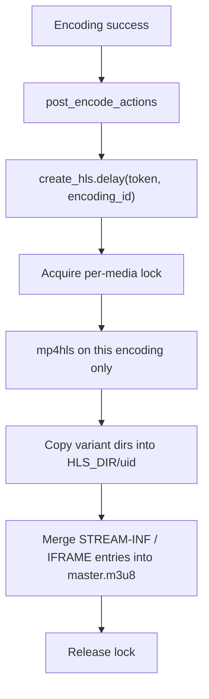

# Resolve Issue 962: Incremental `create_hls`

## Applicability: still open and still real

[#962](https://github.com/mediacms-io/mediacms/issues/962) remains **open**. Current `main` still does this on every successful non-chunk h264 encoding:

```664:667:files/models/media.py
        if encoding and encoding.status == "success" and encoding.profile.codec == "h264" and action == "add" and not encoding.chunk:
            from .. import tasks

            tasks.create_hls.delay(self.friendly_token)
```

[`create_hls`](files/tasks.py) then gathers **all** successful h264 MP4s, runs Bento on the full set, and if HLS already exists does `cp -rT` of the entire tree — the expensive I/O the issue reports. Commit [`5a1e4f25`](https://github.com/mediacms-io/mediacms/commit/5a1e4f25ed41a6f3e6003b3c0afff76acf58d23a) only softens concurrent `rmtree` races; it does not stop repeated full rebuilds. [PR #1095](https://github.com/mediacms-io/mediacms/pull/1095) (“wait until all encodings finish”) was closed unmerged.

## Approach (aligned with maintainer feedback)

mgogoulos rejected “run once at the end” because:
1. HLS would wait for the slowest profile (today 240p makes video available early).
2. Failed mid-profile encodings would leave no HLS fallback.

Preferred design: **package only the newly finished encoding, then merge into the existing HLS tree / `master.m3u8`.**



## Implementation

### 1. Change the enqueue contract

In [`files/models/media.py`](files/models/media.py) `post_encode_actions`, pass the encoding id:

- `tasks.create_hls.delay(self.friendly_token, encoding.id)`
- Keep the existing success / h264 / non-chunk gates; remove the outdated TODO once addressed.

Call sites that still want a full rebuild (or “all current successes”) keep calling with `encoding_id=None`:
- [`post_trim_action`](files/tasks.py) (~1097)
- Migration `finalise_encodings` path (already once-per-media)

### 2. Rewrite `create_hls` for incremental package + merge

In [`files/tasks.py`](files/tasks.py) `create_hls(friendly_token, encoding_id=None)`:

**Incremental path** (`encoding_id` set):
- Load that encoding; require `status="success"`, h264 MP4, non-chunk, file present.
- Run `mp4hls` into a temp dir with **only that file**.
- Under a **per-media lock** (Django cache lock / Redis; MediaCMS already uses Celery+Redis in typical installs):
  - Ensure permanent dir `HLS_DIR/<uid>/` exists.
  - Copy new variant playlist directories from the temp tree into the permanent dir (replace same-named dirs if re-encoding).
  - Merge playlists into `master.m3u8` using the existing `m3u8` dependency (already used in `Media.hls_info`): add/replace `EXT-X-STREAM-INF` and iframe entries for this variant; leave other variants untouched.
  - Set `media.hls_file` if unset.
- Delete the temp dir; never `cp -rT` the whole existing tree.

**Full rebuild path** (`encoding_id` is None) — trim / migration / admin recovery:
- Current behavior: Bento with all successful h264 files into temp, then install into `HLS_DIR/<uid>/` (still under the same lock). Prefer replace-in-place of the permanent dir rather than racing `cp -rT` of giant trees when possible.

### 3. Concurrency

Without a lock, two encodings finishing together can corrupt `master.m3u8`. Add a short-lived lock keyed by `media.uid` around the merge/install section. If the lock cannot be acquired, retry the Celery task (bound task + countdown) rather than overlapping writes.

### 4. Tests

Update / extend:
- [`tests/models/test_models_media.py`](tests/models/test_models_media.py) — assert `create_hls.delay` is called with `(friendly_token, encoding.id)`.
- [`tests/pipeline/test_pipeline_encoding.py`](tests/pipeline/test_pipeline_encoding.py) `CreateHlsTest`:
  - First encoding creates `master.m3u8` + one variant.
  - Second encoding adds a second variant without wiping the first; assert Bento is invoked with a **single** input path when `encoding_id` is passed (mock `run_command` / `MP4HLS_COMMAND`).
  - Full rebuild (`encoding_id=None`) still packages all successes.
  - Existing “rebuild in place” / missing-binary cases still pass.

### 5. Out of scope

- Do not revive PR #1095’s “return until all encodings success” gate.
- No change to EncodeProfile selection or chunk finalize logic (#938 territory).

## Success criteria

- N successful profiles → N light Bento runs (one input each), not N full multi-file rebuilds + full-tree copies.
- First finished profile still publishes HLS quickly.
- A later failed profile does not remove HLS already built from successes.
- Concurrent finishes do not corrupt `master.m3u8` or OOM Celery via piled-up full copies.
