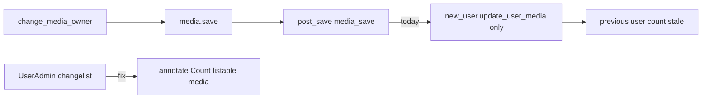

# Fix Django wrong media count (#1627)

## Problem

[`change_media_owner()`](files/methods.py) reassigns `media.user` and saves. The `post_save` signal in [`files/models/media.py`](files/models/media.py) only calls `instance.user.update_user_media()` for the **new** owner. The previous owner's stored [`User.media_count`](users/models.py) is never decremented, so Django admin shows a wrong number.

```679:700:files/methods.py
def change_media_owner(media_id, new_user):
    ...
    # previous_user = media.user   # captured but unused
    media.user = new_user
    media.save(update_fields=["user"])
```

Reporter expectation: do **not** store this count; calculate it when the Django admin view opens.

`User.media_count` is only used for Django admin display (not user API serializers). Category/Tag denormalized counts are out of scope.

## Approach

Remove the denormalized `User.media_count` field and compute listable media count via queryset annotation in admin (same filter as today's `update_user_media`: `listable=True`).



## Implementation

### 1. Admin: live annotated count

In [`users/admin.py`](users/admin.py):

- Override `get_queryset` to annotate:
  - `Count("media", filter=Q(media__listable=True))`
- Replace `list_display` entry `"media_count"` with a `@admin.display` method that reads the annotation (set `ordering` on the annotation alias so sorting still works).
- Drop `media_count` from `exclude` once the model field is gone.

### 2. Model: drop denormalized field and updater

In [`users/models.py`](users/models.py):

- Remove `media_count = models.IntegerField(...)`.
- Remove `update_user_media()`.
- Add a migration under `users/migrations/` to remove the column.

### 3. Stop maintaining the stored count

In [`files/models/media.py`](files/models/media.py):

- Remove `instance.user.update_user_media()` from `media_save` (post_save) and `media_file_delete` (post_delete).

No change required in `change_media_owner` for counts after this; optional cleanup of the commented `previous_user` / MediaPermission-owner block if it stays unused.

### 4. Tests

- Update [`tests/users/test_users_models.py`](tests/users/test_users_models.py) (`UserMediaCountTest`): assert live count via `Media.objects.filter(user=..., listable=True).count()` (or admin annotation), not a stored field.
- Update any other assertions that read `user.media_count` after save/delete ([`tests/models/test_models_search_counts.py`](tests/models/test_models_search_counts.py), [`tests/models/test_models_media.py`](tests/models/test_models_media.py)).
- Extend [`tests/helpers/test_helpers_methods.py`](tests/helpers/test_helpers_methods.py) `test_change_owner_moves_media...` (or add a sibling): after transferring a **listable** media, both owners' listable counts match DB reality (regression for #1627).
- Add a small admin test that `UserAdmin.get_queryset` annotation matches listable media count.

## Out of scope

- Category/Tag denormalized `media_count` and m2m stale-count gaps.
- Changing what "counts" means (`listable` vs public/reviewed); keep current user semantics.
