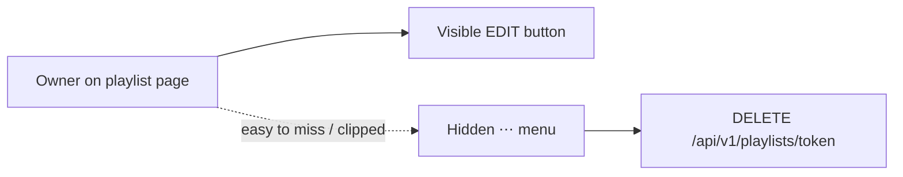

# Fix playlist delete (#1623)

[Issue #1623](https://github.com/mediacms-io/mediacms/issues/1623) (label: `frontend`): after creating a playlist, users “don’t have the ability to” delete it.

## Diagnosis

Backend is fine. `DELETE /api/v1/playlists/{token}` in [`files/views/playlists.py`](files/views/playlists.py) hard-deletes the playlist (CASCADE on `PlaylistMedia`), gated by `IsUserOrEditor`, and covered by [`tests/api/test_api_playlists.py`](tests/api/test_api_playlists.py).

The gap is UI on the playlist detail page ([`frontend/src/static/js/pages/PlaylistPage.js`](frontend/src/static/js/pages/PlaylistPage.js)):

- **EDIT** is a labeled button next to the author.
- **Delete** is the *only* item in a `more_horiz` (⋯) menu (`PlaylistOptions`), so owners have no obvious delete control.
- That popup opens upward (`bottom: 100%`) inside `.playlist-details { overflow: auto }` in [`PlaylistPage.scss`](frontend/src/static/js/components/playlist-page/PlaylistPage.scss), so the menu can be clipped/off-screen.
- Success/fail handlers for removal are registered on `PlaylistEdit`, not on the delete control — fragile wiring.

Profile playlists list has no delete either, but the reported flow is create → try to delete on the playlist page; fix that surface first.

## Approach

Replace the ⋯-only `PlaylistOptions` with a **visible Delete control** next to EDIT (same `CircleIconButton` + icon + label pattern), keep the existing confirm dialog, and attach removal listeners to that control.

## Implementation

### 1. Visible Delete on playlist detail page

In [`PlaylistPage.js`](frontend/src/static/js/pages/PlaylistPage.js):

- Refactor `PlaylistOptions` into a labeled Delete button (icon `delete` + “DELETE”), rendered beside `PlaylistEdit` in `PlaylistAuthor` (owner-only, same `loggedinUserPlaylist` gate).
- Keep the confirm popup (`proceedPlaylistRemovalPopup` / CANCEL / PROCEED) and `PlaylistPageActions.removePlaylist()` → store `REMOVE_PLAYLIST` flow unchanged.
- Remove the orphan `PlaylistActions` ⋯ wrapper (it only existed to host Delete).
- Move `playlist_removal_completed` / `playlist_removal_failed` listeners from `PlaylistEdit` onto the Delete component so notifications + redirect work even if EDIT is not mounted.

### 2. CSS for the new control

In [`PlaylistPage.scss`](frontend/src/static/js/components/playlist-page/PlaylistPage.scss):

- Style the Delete button next to EDIT in `.playlist-author` (match existing edit button spacing).
- Drop or simplify `.playlist-options-wrap` upward-popup rules that are no longer needed; ensure the confirm popup is not clipped by `.playlist-details { overflow: auto }` (prefer `overflow: visible` on the actions/author area, or use the same fullscreen/overlay pattern already used by edit if clipping remains).

### 3. Tests

- Extend or add a frontend component test (alongside existing [`PlaylistPageStore.test.ts`](frontend/tests/utils/stores/PlaylistPageStore.test.ts)) asserting the owner sees a Delete control and confirming triggers `removePlaylist` / store delete request.
- No backend test changes required unless a regression appears while verifying.

### 4. Manual verification

- As playlist owner: open playlist → see DELETE next to EDIT → confirm → 204 → redirect to profile playlists; playlist gone.
- As non-owner: no DELETE/EDIT.
- Confirm dialog cancel leaves playlist intact.

## Out of scope

- Delete from profile playlists grid
- Django admin registration for `Playlist`
- Expanding delete UI to editors/managers (API already allows it; issue is owner discoverability)
