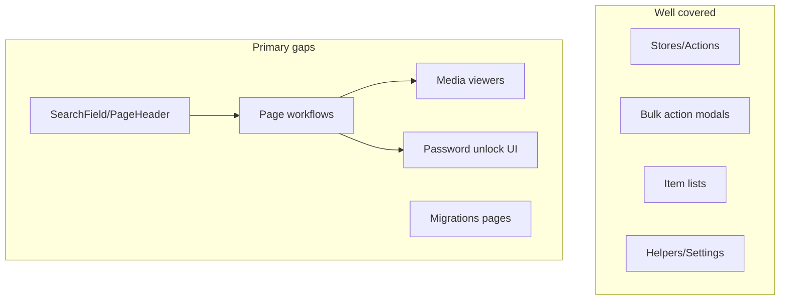

# Frontend Jest Coverage Gap Plan

## Current state

The suite under [`frontend/tests/`](frontend/tests/) is large and real (no `skip`/`todo`/`empty` stubs today): ~130 test files, ~1,050 cases, custom React 19 render helpers (no RTL), heavy Flux store/action coverage.

| Layer | Status |
|-------|--------|
| Settings / helpers / hooks / contexts | Strong |
| Stores + action dispatcher payloads | Strong (except password unlock) |
| Leaf components (bulk modals, comments, share, lists, manage table) | Good |
| Page shells (`src/static/js/pages/*`) | Almost none — only [`PlaylistDelete.test.tsx`](frontend/tests/pages/PlaylistDelete.test.tsx) |
| VideoViewer / VideoJSEmbed / Image / Attachment | None |
| ViewerPassword / ViewerInfo* / PlaylistView / SearchField / PlaylistsSelection | None |
| Migrations UI pages | None (API helper only) |
| Upload | Out of Jest scope (Django + Fine Uploader); shell only |

No coverage thresholds; CI runs `npm run test -- --ci` only ([`.github/workflows/frontend-build-and-test.yml`](.github/workflows/frontend-build-and-test.yml)).



---

## Convention: warn-mode for unimplemented features

Add [`frontend/tests/_support/unimplemented.ts`](frontend/tests/_support/unimplemented.ts):

```ts
/** Expected feature not implemented yet. Jest reports as TODO (warning), does not fail CI. */
export function testUnimplemented(description: string): void {
  test.todo(`[unimplemented] ${description}`);
}
```

Document in [`docs/en/guides/developer/tests.md`](docs/en/guides/developer/tests.md). Use only when product behavior is expected but code is stubbed/absent (not for “we haven’t written the test yet”).

Known candidates (create warn-mode specs now):

- Encoding **pending/running** UI — [`VideoViewer/index.js`](frontend/src/static/js/components/media-viewer/VideoViewer/index.js) matches `running_X` / `pending_X` (dead branches); real statuses never hit them
- Dedicated **AudioViewer** — import commented out in [`MediaPage.js`](frontend/src/static/js/pages/MediaPage.js); audio rides VideoViewer
- Playlist **views count** — commented out in [`PlaylistPage.js`](frontend/src/static/js/pages/PlaylistPage.js)
- Home section titles from config — hardcoded `translateString` in [`HomePage.tsx`](frontend/src/static/js/pages/HomePage.tsx)
- React **upload workflow** — [`entries/add-media.js`](frontend/src/entries/add-media.js) is shell-only; full upload stays Django/E2E

---

## Invalid / bug-locking tests (fix or split before remediation)

These assert current (wrong) behavior and will block fixes unless updated:

| Location | Issue |
|----------|--------|
| [`MediaPageStore.js`](frontend/src/static/js/utils/stores/MediaPageStore.js) + test | Network error copy uses Greek Alpha: `"Αn error…"` — test locks the typo |
| [`optionsPages.test.ts`](frontend/tests/utils/settings/optionsPages.test.ts) | `related.initialSize` expects `10` with comment “should return 25” |
| [`theme.test.ts`](frontend/tests/utils/settings/theme.test.ts) | Trimmed `' sidebar '` → `'header'` with “should be sidebar” |
| Several `@todo: Revisit` comments in settings/helpers tests | Incomplete assertions / commented expectations (playlists `mediaTypes: null`, imageExtension quirks, etc.) |

**Approach:** Convert each to a failing-correct assertion once the product fix lands; until then keep a paired `testUnimplemented` describing the intended correct behavior, and leave the locking test only if it documents the bug for remediation tracking. Prefer: rename locking cases to `… (current buggy behavior)` and add `testUnimplemented('… should …')` so intent is explicit.

---

## Critical missing tests (must-have before bug remediation)

### P0 — Media load failure & password (broken today in coverage)

Missing end-to-end of a primary workflow despite store UI existing:

1. **`requests.test.ts`**: 403 + `password_required` → `{ type: 'password', … }`; 403 without → private (today only 401/400/network are covered)
2. **`MediaPageStore.test.ts`**: `type: 'password'` → emit `loaded_media_password_required`; `UNLOCK_MEDIA_PASSWORD` success/fail/pending events; reload after unlock
3. **New** `ViewerPassword.test.tsx`: form submit, pending state, incorrect-password messaging
4. **New** page tests for [`_MediaPage.js`](frontend/src/static/js/pages/_MediaPage.js) / [`EmbedPage.tsx`](frontend/src/static/js/pages/EmbedPage.tsx): password UI ↔ unlock ↔ viewer; private/unavailable/network → `ViewerError`

### P0 — Media viewers & player workflows

| Module | Tests to add |
|--------|----------------|
| [`VideoViewer/index.js`](frontend/src/static/js/components/media-viewer/VideoViewer/index.js) | Encoding `fail`; no sources; soft-nav next/prev (related + playlist); theater; autoplay handoff — mock `VideoJSEmbed` |
| [`VideoJSEmbed.jsx`](frontend/src/static/js/components/VideoJS/VideoJSEmbed.jsx) | Init props, timestamp `t=`, error callback, dispose (mock video.js if needed) |
| [`VideoViewer/functions.js`](frontend/src/static/js/components/media-viewer/VideoViewer/functions.js) | Codec/resolution matrix, default resolution |
| ImageViewer / AttachmentViewer | Render + fallback links |
| PdfViewer | Already covered — keep |

Warn-mode: encoding pending/running once statuses use real values (`running`/`pending`).

### P0 — Page workflows (compose mocked stores)

Add under `frontend/tests/pages/` using existing `_support/render.ts` + store mocks (same style as component tests):

| Page | Primary cases |
|------|----------------|
| `HomePage` | Featured/recommended gated by flags; empty-site CTA; latest list |
| `MediaPage` / `_VideoMediaPage` | Type routing video/audio/image/pdf/attachment; theater; actions gated by `member.can` + features |
| `EmbedPage` | Query flags; password/error; no chrome |
| `SearchPage` | Valid/invalid query; zero results; advanced vs simple filters |
| `PlaylistPage` | Load, empty Play All disabled, owner edit/delete, reorder fail notify |
| Profile* | Tabs; owner bulk; contact success/fail; shared-with-me LMS exclude; select-media / deep-link mode |
| Manage* | Filter/sort/delete notify; empty table |
| Members / Tags / Categories / Latest / Featured / Recommended / Liked / History | Empty + flag/profile-chrome variants |
| Migrations* | List poll/controls; new source pick; edit connection test/save/start; detail records; error paths |

### P1 — Shell & missing components

- [`SearchField.js`](frontend/src/static/js/components/page-layout/PageHeader/SearchField.js): predictions success/empty/fail; navigate on submit
- Full [`PageHeader.js`](frontend/src/static/js/components/page-layout/PageHeader/PageHeader.js) composition + `MediaUploader()` message inject
- [`PlaylistView.js`](frontend/src/static/js/components/media-page/PlaylistView.js): loop/shuffle/save/expand (today mocked away in ViewerSidebar tests)
- [`PlaylistsSelection.jsx`](frontend/src/static/js/components/playlists-selection/PlaylistsSelection.jsx): membership toggles
- [`ViewerInfo*`](frontend/src/static/js/components/media-page/ViewerInfo.js): private/unlisted/shared labels, views, categories
- [`ProfilePagesHeader.js`](frontend/src/static/js/components/profile-page/ProfilePagesHeader.js): tabs by role/flags; search ≥3 chars
- [`MediaEditButton.jsx`](frontend/src/static/js/components/media-actions/MediaEditButton.jsx)
- Comment timestamp → seek / markers (`videojs-markers*`) — warn-mode if Video.js hard to isolate

### P1 — Failure / permission matrix (cross-cutting)

Ensure every primary action has a failure + gated path:

- Like/dislike/report/save/download/share/comment: feature off + anonymous + API fail (partially present in component tests; verify gaps for download encodings fail, share copy fail)
- Bulk actions: no-selection disabled; modal API error → notification (mostly covered — spot-check LMS Course Cleanup omit-on-fail)
- Lists: pending spinner, empty, axios error (ItemListAsync empty exists; add explicit error path where UI shows it)

### P2 — Hygiene & gates

- Add modest `coverageThreshold` in [`jest.config.js`](frontend/jest.config.js) after P0/P1 land (start with lines/functions on `src/static/js/pages` + `media-viewer` + `media-page`)
- Optional CI `test-coverage` summary step (text-summary only)
- Expand docs “Add a frontend test” section with path mirroring, `setupMediaCMS`, and `testUnimplemented`

---

## Implementation order (execution after plan approval)

1. **Infrastructure**: `testUnimplemented` helper + docs + warn-mode stubs for known stubbed features
2. **P0 password/error path**: requests → MediaPageStore unlock → ViewerPassword → Media/Embed page wiring
3. **P0 viewers**: functions + VideoViewer (mocked embed) + Image/Attachment + warn-mode encoding pending/running
4. **P0 pages**: Home, Media, Embed, Search, Playlist, then Profile/Manage/Migrations batches
5. **P1 shell/missing components**
6. **Bug-locking cleanup**: convert `@todo` locking tests + Greek Alpha once paired product fixes start
7. **P2 thresholds**

Keep existing patterns: `renderIntoContainer`, `compD_*` mocks, `window.MediaCMS` fixtures — do not introduce RTL unless a concrete blocker appears.

---

## Out of scope for this Jest effort

- Fine Uploader / Django upload validation (E2E or backend tests)
- Real Video.js binary behavior beyond mocked embed props/callbacks
- Visual/regression screenshots
- Raising global coverage to 100% of vendor/`static/lib`
