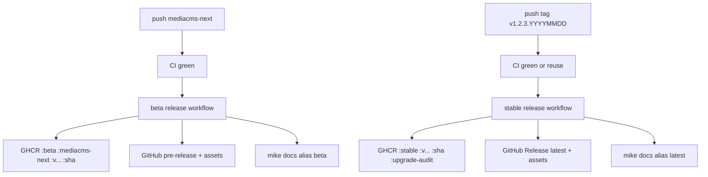

# GHCR + date-stamped beta/stable releases

## Defaults locked for this plan

- **Registry:** `ghcr.io` only (canonical). Compose/docs will use `ghcr.io/mrjoshuap/...`. No Docker Hub publish unless you later add secrets.
- **Product version base:** `1.2.3` for this fork line (independent of upstream `package.json` `9.4.0`). Stored in a small tracked file [`version/FORK_VERSION`](version/FORK_VERSION) (single line `1.2.3`) so upstream merges do not fight semantic-release on `package.json`.
- **Immutable tag shape:** `v1.2.3.YYYYMMDD` (e.g. `v1.2.3.20251114`). Same-day emergency: `v1.2.3.YYYYMMDD.N` (`N` = 1, 2, …).
- **Upgrade audits:** no separate Dockerfile; retag the **base** image as `upgrade-audit` / `upgrade-audit-beta` (same layers; docs tell testers to run `upgrade_site` / smoke scripts from that tag).

## Image / tag contract (what testers pull)

| Pull this | Meaning |
|-----------|---------|
| `ghcr.io/mrjoshuap/mediacms:beta` | Latest successful **beta** base build |
| `ghcr.io/mrjoshuap/mediacms-full:beta` | Latest successful **beta** full build |
| `ghcr.io/mrjoshuap/mediacms:mediacms-next` | Alias of `:beta` (branch name) |
| `ghcr.io/mrjoshuap/mediacms-full:mediacms-next` | Alias of `:beta` |
| `ghcr.io/mrjoshuap/mediacms:stable` | Latest **stable** base release |
| `ghcr.io/mrjoshuap/mediacms-full:stable` | Latest **stable** full release |
| `ghcr.io/mrjoshuap/mediacms:upgrade-audit-beta` | Base image alias for beta upgrade drills |
| `ghcr.io/mrjoshuap/mediacms:upgrade-audit` | Base image alias for stable upgrade drills |
| `ghcr.io/mrjoshuap/mediacms:v1.2.3.YYYYMMDD` | Immutable pin |
| `ghcr.io/mrjoshuap/mediacms:sha-<7>` | Immutable commit pin |

Packages are **two image names** (`mediacms` and `mediacms-full`), not one image with a `-full` tag suffix (clearer than today’s Hub layout).



## Version computation

Add [`scripts/release_version.py`](scripts/release_version.py):

- Read base from `version/FORK_VERSION`.
- Stamp = UTC `YYYYMMDD`.
- Candidate = `v{base}.{stamp}`.
- If that git tag (or GHCR tag / release) already exists, use `v{base}.{stamp}.{N}` with the next free `N`.
- Emit outputs: `version`, `tag`, `channel` (`beta`|`stable`), `is_emergency`.

Stable releases **do not auto-mint tags on every main push**. Someone (or `workflow_dispatch`) creates `v1.2.3.YYYYMMDD[.N]`; the workflow only runs when the ref matches `v[0-9]+\.[0-9]+\.[0-9]+\.[0-9]{8}(\.[0-9]+)?`.

Beta **every push** to `mediacms-next` (after CI) mints the next stamp tag and a **pre-release** (so it never becomes GitHub “Latest”).

## Workflow layout

### Keep

- [`ci.yml`](.github/workflows/ci.yml) — lint/test/frontend on `main` + `mediacms-next`.
- Remove the embedded `release:` job that calls today’s Docker Hub workflow (publish moves out).

### Replace / add

1. **[`docker-build-push.yml`](.github/workflows/docker-build-push.yml)** → rewrite as reusable `workflow_call`:
   - Inputs: `channel` (`beta`|`stable`), `version_tag`, `push` (bool).
   - Login: `docker/login-action` to `ghcr.io` with `GITHUB_TOKEN` + `packages: write`.
   - Buildx cache.
   - Build `target: base` → `ghcr.io/${{ github.repository_owner }}/mediacms`.
   - Build `target: full` → `ghcr.io/${{ github.repository_owner }}/mediacms-full`.
   - Tag set via `docker/metadata-action` driven by channel (table above).
   - Owner is dynamic (`github.repository_owner`) so the same workflows work if the fork name/owner changes; document expected pulls as `ghcr.io/mrjoshuap/...`.

2. **New [`release.yml`](.github/workflows/release.yml)** — single orchestrator:
   - **Beta:** `on.push.branches: [mediacms-next]` → `needs: [ci]` via `workflow_call` or `workflow_run` / job needs if inlined. Prefer: CI stays separate; release uses `workflow_run` on successful CI for `mediacms-next`, **or** release is a job in an expanded CI that only publishes after tests (cleaner: one `release.yml` that calls test reusable workflows then publish — avoids `workflow_run` races).
   - **Stable:** `on.push.tags: ['v*.*.*.*']` matching the stamp regex + `workflow_dispatch` (manual stamp tag create + release).
   - Steps: compute version → build docs (`prepare_docs_build` + `mkdocs build --strict`) → build/push images → pack assets → `softprops/action-gh-release`.

3. **Release assets** (attached to the GitHub Release / pre-release):
   - `mediacms-${tag}-source.tar.gz` / `.zip` (git archive of the commit)
   - `mediacms-${tag}-docs.tar.gz` (contents of `site/`)
   - `mediacms-${tag}-openapi.yaml`
   - `SHA256SUMS`
   - Short `INSTALL-BETA.md` / note in release body with exact `docker compose` image lines for stable vs beta

4. **Docs:** keep [`docs.yml`](.github/workflows/docs.yml) mike aliases (`beta` / `dev` / `latest`) but extend tag pattern for four-segment versions; release body links to `…/documentation/` or Pages URL when enabled.

5. **Semantic-release:** keep [`semantic-release.yaml`](.github/workflows/semantic-release.yaml) **gated off for this fork’s stamp scheme** (already stable-branch-only + SSH skip). Add an early step or job `if: vars.MEDIACMS_ENABLE_SEMANTIC_RELEASE == 'true'` defaulting to skip with notice, so date-stamped releases are the source of truth on `mrjoshuap/mediacms`. Upstream can re-enable via the variable later.

## Permissions / packages

- Workflows need `packages: write`, `contents: write`, `id-token: write` (optional attestations later).
- First publish: ensure GHCR packages are public (or grant tester access) via package settings.
- Beta tag spam: one pre-release per push; optional retention note in docs (delete old pre-releases manually or a later cleanup workflow — not in v1).

## Tester UX (document in release notes + AGENTS / getting-started)

```yaml
# Beta
image: ghcr.io/mrjoshuap/mediacms:beta
# or full:
image: ghcr.io/mrjoshuap/mediacms-full:beta

# Stable
image: ghcr.io/mrjoshuap/mediacms:stable

# Pin
image: ghcr.io/mrjoshuap/mediacms:v1.2.3.20251114

# Upgrade audit (base + upgrade_site scripts in tree)
image: ghcr.io/mrjoshuap/mediacms:upgrade-audit-beta
```

## Repo variables (extend existing)

| Variable | Default | Role |
|----------|---------|------|
| `MEDIACMS_STABLE_BRANCH` | `main` | Stable line |
| `MEDIACMS_BETA_BRANCH` | `mediacms-next` | Beta line |
| `MEDIACMS_ENABLE_SEMANTIC_RELEASE` | unset/false | Opt-in upstream-style semver |
| `MEDIACMS_GHCR_OWNER` | (optional) | Override image owner if needed |

## Implementation order

1. Add `version/FORK_VERSION` + `scripts/release_version.py` + unit-ish shell check.
2. Rewrite reusable GHCR docker workflow (base + full + channel tags).
3. Add `release.yml` (beta-every-push, stable-on-tag) with asset packaging + gh-release.
4. Slim `ci.yml` (no Hub publish); gate semantic-release; align `docs.yml` tag glob.
5. Short tester docs in `docs/en/getting-started/install.md` (or a “Beta images” subsection) + AGENTS note.
6. Push to `mediacms-next`, verify one beta pre-release + GHCR tags; dry-run a stamp tag on a test tag if desired.

## Out of scope for this pass

- Publishing to Docker Hub `mrjoshuap/mediacms`
- Changing upstream `mediacms-io` release process
- SBOM/provenance attestations (easy follow-up on the same workflow)
- Automatic deletion of old beta pre-releases
