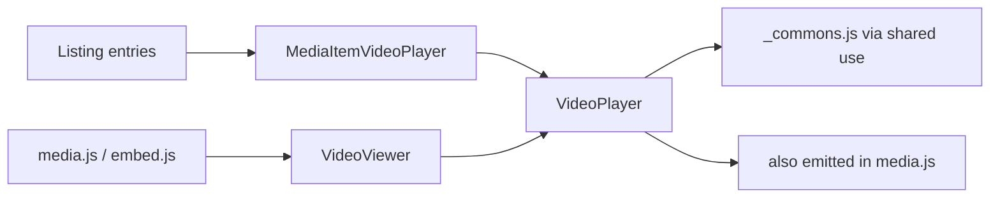

# Issue 927: no longer applicable — close with verification

## Verdict

**Not applicable as filed.** The reported duplication of [`VideoPlayer.jsx`](frontend/src/static/js/components/video-player/VideoPlayer.jsx) into both `static/js/_commons.js` and `static/js/media.js` cannot reproduce: that file was removed in `a5e6e7b` (Video.js v8 upgrade), and listing-page hover playback that pulled the player into shared bundles is commented out.

## Why it used to happen

Historically the same player module was imported from two surfaces:

Webpack’s vendor commons chunk plus multi-entry sharing caused the player body to land in both downloads on a media page (`_commons.js` + `media.js`).

## Why it no longer happens

- [`frontend/src/static/js/components/video-player/`](frontend/src/static/js/components/video-player/) is gone (0 matching files).
- [`VideoViewer`](frontend/src/static/js/components/media-viewer/VideoViewer/index.js) uses `VideoJSEmbed`; the old `VideoPlayer` import is commented out.
- [`MediaItemVideoPlayer`](frontend/src/static/js/components/list-item/includes/items/includes.js) no longer mounts `VideoPlayerByPageLink` (stub only).
- Current [`frontend/webpack.config.js`](frontend/webpack.config.js) puts only `node_modules` (and shared extracted CSS) into `_commons`; there is no app-src → commons `minChunks` group that would reintroduce this pattern for listing + media.

**Built artifact check** (workspace `static/js/`):

| Marker | `_commons.js` | `media.js` | `embed.js` |
|--------|---------------|------------|------------|
| VideoViewer body (`encodingRunning`, `video-js-root`) | absent | present | present |
| Old `VideoPlayer.jsx` | absent everywhere | | |

Media pages still load `_commons.js` then `media.js` ([`templates/common/body-scripts.html`](templates/common/body-scripts.html), [`templates/cms/media.html`](templates/cms/media.html)), but the player implementation is only in the page bundle, not duplicated into commons.

## Residual note (out of scope for #927)

`media.js` and `embed.js` each still contain a copy of the VideoViewer/VideoJSEmbed stack (~shared app code across two entries). That is a different, smaller concern than #927’s commons↔media duplication and does not keep #927 open.

## Resolution steps

1. Post a short comment on [mediacms-io/mediacms#927](https://github.com/mediacms-io/mediacms/issues/927) summarizing the above (removed `VideoPlayer.jsx` in `a5e6e7b`, listing player disabled, grep of current bundles).
2. Close the issue as completed / no longer reproducible (assignee: mgogoulos; no code change required for this ticket).
3. Do **not** change webpack splitChunks or re-enable listing hover playback as part of closing #927.

No frontend rebuild or PR is required unless you later want a separate ticket for media/embed shared-chunk deduplication.
