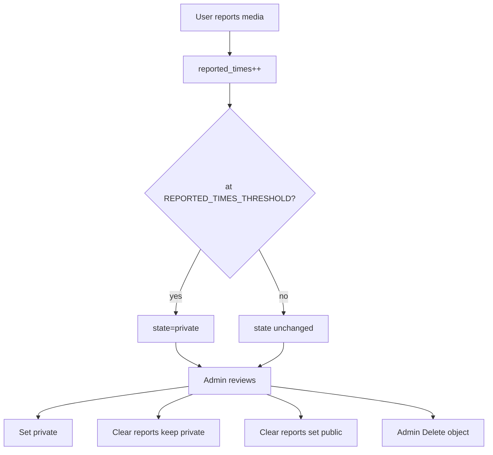

# Media admin actions (no schema)

## Constraints

- **No schema/migrations.** Private stays owner-visible; no quarantine/lock flag.
- **Delete original** = remove the uploaded file from disk; keep the Media row, encodings, HLS, thumbs, sprites, metadata. Because [`Media.media_file`](files/models/media.py) is a required `FileField` (no `blank`/`null`), the DB path stays as a stale reference after disk delete.
- **Delete original is gated on successful encodings** — never delete (or offer confirm) unless encodings are fully successful; see eligibility rules below.
- Destructive delete uses a Django admin **intermediate confirmation page** with an explicit typed phrase (`I am sure`), not a browser `confirm()`.

## Report workflow today (clarify in UI + docs)

Private still allows owner/editors/shares/RBAC. Clearing reports does **not** restore prior state unless the admin chooses public.

## New / improved MediaAdmin actions

Implement in [`files/admin.py`](files/admin.py), with shared helpers in [`files/methods.py`](files/methods.py) where reusable. Keep existing actions; extend `actions = [...]`.

### Encoding / derivatives (reuse existing helpers)

| Action | Behavior |
|--------|----------|
| **Force re-encode** | `media.encode(force=True)` (API already does this; admin only has `force=False`) |
| **Regenerate thumbnails** | `set_thumbnail(force=True)` / video path via `produce_thumbnails_from_video()` |
| **Regenerate sprites** | `produce_sprite_from_video()` |
| **Regenerate preview** | `encode(profiles=[preview], force=True, chunkize=False)` using `PREVIEW_PROFILE_NAME` |
| **Regenerate HLS** | `create_hls.delay(friendly_token)` |
| **Refresh derivatives** | thumbs + sprites + preview + HLS in one action (videos only where applicable) |

Each action should skip items that cannot run (wrong type / missing original on disk) and `message_user` with counts of queued vs skipped. Missing original → warning that re-encode/thumbs/sprites need the source file.

### Delete original (confirmed + encoding gate)

- Action: **Delete original media file**
- Permission: same gate as clear reports (`is_mediacms_editor`) via custom `has_*_permission`
- **Eligibility before offering delete** via helper `can_delete_original_media_file(media)` (used on the confirmation page and again on confirm). Eligible only when all of:
  - Original file exists on disk
  - Media type is video or audio (image/pdf have no encoding fallback — never eligible)
  - `media.encoding_status == "success"`
  - At least one successful non-preview encoding row exists
  - No encoding rows in `pending` / `running` / `fail` (ignore chunk child rows the same way the encode pipeline treats them if needed; prefer matching how `encoding_status` is computed)
- Django always lists the action in the dropdown; **do not proceed for ineligible items**. Intermediate page:
  - **Eligible** list (only these can be confirmed)
  - **Blocked** list with reason (e.g. encodings incomplete / failed / missing original / wrong type)
  - If zero eligible: show error, no confirm submit (or disabled confirm)
  - Strong warning on eligible: playback may still work from encodings; **re-encode / new thumbs / sprites / trim / transcription will fail**; DB path remains; irreversible without re-upload
  - Require typing **`I am sure`** into a text field
- On confirm: re-check eligibility per item, then `delete_original_media_file(media, user=request.user)`:
  - Resolve path from `media.media_file`
  - If file exists: `helpers.rm_file` (sync in admin so the message is accurate)
  - Do **not** clear/null the FileField (schema constraint)
  - Do **not** call full `Media.delete()` or touch encodings
  - **Audit:** after a successful disk delete, create a valid moderation `MediaAction` via existing `record_moderation_action(user, media, "original_deleted", extra_info=...)` (path/filename summary in `extra_info`)
  - Add `("original_deleted", "Original deleted")` to [`MODERATION_MEDIA_ACTIONS`](actions/models.py) so `record_moderation_action` accepts it and admin filters/choices show it. This is a **choices-only** update on the existing `CharField(max_length=20)` — **no DB migration** (same pattern as `report_cleared` / `media_reviewed`). Name fits within `max_length=20`.
  - Public like/report API must keep ignoring moderation actions (already gated by `PUBLIC_USER_MEDIA_ACTIONS`)
- Message: deleted N, blocked M, already missing K
- Tests: incomplete/failed encodings never delete; success path deletes file only when gate passes **and** creates `MediaAction(action="original_deleted")` for the moderator; update [`tests/helpers/test_moderation_actions.py`](tests/helpers/test_moderation_actions.py) for the new allowed moderation action

### Change owner (intermediate form)

- Mirror bulk API [`change_media_owner`](files/methods.py) / MediaBulk `change_owner`
- Intermediate page: username field + selected media list
- Validate user exists; update via `change_media_owner`; report success/fail counts
- Permission: `change` (editors/managers who can use Media admin)

### Report triage (improved private / clear workflow, no new states)

Rename/clarify via action descriptions + two combined actions (still using existing `clear_media_reports` + `state`/`save()`):

| Action | Behavior |
|--------|----------|
| **Confirm reports: set private** | `state=private` + `save()` (listable updates). Leaves report rows/`reported_times` intact as evidence |
| **Clear reports, keep private** | `clear_media_reports` then ensure `state=private` |
| **Clear reports, set public** | `clear_media_reports` then `state=public` + `save()` |

Keep existing standalone **Clear reports** and **Set state: \*** for flexibility. Update action description strings so “Confirm reports” is obviously the hide-from-public path (not owner-lock).

## EncodingAdmin additions

In [`EncodingAdmin`](files/admin.py):

- **Retry failed encodings**: for selected rows with `status=fail` (and optionally `pending` stuck), recreate/queue via parent `media.encode(profiles=[encoding.profile], force=True, chunkize=False)` or equivalent encode_media path; skip non-failed; warn if original missing.

## Docs + tests

- Update [`docs/admins_docs.md`](docs/admins_docs.md) §7: report triage map (report → threshold private → confirm private / clear+keep private / clear+set public / delete object); list new actions; document delete-original encoding gate and caveats.
- Extend [`tests/admin/test_admin_files.py`](tests/admin/test_admin_files.py):
  - force re-encode calls `encode(force=True)`
  - delete original: blocked when encodings incomplete/failed; intermediate rejects wrong phrase; accepts `I am sure` only for eligible items and removes file while Media/encodings remain
  - clear reports keep private / set public
  - confirm reports set private
  - change owner happy path
  - regenerate actions smoke (mock encode/task where needed)

## Out of scope

- Schema/migrations, soft-delete, owner-blocking quarantine (choices-only `original_deleted` is allowed)
- Clearing `media_file` DB value / placeholder replacement file
- Restoring previous pre-report state automatically (no history without schema)
- Frontend player changes beyond what missing-original already does today
