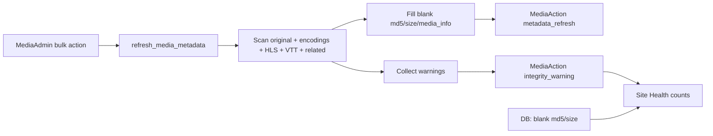

# Media file integrity checks and metadata refresh

## Decisions locked

- **Fill missing only**; on md5/size mismatch keep DB values and warn (`1A`)
- **Two audit codes** + Site Health aggregates (`2C`)
- **Queued**: MediaAdmin bulk action enqueues Celery (`refresh_media_metadata.delay`) per selected media — same pattern as `regenerate_hls` / encode actions. The HTTP request only queues; workers do md5 + filesystem I/O
- Existing DB-consistency suite in [`files/integrity.py`](files/integrity.py) stays as-is; this is a separate filesystem/metadata pass

## Architecture



## 1. New moderation audit actions

In [`actions/models.py`](actions/models.py), add to `MODERATION_MEDIA_ACTIONS` (both fit `max_length=20`):

- `metadata_refresh` — "Metadata refreshed"
- `integrity_warning` — "Integrity warning"

Migration altering `MediaAction.action` choices (follow [`actions/migrations/0004_...`](actions/migrations/0004_alter_mediaaction_options_alter_mediaaction_action.py)).

Wire through existing surfaces:

- [`record_moderation_action`](files/methods.py) already validates against `MODERATION_MEDIA_ACTIONS`
- [`MEDIA_REPORT_TAB_ACTIONS`](files/admin.py) auto-includes new moderation actions on the Media Reports tab
- Exclude both from `REPORT_AUDIT_ACTIONS` in [`admin_customizations/admin.py`](admin_customizations/admin.py) (same as `media_reviewed`) so the moderation "recent audits" tile stays report-focused; Site Health covers integrity instead
- Reject via public `save_user_action` (already limited to `PUBLIC_USER_MEDIA_ACTIONS`)

## 2. Core refresh/check logic

New module [`files/metadata_integrity.py`](files/metadata_integrity.py) (keeps admin/tasks thin):

`refresh_and_check_media(media, user=None) -> dict` returns `{filled: [...], warnings: [...]}`.

**Per original file**

- Path missing on disk → warning (`original missing on disk`); skip hash fill
- If present: compute md5 + size (reuse `md5sum`/`stat` via helpers, not full `set_media_type`)
  - Blank `media.md5sum` / `media.size` / empty `media_info` → fill and note in `filled`
  - Existing value differs → warning (`md5sum mismatch: stored=… computed=…`); **do not overwrite**

**Per Encoding** (prefer successful non-chunk outputs; also check chunk paths when present)

- Missing `media_file` / `chunk_file_path` on disk → warning
- Blank `md5sum`/`size` when file exists → fill
- Mismatch → warning, keep stored

**Related objects**

- HLS: if `media.hls_file` set but path missing → warning; if video `encoding_status=success`, has playable encodings, and `hls_file` empty → warning (`missing HLS`)
- VTT/subtitles: each `Subtitle.subtitle_file` missing on disk → warning
- Related paths when set: sprites, poster/thumbnail, `preview_file_path` missing → warning
- Missing playable encodings for success video (when not `DO_NOT_TRANSCODE_VIDEO`) → warning (complements existing integrity queryset check)

**Audits**

- Always `record_moderation_action(..., "metadata_refresh", extra_info=summary of fills or "no missing metadata")`
- If any warnings: also `integrity_warning` with compact semicolon-separated details (truncate ~500–1000 chars like delete-original)

Save only changed fields (`update_fields`) to avoid side effects.

## 3. Celery + MediaAdmin bulk action

**Task** in [`files/tasks.py`](files/tasks.py):

```python
@shared_task
def refresh_media_metadata(friendly_token, user_id=None):
    ...
    refresh_and_check_media(media, user=user)
```

**Admin** in [`files/admin.py`](files/admin.py):

- Action description: "Refresh metadata / check integrity"
- Permission: `change` (editors), grouped with derivative actions (`action_groups`)
- For each selected media: `refresh_media_metadata.delay(m.friendly_token, request.user.id)`
- Message via `admin_text`: queued count
- No token confirmation page (unlike delete original) — read-only w.r.t. files; only fills blanks + writes audits

## 4. Site Health aggregates (feasible without full FS scan)

Extend health checks (either new entries in [`files/integrity.py`](files/integrity.py) or adjacent helpers consumed by [`get_site_health_checks`](admin_customizations/admin.py)):

| Check | Signal | Status |
|---|---|---|
| Missing media metadata | Media with blank `md5sum` or `size` where `media_file` is set | warn + Media changelist filter link |
| Recent integrity warnings | Count of `integrity_warning` MediaActions (e.g. last 7 days) | warn/info + MediaAction changelist `?action__exact=integrity_warning` |

Do **not** live-scan the filesystem on every Site Health load (too slow / cache-hostile). Live FS + md5 only runs via the queued bulk action.

Optional MediaAdmin list filter for "missing metadata" if the health link needs a stable query param (mirror `IntegrityIssuesFilter`).

## 5. Translations

Add new admin strings to [`files/frontend_translations/en.py`](files/frontend_translations/en.py) first, then `python manage.py process_translations` (action label, queued message, any filter labels).

## 6. Tests

- [`tests/helpers/`](tests/helpers/) or new `tests/test_metadata_integrity.py`: fill blanks; mismatch keeps stored + warning; missing original/encoding/HLS/subtitle warns; always writes `metadata_refresh`
- [`tests/helpers/test_moderation_actions.py`](tests/helpers/test_moderation_actions.py): new actions in `MODERATION_MEDIA_ACTIONS`; public pipeline rejects them
- [`tests/admin/test_admin_files.py`](tests/admin/test_admin_files.py): bulk action queues task (mock `.delay`)
- [`tests/admin/test_admin_dashboard_stats.py`](tests/admin/test_admin_dashboard_stats.py): Site Health includes new check ids; `REPORT_AUDIT_ACTIONS` excludes the two new codes
- [`tests/api/test_api_media_actions.py`](tests/api/test_api_media_actions.py): API still rejects moderation types

## Out of scope

- Overwriting mismatched hashes/sizes
- Regenerating missing encodings/HLS/VTT (use existing admin actions)
- Changing the existing 7 DB integrity checks' semantics
