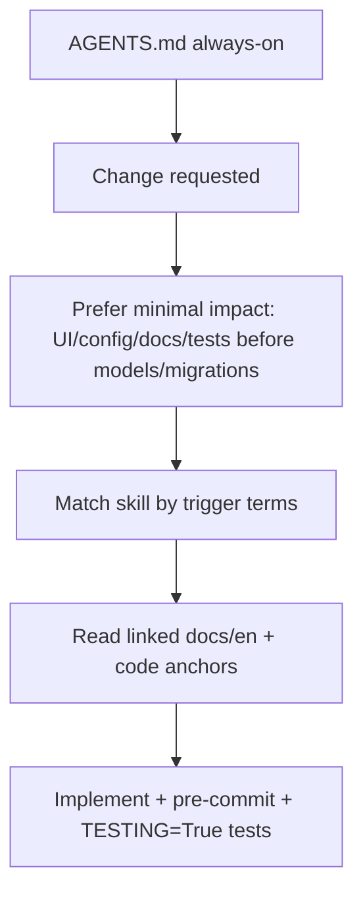

# MediaCMS agentic coding structure

## Audit summary (what drives the design)

From **83** MediaCMS agent transcripts (mostly 2026-11-07 → 2026-11-14) plus docs/architecture review:

| Rank | Theme | Implication |
|------|--------|-------------|
| 1 | Admin portal / jazzmin dashboard (~45–50%) | Highest-value skill: patterns agents keep relearning |
| 2 | Plan → implement loops (~44/83) | Keep always-on: plan contract + minimal-impact default |
| 3 | Issue triage / fix plans | Skill: verify applicability, prefer no schema |
| 4 | Fork docs / mike / GHCR | Skill: don’t duplicate AGENTS fork essay |
| 5 | Admin i18n + RTL | Skill: dual gettext vs `frontend_translations` |
| 6 | Merge into `mediacms-next` + `local_settings` | Skill: hygiene + conflict preservation |
| 7 | Media integrity / encode / import | Skill: point at architecture + code anchors |
| 8 | Test / CI / pre-commit | Skill: `TESTING=True`, pre-commit as lint SoT |

**Existing state:** only [AGENTS.md](AGENTS.md) (~164 lines). No `CLAUDE.md`, `skills/`, `.agents/`, `.claude/`, or `.cursor/rules`. Docs under [docs/en/](docs/en/) are already the right lazy-load source of truth.

**AGENTS.md problems to fix while slimming:** typos (`doues`, `docstalls`, `s/frontend_translations/en.py`), model name drift (`Encode` vs `Encoding`), and fork/mike/encode essays that belong in skills/docs—not always-on context.

---

## Target layout (compatibility)

```text
mediacms/
├── AGENTS.md                 # Slim always-on rules + skill index
├── CLAUDE.md                 # Starts with @AGENTS.md only
├── skills/                   # Canonical shared skills (committed)
│   ├── admin-portal/
│   ├── i18n/
│   ├── fork-docs-release/
│   ├── media-pipeline/
│   ├── rbac-permissions/
│   ├── test-ci/
│   ├── merge-hygiene/
│   └── issue-triage/
├── .cursor/
│   ├── skills -> ../skills   # Cursor discovery path
│   └── rules/                # Thin path-scoped .mdc pointers
├── .claude/skills -> ../skills
└── .agents/skills -> ../skills
```

**Default:** relative symlinks (not copies) so one edit updates all tools. Cursor requires [`.cursor/skills/`](.cursor/skills/) for project skill discovery; the shared tree stays at `skills/` as you specified.

Skills omit `disable-model-invocation` so agents can auto-apply from description triggers. Keep each `SKILL.md` short; put checklists in `references/` only when needed.

---

## Always-on: slim [AGENTS.md](AGENTS.md)

Keep (~80–100 lines max):

- One-paragraph project + stack
- Top-level layout table (short)
- Docker-first day-1 (`make docker-up`, ports 80/8088)
- **Change impact policy (new, always-on):** prefer templates/CSS/admin config/settings overrides over model/schema/migrations/DB changes unless explicitly required
- Hard gotchas: `TESTING=True`, frontend rebuild for :80, never commit `deploy/docker/local_settings.py`, translation mandatory one-liner + correct path `files/frontend_translations/en.py`
- Lint/commit one-liners (pre-commit, Conventional Commits)
- Skill index + “read docs before inventing”
- Pointers only: architecture → [docs/en/guides/developer/architecture.md](docs/en/guides/developer/architecture.md); tests → [tests.md](docs/en/guides/developer/tests.md); etc.

**Move out of always-on into skills/docs:** full Makefile catalog, fork/mike/GHCR narrative, encode pipeline detail, long settings catalog.

**Add** [CLAUDE.md](CLAUDE.md):

```markdown
@AGENTS.md
```

**Touch** [docs/en/guides/developer/index.md](docs/en/guides/developer/index.md): one line that agent skills live under `skills/` and follow `AGENTS.md`.

---

## Skills to create (8, frequency-ranked)

Each skill: YAML frontmatter (`name`, third-person `description` with WHAT + WHEN), Instructions (checklist), Additional resources (one-level links to docs/code). No scripts unless a real fragile command exists.

### 1. `skills/admin-portal/` — highest ROI

- **Triggers:** admin portal, jazzmin, dashboard, overview, sidebar, health check, changelist, change form, theme/dark mode
- **In skill:** sidebar ↔ overview selector order; section registration in [`admin_customizations/`](admin_customizations/); icons + labels; health-check wiring; dark/light Flatly-Darkly checklist; prefer existing patterns over new frameworks
- **Lazy-load:** [`admin_customizations/sidebar.py`](admin_customizations/sidebar.py), templates under `admin_customizations/templates/`, [docs/en/guides/admin/](docs/en/guides/admin/), [architecture.md](docs/en/guides/developer/architecture.md) (Manage vs Admin)
- **Optional ref:** `references/dashboard-checklist.md` (compact)

### 2. `skills/i18n/`

- **Triggers:** translation, i18n, RTL, gettext, `process_translations`, admin strings, el/de/es/pt
- **In skill:** dual systems — Django `` for admin vs `files/frontend_translations` + `process_translations` for React; never skip `en.py` first; RTL smoke (sidebar vs body)
- **Lazy-load:** [docs/en/guides/developer/translations.md](docs/en/guides/developer/translations.md), `files/frontend_translations/en.py`

### 3. `skills/fork-docs-release/`

- **Triggers:** docs site, mike, what’s new, GHCR, beta/stable, `mediacms-next`, Pages
- **In skill:** edit only [`docs/_shared/fork-whats-new.md`](docs/_shared/fork-whats-new.md); never hand-edit generated `whats-new` / upstream `CHANGELOG.md`; `make docs-up` → `/documentation/`; mike aliases; release stamp tags
- **Lazy-load:** [docs/en/releases/](docs/en/releases/), [docs/en/contributing/writing.md](docs/en/contributing/writing.md), `.github/workflows/{docs,release}.yml`, `scripts/prepare_docs_build.py`

### 4. `skills/media-pipeline/`

- **Triggers:** encoding, HLS, integrity, media paths, X-Accel, filesystem import, `migrationservice`, MediaAction
- **In skill:** `Encoding` lifecycle (not “Encode”); chunk/concat/HLS; `DO_NOT_TRANSCODE_VIDEO`; prefer health/integrity/admin surfaces before schema; workers share filesystem
- **Lazy-load:** [architecture.md](docs/en/guides/developer/architecture.md), [processing.md](docs/en/guides/admin/processing.md), `files/models/`, `tests/pipeline/`

### 5. `skills/rbac-permissions/`

- **Triggers:** RBAC, roles, FE/BE permission mismatch, `CAN_*`, `PORTAL_WORKFLOW`, `MEDIA_IS_REVIEWED`
- **In skill:** cross-check docs roles ↔ Django ↔ React gates; document behavior impact; avoid schema unless required
- **Lazy-load:** [docs/en/roles/](docs/en/roles/), [permissions.md](docs/en/guides/operator/permissions.md), [permissions-changes.md](docs/en/guides/admin/permissions-changes.md), `tests/rbac/`

### 6. `skills/test-ci/`

- **Triggers:** pytest, Jest, CI failure, pre-commit, flake8, coverage gaps
- **In skill:** always `TESTING=True`; `@unimplemented` policy; **pre-commit is lint source of truth** (don’t invent Makefile/`npm` lint paths when hooks cover it); install frontend package deps before hooks
- **Lazy-load:** [tests.md](docs/en/guides/developer/tests.md), `conftest.py`, `tests/_support/unimplemented.py`, `.github/workflows/`

### 7. `skills/merge-hygiene/`

- **Triggers:** merge into `mediacms-next`, sync PR branch, FIX-branch audit, stash `local_settings`
- **In skill:** never commit [`deploy/docker/local_settings.py`](deploy/docker/local_settings.py); preserve both sides in conflicts; post-merge CSRF/`CSRF_TRUSTED_ORIGINS` check; run pre-commit + `TESTING=True` pytest
- **Lazy-load:** AGENTS gotchas; release/docs skills if docs conflict

### 8. `skills/issue-triage/`

- **Triggers:** GitHub/Gitea issue applicability, “plan to fix”, revive closed PR
- **In skill:** verify still true on current branch; root-cause in code; **minimal-impact plan** (no migration unless necessary); wait for implement approval; don’t commit unless asked
- **Lazy-load:** issue URL + matching tests under `tests/`

**Deferred (not in first ship):** auth-identity, fake-data/populator — document as follow-ups in AGENTS skill index comments only if space; otherwise omit until needed.

---

## Optional Cursor rules (thin)

Under [`.cursor/rules/`](.cursor/rules/), path-scoped `.mdc` files that only nudge skill selection (not duplicate skill body):

- `admin-portal.mdc` — globs `admin_customizations/**` → use skill `admin-portal` (+ `i18n` if UI strings)
- `docs.mdc` — globs `docs/**` → use skill `fork-docs-release`
- `frontend.mdc` — globs `frontend/**` → rebuild note + `i18n` when strings change

Keep each rule &lt;15 lines.

---

## Content principles (every file)



- Skills teach **workflow + checklists**, not encyclopedia dumps
- One-level links only (`SKILL.md` → `references/foo.md` or `docs/en/...`)
- Align terminology with docs: **`Encoding`**, `admin_customizations`, `mediacms-next` / `main`
- Encode the recurring user constraint: **minimally impactful changes over model/database changes**

---

## Implementation order

1. Rewrite slim `AGENTS.md` + add `CLAUDE.md`
2. Create `skills/<name>/SKILL.md` (+ thin `references/` only for admin-portal and i18n)
3. Symlink `.cursor/skills`, `.claude/skills`, `.agents/skills` → `../skills`
4. Add three thin `.cursor/rules/*.mdc`
5. One-line update to developer docs index
6. Sanity-check: each skill description has WHAT+WHEN; no skill &gt; ~120 lines; AGENTS under ~100 lines; symlinks resolve

No application code, migrations, or docs content rewrites beyond the developer index pointer.
