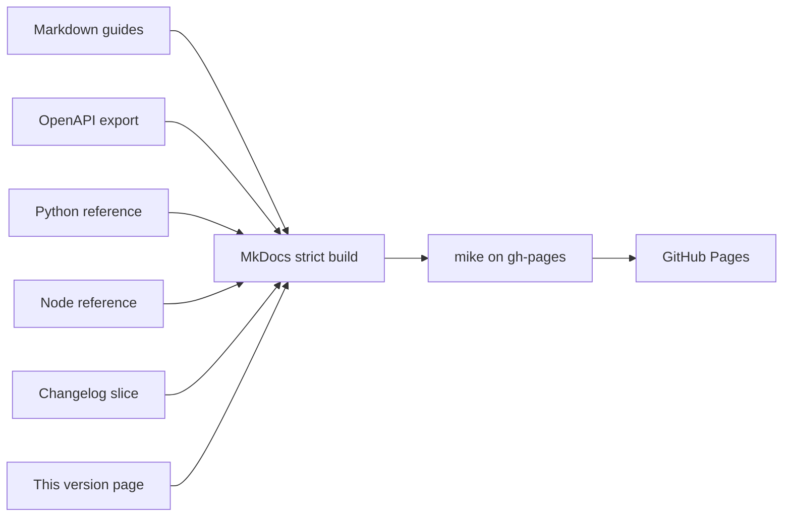
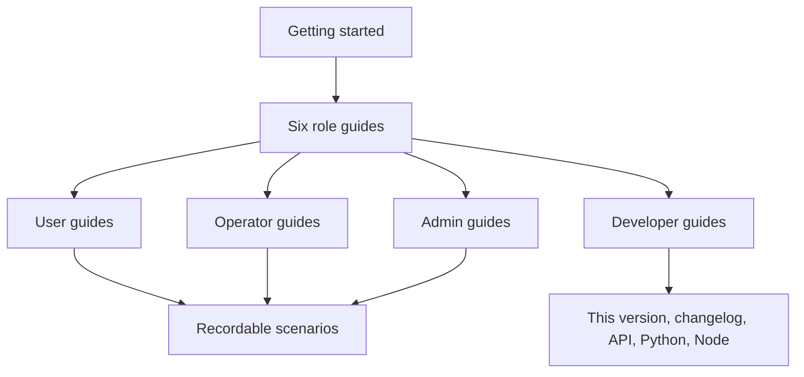

# MediaCMS documentation site

Publish a Markdown site with MkDocs Material. GitHub Actions builds it and [mike](https://github.com/jimporter/mike) deploys each release to the `gh-pages` branch. The site has a light/dark toggle and a version switcher. Each published version has its own changelog and a separate page for that version's build and release details.

English source lives in [docs/en/](docs/en/). These parts are generated into that folder at build time: OpenAPI, a curated Python reference, a Node reference, the changelog pages, and the This version page. Another language is a sibling folder, such as `docs/fr/`, and falls back to English where a page is missing.

The live app keeps Swagger at `/swagger/` and ReDoc at `/docs/api/`. The static site is a separate GitHub Pages site.

## Publishing



- New [requirements-docs.txt](requirements-docs.txt): `mkdocs`, `mkdocs-material`, `mike`, `mkdocstrings[python]`, `mkdocs-swagger-ui-tag`, `PyYAML`.
- [mkdocs.yml](mkdocs.yml) uses the Material theme. Palette follows the system scheme and offers an on-page light/dark switch. Navigation uses tabs for Getting started, Roles, Guides, Scenarios, and Reference. `pymdownx.superfences` renders Mermaid. `docs/stylesheets/extra.css` styles the screenshot placeholder.
- `mkdocs-static-i18n` builds one site per locale from [docs/languages.yml](docs/languages.yml). English is the default and is served at the site root. Other built locales are served at `/<locale>/`.
- A pre-build hook reads [package.json](package.json), [CHANGELOG.md](CHANGELOG.md), and the git commit. It writes three Reference pages for that commit only:
  - **This version:** identity, build, requirements, and artifact links for the version on screen. Details are in the section below. What's new stays the change list.
  - **What's new:** the single release section for the version in `package.json` (today `9.4.0`).
  - **Changelog:** the changelog file as it exists on that commit. On an older published version, later releases are absent because that commit does not contain them.
- Version switcher starts with the first deploy. Older tags are not backfilled.
  - Push to `main`: publish alias `dev`.
  - Push of `vX.Y.Z`: publish `X.Y.Z` and move alias `latest`.
  - `workflow_dispatch`: publish the current `package.json` version once, so the site has a `latest` before the next semantic-release tag.
- One-time repo setting: GitHub Pages for `mrjoshuap/mediacms`, source branch `gh-pages`, folder `/`. The same workflow works upstream after merge.
- Pull requests run `mkdocs build --strict` and the scenario checker. They do not deploy.

## Languages

The header has a Languages link on every page. That page is generated from [docs/languages.yml](docs/languages.yml) and lists each locale, its native name, and whether it is published. When two or more locales are published, the Material language selector also appears in the header. Both controls go to the same page in the other language.

[docs/languages.yml](docs/languages.yml) is the only language list. It starts with one entry per locale in `LANGUAGES` in [cms/settings.py](cms/settings.py): `ar`, `bn`, `da`, `nl`, `en`, `fr`, `de`, `hi`, `id`, `it`, `ja`, `ko`, `pt`, `ru`, `zh-hans`, `sl`, `zh-hant`, `es`, `tr`, `el`, `ur`, `he`. English has `build: true`. The others have `build: false`, so they do not multiply the published site until someone is ready. `ar`, `he`, and `ur` are marked `rtl: true`.

Add a language with one command:

```bash
python scripts/add_docs_language.py fr
```

The script sets `build: true`, creates `docs/fr/index.md` from a short template, and prints the next step. It does not copy the whole tree. `fallback_to_default: true` serves the English page when `docs/fr/` has no file at that path. A pre-build hook adds one admonition on those pages: "This page is not available in this language yet. The English page is shown." Translate a page by copying it from `docs/en/` to `docs/<locale>/` at the same path and translating the sentences. UI labels in bold stay the English words that appear on the product screen. The same one-word-per-concept rules apply in the target language. Setting names, tokens, and placeholders stay unchanged. For an RTL locale, the script also sets the theme direction to `rtl`.

Generated pages are written in English. A locale shows them in English until that file exists under `docs/<locale>/`. Shared files (`docs/assets/`, `docs/stylesheets/`) sit outside the language folders and are copied into each language build.

## How the site is organized



A beginner follows Getting started, opens their role page, then follows that role's scenarios in order. An administrator uses the admin guides and the settings catalog. A developer uses the local-dev guide and the generated references.

Two surfaces stay distinct in every page that mentions them:

- **Manage pages** at `/manage/media`, `/manage/users`, and `/manage/comments`. Editors and managers use these. Staff does not, unless that account is also an editor or manager.
- **Admin portal** at `/admin/`. Staff and superusers use this. Managers do not.

Role facts come from [users/models.py](users/models.py), [files/methods.py](files/methods.py), [cms/permissions.py](cms/permissions.py), and [admin_customizations/sidebar.py](admin_customizations/sidebar.py). Portal roles (`is_editor`, `is_manager`, pending `is_approved`) are not Django `is_staff` or `is_superuser`. RBAC category roles (`member`, `contributor`, `manager`) and per-media shares (`viewer`, `editor`, `owner`) get their own guide so they are not mixed with the six account roles.

### Getting started

- What MediaCMS is
- Install and update with Docker, including the current PostgreSQL 17 note from [docs/admins_docs.md](docs/admins_docs.md)
- Deployment patterns: local port, TLS, reverse proxy
- First sign-in (`admin` / `admin` on the dev stack)
- Concepts: media, public / private / unlisted, encoding, `listable` (public + encoding success + reviewed), review, the two management surfaces

### Role guides

Each role page states who the account is, what they can do, what they cannot do, and which scenarios to run. Pages: anonymous, pending approval, viewer, editor, manager, staff, superuser, plus a comparison page.

Each role page has a **MediaCMS Architecture** section for that persona only. The diagram shows the path that persona can take. It does not repeat the developer stack diagram.

- Anonymous: a public request reaches listable media only. A write stops at sign-in.
- Pending user: the same read path. Upload, edit, and Manage pages are refused. Superusers skip this gate.
- Viewer: own media, playlists, comments, and shares. Upload waits on encoding before the media can become listable.
- Editor: Manage media and comments, plus review. Listable still requires public, encoding success, and reviewed.
- Manager: the editor path, plus user approval and role assignment. The admin portal stays closed.
- Staff: the admin portal and `/api/v1/tasks`. Manage pages stay closed unless the account is also an editor or manager.
- Superuser: the staff path, the content-migration UI, and the site upgrade commands.

Pending approval is a signed-in user with `is_approved=False` while `USERS_NEEDS_TO_BE_APPROVED` is on. They can read. They cannot upload, edit, or open Manage pages. Superusers skip this gate.

### User guides

Rewrite [docs/user_docs.md](docs/user_docs.md) into task pages: browse and play, search, upload, edit your media, captions, comments and mentions, playlists, share and embed, trim, profile, download. Replace the unfinished stubs. Each task page has a short **MediaCMS Architecture** section for that task. Use a diagram when the task crosses more than one part of the system, such as upload, then encoding, then listable.

### Operator guides

For editors and managers on the portal, not the admin portal:

- Manage media and comments
- Review and publish (`MEDIA_IS_REVIEWED`, `PORTAL_WORKFLOW`)
- Categories, tags, and who can edit them
- Permissions, direct shares, and RBAC ([docs/media_permissions.md](docs/media_permissions.md) rewritten against `has_member_access_to_media` and `can_edit_category`)
- Manage users: create, approve, assign editor or manager, the accounts a manager cannot change

### Admin guides

Rewrite the admin material in [docs/admins_docs.md](docs/admins_docs.md) against the current portal. Sidebar groups in [admin_customizations/sidebar.py](admin_customizations/sidebar.py) are the table of contents:

- Moderation, including reported media, the report limit, needs review, and the media actions audit
- Library and engagement
- Processing: encoding queue, failed encodings, subtitles, transcription, trim, encode profiles, Whisper
- People: users, waiting for approval, RBAC groups when enabled
- Integrations: identity providers, SAML, LTI
- Site: health, configuration, system, database backup and restore, support bundle
- Tasks API at `/api/v1/tasks` (staff)
- Content migration UI (superuser only), rewritten from the Kaltura, YouTube, and Panopto guides. This imports media from another platform.
- Site upgrade, from the working-tree utility below. This moves an existing MediaCMS install to a new version. The glossary uses **content migration** and **site upgrade** for these two jobs.
- Moodle / LTI, rewritten from [docs/moodle_plugin.md](docs/moodle_plugin.md)

The settings catalog is grouped by job (sign-in and registration, upload and comments, workflow and review, appearance, email, limits, anonymous access, approval). Each entry names the setting as it appears in [cms/settings.py](cms/settings.py), says what changes on screen, and says which role notices it. Keep the procedures that are still accurate (logo, languages, static pages, analytics, cookies) and rewrite them in the instruction pattern below.

#### Site upgrade

Document the working-tree utility as an admin guide, linked from Getting started (update) and from This version. The source database is not migrated by the inventory step.

- `upgrade_site inventory` writes a JSON report. It compares migration file hashes with the mounted previous tree (`/audit/previous` by default). `fast_forward` means every applied migration file is in the new image with the same hash. A same-name file with a different hash is `do-not-fake`. A missing file is `missing`. The report also counts listable mismatches, users waiting for approval, public and private reports, report-count disagreements, custom pages whose slug is reserved, template diffs, missing media files, RBAC membership rows, and anonymous-access flags from the previous `local_settings.py`. Those last items are reported. Inventory does not rewrite them. Tests: [tests/upgrade/test_upgrade_audit.py](tests/upgrade/test_upgrade_audit.py).
- `upgrade_site scratch` dumps the source database, restores that dump into a destination database, and runs `migrate` on the destination only.
- `upgrade_site apply --choice approve` or `--choice leave` records one `UpgradeDecision`. A second run does not change users. `--recount` sets category and tag counts from public reviewed media. A second recount changes nothing.
- `export_database` writes the gzipped backup used for a round trip. Engagement rows and failed encoding or trim rows stay out unless the command asks for them. [deploy/docker/postgres_gate.sh](deploy/docker/postgres_gate.sh) compares a restored database with its source before migrate. [deploy/docker/upgrade_site_smoke.sh](deploy/docker/upgrade_site_smoke.sh) is the smoke script for this path.
- Custom page addresses use [files/page_slugs.py](files/page_slugs.py). Reserved names such as `admin`, `api`, `manage`, and `docs` are reported and left out of the copy list. The static-pages guide uses the same rule.

The architecture diagram for this guide is inventory, then scratch restore, then apply on the destination. Apply is the only step that writes user or taxonomy rows, and it writes them once.

### Developer guides

- Local development from [docs/dev_exp.md](docs/dev_exp.md) and [AGENTS.md](AGENTS.md): `docker-compose-dev.yaml`, ports 80 and 8088, `make build-frontend`, `TESTING=True`
- **MediaCMS Architecture** for a developer: Django apps, PostgreSQL, Redis, Celery encode pipeline, and React entries. Role pages link here for the full stack and keep their own smaller diagram.
- REST API page that embeds the generated OpenAPI document
- Python reference and Node reference
- Tests, and the translation workflow (`en.py`, then `process_translations`)
- How to add a documentation page

### This version

The first page on the Reference tab. It describes the docs version the reader has selected. Switching versions in the header opens that version's copy of this page. What's new and Changelog stay separate pages and link here.

The pre-build hook fills the page from the commit being built:

- Version from [package.json](package.json), release date from the matching [CHANGELOG.md](CHANGELOG.md) heading, git tag `v{version}` when the commit is that tag, and the commit SHA.
- Docs channel: `latest`, `dev`, or the pinned version mike is deploying.
- Docs build time in UTC. On GitHub Actions, the workflow run URL from `GITHUB_REPOSITORY` and `GITHUB_RUN_ID`. A local build says "Local build".
- Requirements for this version: Python 3.11+, Django 5.2, PostgreSQL 15+ (development compose uses PostgreSQL 17), Node >= 20.9.0. License AGPL-3.0, with links to [LICENSE.txt](LICENSE.txt) and the upstream source repository.

Artifact links use the real URL pattern and are marked placeholder until a later change confirms the file exists. Patterns come from [.github/workflows/docker-build-push.yml](.github/workflows/docker-build-push.yml) and GitHub release tags:

- GitHub release `https://github.com/{repository}/releases/tag/v{version}`
- Source zip and source tar.gz for that tag
- Docker image `mediacms/mediacms:{version}` and full image `mediacms/mediacms:{version}-full`
- OpenAPI file from this docs build (a real relative link to the generated schema)
- Checksums and SBOM, labeled "Not published yet"

The home page and What's new each link to This version. This version links to What's new.

### Generated references

- **API.** In the docs workflow, run `manage.py generate_swagger` from the app image with a docs settings module that uses SQLite, so schema export does not need PostgreSQL. Render that file with Swagger UI on the Reference tab. The file is the schema of the commit being published, so old site versions keep their old schema. The This version page links to the same file.
- **Python.** mkdocstrings pages for the public permission and access surface: [files/methods.py](files/methods.py), [cms/permissions.py](cms/permissions.py), the access helpers on the user model, media state and `listable`, and RBAC role names. Do not generate migrations, tests, or the whole tree.
- **Node.** Add TypeDoc as a frontend dev dependency. Generate from `frontend/src/entries` and `frontend-tools/`. Add a file-level JSDoc header to each webpack entry so every generated page names the Django page that bundle serves. The frontend is an application, so this reference lists entries and documented functions. It is not a second HTTP API.

## Instruction and scenario pattern

Adapt the simplified-English rules already used for admin copy. Do not copy the ASD-STE100 dictionary. Write procedures like this:

- One word for one thing. Use the glossary: media, playlist, category, tag, public, private, unlisted, viewer, editor, manager, staff, superuser, anonymous user, pending user, Manage pages, admin portal.
- Active voice. Short sentences. No idioms, slang, or filler such as "simply" or "please".
- Number the steps. One action in each step. Start with a verb: **Open**, **Select**, **Enter**, **Set**, **Check**, **Clear**.
- Put a condition in its own sentence before the action.
- Copy control labels from the screen and mark them in bold.
- Put notes and warnings in admonitions. They are not steps.
- One scenario is one role and one path. A branch is a new scenario.
- Leave setting names, tokens, and placeholders unchanged.
- Add the glossary terms **content migration** (import from another platform) and **site upgrade** (move this MediaCMS install to a new version).

### MediaCMS Architecture

Every role page and every task guide includes a heading **MediaCMS Architecture**. The section describes only the parts that persona uses for that page. Put the Mermaid diagram here, before the numbered steps. A task that is a single screen action can use a short paragraph and omit the diagram. Scenarios do not repeat the section. They link to the guide.

### Screenshot placeholder

No screenshots ship in this pass. Every step that changes the picture uses one shared frame, [docs/assets/screenshot-placeholder.svg](docs/assets/screenshot-placeholder.svg), labeled "Screenshot". The visible caption and the image `alt` are the same sentence. That sentence describes the future screenshot: which page, which control state, and which row or message is in frame. When a real image replaces the frame, keep that sentence as the alt text.

```html
<figure class="screenshot-placeholder">
  
  <figcaption>The Manage media table. The Needs review filter is selected. The first row is a video named Lecture 1.</figcaption>
</figure>
```

The scenario checker requires each scenario to contain at least one `screenshot-placeholder` figure whose `alt` and caption match and are not empty.

Every scenario is a Markdown file in `docs/en/scenarios/` with frontmatter:

- `id`, `role`, `audience`, `goal`, `duration`, `viewport` (desktop 1280 by 800 unless the task is mobile)
- `preconditions`: the setup a presenter performs before recording
- `related_tests`: pytest node ids or Jest file paths that already cover this path
- `coverage: gap` only when no test exists. The checker allows an empty test list only with that flag

The body is Before you start, Steps, a screenshot placeholder on each step that changes the picture, Expected result, and If this fails. [scripts/check_doc_scenarios.py](scripts/check_doc_scenarios.py) fails the build when a named test file is missing, or when a named `test_*` function is missing from that file.

Ship these scenarios, and link each one from its role page and its task guide:

- Anonymous: browse public media; an action that requires sign-in
- Pending user: browse, and an upload that is refused
- Viewer: upload and add metadata; comment; create a playlist; share with another viewer
- Editor: review media; moderate a comment
- Manager: approve a user; assign the editor role; confirm the admin portal is refused
- Staff: open the admin dashboard; open the processing queue
- Superuser: mark media reviewed from the admin portal; open Health; open the content-migration start page; run `upgrade_site inventory` and read the JSON report. The inventory scenario links [tests/upgrade/test_upgrade_audit.py](tests/upgrade/test_upgrade_audit.py). Its placeholder describes the terminal report, including a `fast_forward` line.

Use the existing tests under [tests/](tests/) and [frontend/tests/](frontend/tests/) as the `related_tests` targets. Search those trees while writing each scenario. Do not invent test names. Mark a real hole with `coverage: gap`.

## Review the old files, then delete them

Review every existing document. Move each concept, principle, and workflow into the new guide that owns it. Then delete the old file. Do not leave a stub. Git history keeps the old text.

During the move, drop procedures that describe a screen or command the current product no longer has. The admin portal guides follow the current sidebar, not the old admin chapters.

- [docs/admins_docs.md](docs/admins_docs.md): install, deployment, and settings go to Getting started and the settings catalog. Portal workflow and roles go to the role guides. Encoding, captions, categories, translations, RBAC, SAML, identity providers, Whisper, and custom pages go to the matching admin guides.
- [docs/user_docs.md](docs/user_docs.md): upload, download, captions, search, timestamps, mentions, timebar comments, share, embed, profile, and trim go to the user task guides.
- [docs/developers_docs.md](docs/developers_docs.md) and [docs/dev_exp.md](docs/dev_exp.md): local development, tests, and the API pointer go to the developer guides. Leave out the empty architecture section and the commands that disagree with [AGENTS.md](AGENTS.md).
- [docs/media_permissions.md](docs/media_permissions.md): states, shares, and RBAC go to the permissions guide and the role pages.
- [docs/transcoding.md](docs/transcoding.md): profiles and settings go to the processing guide.
- [docs/kaltura_migration.md](docs/kaltura_migration.md), [docs/youtube_migration.md](docs/youtube_migration.md), and [docs/panopto_migration.md](docs/panopto_migration.md): operator steps go to the content-migration guides.
- [docs/saml_entraid_setup.md](docs/saml_entraid_setup.md) and [docs/moodle_plugin.md](docs/moodle_plugin.md): setup steps go to the SAML and Moodle guides.
- [docs/superpowers/](docs/superpowers/): keep a workflow only when the product still does that work and the new guides do not already describe it. The migration chooser and the video preview behavior are the items to check. Then delete the specs and the implementation plan.

After the deletions, search the repo for those filenames and retarget the links in [README.md](README.md), [AGENTS.md](AGENTS.md), and any other reference. README product images under `docs/images/` stay if the README still shows them.

## Check before calling it done

- `mkdocs build --strict` and the scenario checker pass.
- Serve the site locally and, in the browser, walk Getting started, one role page, one scenario, the site upgrade guide, the admin portal map, What's new, This version, the Languages page, and the Swagger page. Toggle light and dark. On This version, confirm the version, commit, build line, and placeholder artifact links. On a role page, confirm the MediaCMS Architecture heading and a rendered Mermaid diagram. On a scenario, confirm the screenshot frame is visible and its caption matches the image alt.
- Run `python scripts/add_docs_language.py fr`, rebuild, and confirm the header selector opens the French home page and that an untranslated guide shows the English text plus the not-translated admonition. Remove that locale afterward if it should not ship. The committed site ships English until a language is intentionally left in `docs/languages.yml` with `build: true`.
- Deploy once with `workflow_dispatch` or a local mike build of version `9.4.0` so the version switcher has a `latest` entry to click.
