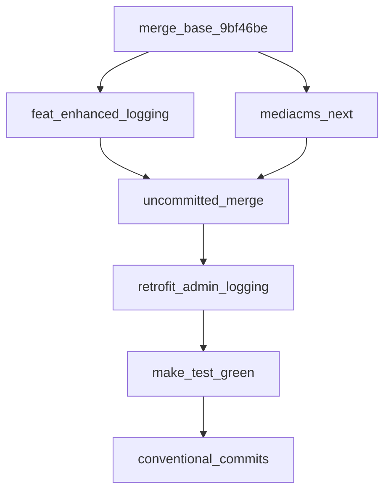

# Merge enhanced logging into mediacms-next

## Audit summary

`feat/enhanced-logging` is **31 commits** ahead of the shared base (`9bf46be`); `mediacms-next` is **55 commits** ahead (MkDocs, GHCR release, and the enhanced admin dashboard).

**What the logging branch delivers (keep):**
- Post-`local_settings` logging stack: `LOGLEVEL`, `ENABLE_SQL_DEBUG_LOGGING`, verbose formatters, per-app loggers (`files`, `users`, `uploader`, `saml_auth`, `rbac`, `identity_providers`, `actions`, `cms`), DEBUG console + Celery noise control
- ~265 new `logger.*` call sites across models, signals, tasks, views, auth/SAML/upload
- Failed-login logging via [`users/adapter.py`](users/adapter.py) using real client IP
- Trusted reverse-proxy support: [`cms/utils.py`](cms/utils.py) `get_client_ip`, `ProxyAwareMiddleware`, `TRUSTED_PROXIES` / related settings (also complements dashboard health checks in [`admin_customizations/deployment_health.py`](admin_customizations/deployment_health.py))
- Template/context defaults that stop AttributeError debug floods
- CI-hardening commit `ebbeacb` (SAML logger propagate, revoked-task safety, login/approval contracts) — treat as the source of truth for those touchpoints

**Incidental / do not resurrect as-is:**
- Flat docs dumps (`docs/admins_docs.md`, `docs/developers_docs.md`, `docs/reverse_proxy.md`, etc.). `mediacms-next` already migrated to MkDocs under [`docs/en/`](docs/en/). **Reject those file adds.** Port only operator/developer-needed facts into the existing MkDocs pages listed under **Docs adaptation** (catalog tables, numbered deploy steps, local-dev troubleshooting, fork what's-new) — never a parallel root-level markdown tree.

**Retrofit gap (dashboard-only code, zero logging today):**
- All of [`admin_customizations/`](admin_customizations/) (backup/restore, health, support bundle, object actions, views)
- Management commands such as [`files/management/commands/export_database.py`](files/management/commands/export_database.py), `populate_fake_media.py`, `upgrade_site.py`



## Locked decisions

- Merge **into** `mediacms-next` (current clean branch); include reverse-proxy code from the logging branch (needed for accurate auth IP logs; off by default when `TRUSTED_PROXIES = []`).
- **No commits until** `make test` (and any directly impacted frontend tests) pass.
- After green: one merge commit for the branch integration, then a follow-up commit for dashboard retrofit **and** MkDocs updates (Conventional Commits).
- Documentation must follow [`docs/en/contributing/writing.md`](docs/en/contributing/writing.md): clear simple English, one word per concept, existing guide roles (admin / developer / getting-started). Prefer extending current pages over new top-level guides.
- **Changelog accuracy is mandatory.** Fork release notes live only in [`docs/_shared/fork-whats-new.md`](docs/_shared/fork-whats-new.md). Do **not** hand-edit upstream [`CHANGELOG.md`](CHANGELOG.md) or generated [`docs/en/reference/whats-new.md`](docs/en/reference/whats-new.md) / [`docs/en/reference/changelog.md`](docs/en/reference/changelog.md). Commit messages must describe what actually landed.

## Execution steps

### 1. Start the merge (no commit)

```bash
git merge --no-commit --no-ff feat/enhanced-logging
```

Expect content conflicts in at least:

| File | Strategy |
|------|----------|
| [`cms/settings.py`](cms/settings.py) | Keep next apps/`ALLOW_POPULATE_FAKE_MEDIA`/LTI/login-required/approval blocks; replace early stub `LOGGING` with logging-branch post-`local_settings` config; add proxy settings + `ProxyAwareMiddleware` registration; add `admin_customizations` logger |
| [`cms/middleware.py`](cms/middleware.py) | Keep next `ApprovalMiddleware`; add `ProxyAwareMiddleware` |
| [`deploy/docker/local_settings.py`](deploy/docker/local_settings.py) | Keep next `ALLOW_POPULATE_FAKE_MEDIA`; keep proxy knobs commented/disabled |
| [`actions/models.py`](actions/models.py) | Keep next action choices / metadata / integrity; add logger + signal logging from logging branch |
| [`files/context_processors.py`](files/context_processors.py) | Keep next sidebar `Page` injection; add logging-branch safe defaults (`CAN_*`, `media`, `current_site`) |
| [`files/methods.py`](files/methods.py), [`files/tasks.py`](files/tasks.py), [`files/views/media.py`](files/views/media.py) | Manual combine: next behavior + logging instrumentation; prefer `ebbeacb` patterns where they diverge |
| [`files/models/media.py`](files/models/media.py), `encoding.py`, `page.py`, `playlist.py` | Keep next model/API changes; overlay logger + create/update/delete/signal logs |
| [`users/serializers.py`](users/serializers.py) | Keep next deletions/shape; re-apply logging with CI-fix caution |
| Flat `docs/*.md` | **Ours** — refuse logging-branch adds; document via MkDocs pages in step 3 |

Auto-merged logging-only files (models, SAML, uploader, users adapter/forms/views, templates, `cms/utils.py`) should be reviewed quickly for accidental overwrites of next-only behavior.

### 2. Retrofit logging onto dashboard surfaces

Match existing conventions from the logging branch:

- `logger = logging.getLogger(__name__)`
- `info` for successful operational outcomes (backup created, restore finished, support bundle built)
- `warning` for recoverable/rejected admin actions
- `error` / `exception` on failures with context (user id, paths, profile flags) — never log secrets/passwords
- Skip noisy debug on pure read/stats paths unless useful for failures

Primary targets: `database_backup.py`, `database_restore.py`, `support_bundle.py`, `object_actions.py`, `views.py`, `deployment_health.py` / `status_health.py` (failures only), plus `export_database.py` / `upgrade_site.py` / `populate_fake_media.py`.

Ensure [`cms/settings.py`](cms/settings.py) `LOGGING["loggers"]` includes `admin_customizations` (and console wiring under `DEBUG`).

### 3. Docs adaptation (MkDocs only, match established patterns)

Do **not** reintroduce root-level `docs/admins_docs.md`, `docs/developers_docs.md`, or a full `docs/reverse_proxy.md`. Do **not** add a new nav entry unless an existing page cannot hold the content cleanly. Write in the same voice as neighboring guides (short sentences, numbered steps, Setting / Default / Effect tables).

**Admin settings catalog** — [`docs/en/guides/admin/settings.md`](docs/en/guides/admin/settings.md)

- In **Hosts, security, and storage**, add rows for `TRUSTED_PROXIES` (default `[]`), `PROXY_AWARE_MIDDLEWARE_ENABLED`, `SET_REAL_IP_IN_META`, and clarify how they relate to the existing `USE_X_FORWARDED_HOST` / `SECURE_PROXY_SSL_HEADER` / `ALLAUTH_TRUSTED_PROXY_COUNT` rows.
- Add a small **Logging** subsection (or rows under hosts/security) for `LOGLEVEL` (default `ERROR`, env or `local_settings.py`) and `ENABLE_SQL_DEBUG_LOGGING` (default `False`; SQL only when `DEBUG` and this flag are both on).
- In **Settings that other settings change**, document: empty `TRUSTED_PROXIES` keeps proxy middleware off; `DEBUG=True` raises the effective file/console log level; logging is built **after** `local_settings.py` is imported.
- Note restart of web / celery_worker / celery_beat after logging or proxy changes (same pattern as other settings pages).

**Deploy behind a reverse proxy** — [`docs/en/getting-started/deploy.md`](docs/en/getting-started/deploy.md)

- Extend the existing **Deploy behind a reverse proxy** numbered steps: set `FRONTEND_HOST`, then set `TRUSTED_PROXIES` to the proxy CIDR/IP list, set `USE_X_FORWARDED_HOST` / `SECURE_PROXY_SSL_HEADER` when HTTPS is terminated upstream. Keep the section short; link to the settings catalog for the full table. Do not paste the 600+ line logging-branch essay.

**Site health / configuration** — [`docs/en/guides/admin/site.md`](docs/en/guides/admin/site.md) (and [`docs/en/scenarios/superuser-health.md`](docs/en/scenarios/superuser-health.md) if a one-line tip fits)

- Where reverse-proxy checks are listed, mention that client-IP accuracy for auth logs also needs `TRUSTED_PROXIES` when a proxy sits in front.
- If Configuration already lists reverse-proxy values, ensure docs stay consistent with what the page shows after the merge.

**Local development** — [`docs/en/guides/developer/local-dev.md`](docs/en/guides/developer/local-dev.md)

- Add a short troubleshooting/settings note: set `LOGLEVEL` / `DEBUG` via env or `deploy/docker/local_settings.py`; leave `ENABLE_SQL_DEBUG_LOGGING` off unless debugging queries; default proxy settings stay disabled in Compose.

**Fork changelog (source of truth)** — [`docs/_shared/fork-whats-new.md`](docs/_shared/fork-whats-new.md)

Write bullets **after** conflict resolution and retrofit are settled, from the real `git diff origin/mediacms-next...HEAD` (or uncommitted merge tree), not from the logging branch’s aspirational commit list.

Rules for accuracy:
- Only claim behavior that is present in the merged tree (settings names, defaults, middleware off when `TRUSTED_PROXIES = []`, SQL logging opt-in via `ENABLE_SQL_DEBUG_LOGGING`, failed-login warnings with client IP, admin op logging if retrofit shipped).
- Do **not** claim resurrected flat docs, enabled-by-default proxy trust, or dashboard features that were already listed.
- Use the same Conventional Commits section style as existing entries (`**area:**` short fact). Split across **Features**, **Bug Fixes**, and **Documentation** only when each claim fits that type.
- Draft expected content (adjust to match final diff):
  - Features: structured app logging / `LOGLEVEL`; failed-login logging; trusted-proxy client IP helpers; logging on admin dashboard operations (backup/restore/support/actions) if included
  - Documentation: settings catalog + deploy reverse-proxy + local-dev notes for logging/proxy
  - Bug Fixes: only if the merge keeps a real fix (e.g. template context defaults that stop AttributeError log floods) — omit if not verifiable in the diff
- Never edit [`CHANGELOG.md`](CHANGELOG.md) (upstream semantic-release). Never hand-edit generated [`docs/en/reference/whats-new.md`](docs/en/reference/whats-new.md).
- After editing `fork-whats-new.md`, run `scripts/prepare_docs_build.py` (channel `local` or as used in this fork) and confirm the generated What's new page shows the new bullets under the fork section and still appends the upstream changelog section correctly.

**Out of scope for docs**

- No new glossary terms unless a page introduces a word not already covered (prefer existing “reverse proxy” phrasing).
- No `mkdocs.yml` nav churn for a standalone reverse-proxy chapter.

### 4. Validate before any commit

```bash
docker compose -f docker-compose-dev.yaml exec --env TESTING=True -T web pytest
# or: make test
pre-commit run --files <touched files>   # at least on conflict/retrofit set
```

Fix failures (likely candidates: logger propagate/`assertLogs`, approval/login flows, MediaAction/signal side effects, settings import order with `ALLOW_POPULATE_FAKE_MEDIA` + post-import `LOGGING`).

### 5. Commit only when green

1. Merge commit: `feat: merge enhanced logging into mediacms-next`
2. Follow-up commit(s) with messages that match the final diff (e.g. `feat: add logging to admin dashboard operations`, `docs: document logging and trusted proxy settings`). Include the verified `fork-whats-new.md` update in the docs-related commit.

No push unless you ask.

## Risk watchlist

- **`cms/settings.py` import order**: logging config must stay after `local_settings` so `DEBUG`/`LOGLEVEL` overrides apply; next’s `ALLOW_POPULATE_FAKE_MEDIA` resolution must still run after that.
- **`files/methods.py` / `files/tasks.py`**: largest semantic overlap — resolve by behavior-first, then re-apply log lines; do not drop next’s dashboard/helper additions.
- **MediaAction**: next’s new action types must remain; logging must not break integrity/metadata expectations or admin smoke tests.
- **Proxy defaults**: leave `TRUSTED_PROXIES = []` so existing installs stay unchanged until explicitly configured.
- **Changelog drift**: do not invent bullets for dropped conflicts, unmerged side features, or upstream `CHANGELOG.md` entries; verify generated What's new after `prepare_docs_build.py`.
