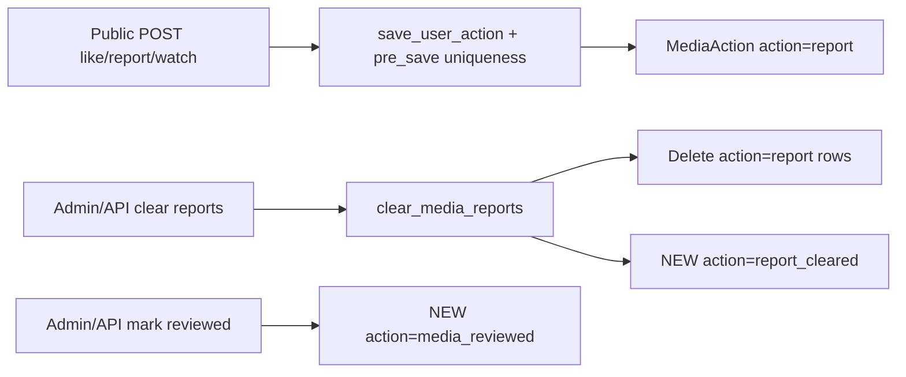

# Feasibility: MediaAction moderation events

## Verdict

**Highly feasible / low–medium effort.** `MediaAction` is already a generic event log with a 20-char `action` choice field ([`actions/models.py`](actions/models.py)). Adding admin/moderator audit events fits the model well. The main design work is **not** schema — it is keeping these events out of the public like/report pipeline and deciding what happens to existing `report` rows when clearing.



---

## Why it fits

| Concern | Current state | Impact of new actions |
|---------|---------------|------------------------|
| Storage | `MediaAction.action` CharField(max_length=20) + `USER_MEDIA_ACTIONS` | `report_cleared` / `media_reviewed` / `media_unreviewed` fit length; choices are app-level only (no DB migration required for choices) |
| Who can create | Public API → Celery `save_user_action` | Must **not** accept new types via public POST; emit only from trusted server paths |
| Uniqueness | `pre_save_action` blocks repeat like/dislike/report per user | New types must skip that path (many clears/reviews over time are expected) |
| Counters | report increments `reported_times`; like/dislike increment counts | New types must not touch those counters |
| Admin/dashboard | Filters `action=report` for moderation stats | New types appear in MediaAction admin naturally; leave report stats filtering on `report` only |

---

## Recommended design (concrete)

Add three choice values to `USER_MEDIA_ACTIONS`:

- `report_cleared` — moderator resolved reports
- `media_reviewed` — moderator set `is_reviewed=True`
- `media_unreviewed` — moderator set `is_reviewed=False`

Add a small helper (e.g. in [`files/methods.py`](files/methods.py)):

```python
def record_moderation_action(user, media, action, extra_info=None):
    MediaAction.objects.create(user=user, media=media, action=action, extra_info=extra_info or "")
```

**Emit from:**

1. [`clear_media_reports`](files/methods.py) — after deleting `report` rows / resetting counter (covers admin Media + MediaAction clear actions). Also mirror in API DELETE in [`files/views/media.py`](files/views/media.py) (today duplicates clear logic; should call the shared helper so both paths log).
2. Review paths — MediaAdmin `mark_as_reviewed` / `mark_as_unreviewed`, and API `POST ... type=review` in `MediaDetail.post`. For `list_editable` saves of `is_reviewed`, override `MediaAdmin.save_model` / changelist save to emit only when the value **changes**.

**Do not** route through `save_user_action`, `ALLOW_ANONYMOUS_ACTIONS`, or frontend report UI.

**`extra_info` usage:**

- `report_cleared`: e.g. `cleared N report(s)` and optionally a short summary of reasons before delete
- `media_reviewed` / `media_unreviewed`: optional note; usually empty

**Report history tradeoff (chosen default):** Keep today’s behavior of **deleting** open `report` rows on clear (so `reported_times` and GET reports stay consistent), and write one `report_cleared` audit row. Original report reasons are lost unless copied into `extra_info` at clear time — do a compact summary (count + truncated reasons) in `extra_info` when clearing.

Preserving full report rows forever would be a larger product change (open vs resolved reports) and is out of scope for this event addition.

---

## Touch points (implementation checklist)

1. [`actions/models.py`](actions/models.py) — extend `USER_MEDIA_ACTIONS`
2. [`files/methods.py`](files/methods.py) — `record_moderation_action`; enhance `clear_media_reports(user=...)` to log `report_cleared`
3. [`files/views/media.py`](files/views/media.py) — DELETE report + `type=review` call shared helpers
4. [`files/admin.py`](files/admin.py) / [`actions/admin.py`](actions/admin.py) — pass `request.user` into clear/review; detect `is_reviewed` flips on save
5. Admin list filter already uses `action` choices — new labels show automatically
6. Tests — clear creates `report_cleared`; review creates `media_reviewed`; public POST of new types ignored/rejected; dashboard report counts unchanged
7. Docs — note audit events in [`docs/admins_docs.md`](docs/admins_docs.md) §7

---

## Effort and risks

- **Effort:** roughly a half-day including tests (smaller if list_editable review logging is deferred and only bulk/API review is instrumented first).
- **Risks:** (1) accidentally allowing public creation via `save_user_action` if action whitelist is not tightened; (2) double-logging if both API and helper clear without deduping — fix by making API call `clear_media_reports` only; (3) noisy history if list_editable toggles repeatedly — acceptable for audit.
- **Non-goals:** separate MediaReport model; soft-delete/resolve workflow; notifying reporters.

---

## Bottom line

Yes — this is a natural extension of `MediaAction` as an audit log for moderator workflows you just built. Treat the new types as **server-emitted moderation events**, not user actions, and wire them into the existing clear/review helpers so admin and API stay consistent.
