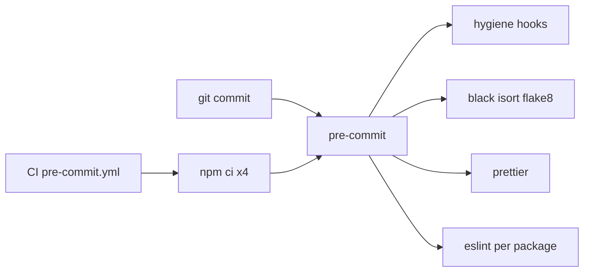

# Node lint and pre-commit hardening

## Goals

Full scope (`frontend/` + all three `frontend-tools/` packages) with track B: hygiene hooks, Prettier enforcement, and ESLint (recommended + react-hooks), including a one-time cleanup so `pre-commit run --all` and CI stay green.

## Current gaps

- [`.pre-commit-config.yaml`](.pre-commit-config.yaml) is Python-only (`flake8` / `isort` / `black`).
- Docs claim Prettier for frontend, but [`.prettierignore`](.prettierignore) excludes `/frontend/` and Prettier is not a pre-commit hook.
- Main [`frontend/`](frontend/) has Prettier as a dep but no `lint`/`format` scripts and no ESLint.
- Only [`frontend-tools/video-js`](frontend-tools/video-js) has ESLint (1 existing `react-hooks/exhaustive-deps` warning).
- [`.github/workflows/pre-commit.yml`](.github/workflows/pre-commit.yml) installs Python only — Node deps must be installed before local ESLint hooks can run in CI.

## Approach

### 1. Hygiene hooks

Add `https://github.com/pre-commit/pre-commit-hooks` to [`.pre-commit-config.yaml`](.pre-commit-config.yaml):

- `trailing-whitespace`, `end-of-file-fixer`
- `check-merge-conflict`, `check-added-large-files`
- `detect-private-key`
- `check-yaml` (exclude generated docs YAML already listed in `.prettierignore` where needed)
- `check-json`

Keep Python hooks as they are.

### 2. Prettier via pre-commit

- Add `https://github.com/pre-commit/mirrors-prettier` (pinned rev) with `prettier` matching the repo’s major (`^3`).
- Types: `javascript`, `jsx`, `ts`, `tsx`, `css`, `json`, `markdown`, `yaml` — **not** `scss` (already ignored; leave `*.scss` out to avoid a huge style churn).
- Update [`.prettierignore`](.prettierignore):
  - **Remove** `/frontend/` so main app is covered.
  - Keep MkDocs generated ignores.
  - Add build artifacts: `**/node_modules/`, `frontend/dist/`, `frontend/coverage/`, `frontend-tools/**/dist/`, `static/video_js/`, `static/video_editor/`, `static/chapters_editor/`, `static/js/`.
- Run Prettier `--write` once on the ~27 currently dirty files under `frontend-tools/` (main `frontend/` is already clean against root [`.prettierrc`](.prettierrc)).

### 3. ESLint per package (flat config)

Shared rule intent everywhere: `@eslint/js` recommended + `eslint-plugin-react-hooks` recommended. TypeScript packages also get `typescript-eslint` recommended (type-aware off initially to keep install/setup light and CI fast).

| Package | Config | Notes |
|---|---|---|
| [`frontend/`](frontend/) | new `eslint.config.mjs` | Mixed JS/JSX/TS/TSX; Webpack — **no** `react-refresh`. Ignore `dist/`, `coverage/`, `node_modules/`. |
| [`frontend-tools/video-js/`](frontend-tools/video-js/) | keep [`eslint.config.js`](frontend-tools/video-js/eslint.config.js) | Already green aside from one hooks warning; leave that as warn. |
| [`frontend-tools/video-editor/`](frontend-tools/video-editor/) | new flat config | TS/TSX under `client/`; add eslint deps. |
| [`frontend-tools/chapters-editor/`](frontend-tools/chapters-editor/) | new flat config | Same pattern as video-editor. |

Package scripts (each):

- `lint`: `eslint .` (or scoped paths)
- `format`: `prettier --write …` using root `.prettierrc` where practical
- `format:check`: `prettier --check …`

Main frontend deps to add: `eslint`, `@eslint/js`, `eslint-plugin-react-hooks`, `globals`, `typescript-eslint` (and keep existing `prettier`).

### 4. Wire ESLint into pre-commit

Local hooks (one per package), `language: system`, `pass_filenames: false`, `files:` scoped to that package path, entry: `bash -lc 'cd <pkg> && npm run lint'`.

Rationale: each package has its own `node_modules` and flat config; mirrors-eslint fights TypeScript/React flat configs in a multi-package tree.

### 5. CI

Update [`.github/workflows/pre-commit.yml`](.github/workflows/pre-commit.yml):

1. `actions/setup-node` (Node 24 to match frontend CI).
2. `npm ci` (or `npm install` if no lockfile) in `frontend/`, `frontend-tools/video-js/`, `frontend-tools/video-editor/`, `frontend-tools/chapters-editor/`.
3. Then existing `pre-commit/action`.

Also add a `lint` step to [`.github/workflows/frontend-build-and-test.yml`](.github/workflows/frontend-build-and-test.yml) for the main app (`npm run lint` before tests) so frontend PRs fail fast even if someone bypasses hooks.

### 6. Cleanup pass (required for green CI)

1. Prettier-write the 27 dirty `frontend-tools` files.
2. Install ESLint deps; run lint in each package; autofix (`eslint --fix`) then fix remaining errors until exit 0.
3. Prefer fixing real issues over blanket `eslint-disable`. Only add narrow file-level disables if a generated or third-party pattern is intractable.
4. Re-run `pre-commit run --all` and fix hygiene/Python fallout from EOF/trailing-whitespace on touched files.

### 7. Docs / developer UX

Update [docs/en/guides/developer/local-dev.md](docs/en/guides/developer/local-dev.md) (and the short note in [docs/en/guides/developer/index.md](docs/en/guides/developer/index.md) / [AGENTS.md](AGENTS.md)) to state:

- Python: black / isort / flake8
- JS/TS: Prettier + ESLint via pre-commit
- Prerequisite: `npm install` in each frontend package you touch (or all four) so local ESLint hooks work

Optional Makefile convenience (only if it stays thin): `make lint-frontend` that runs lint in all four packages via compose or host npm.

## Out of scope

- Reformatting all SCSS
- Type-aware typescript-eslint (`parserOptions.project`) — slower; can follow later
- Husky / lint-staged (pre-commit already covers the repo)
- Moodle plugin JS under `lms-plugins/`

## Risk note

Main `frontend/` ESLint is new on ~400 source files. Expect a non-trivial first cleanup (especially `no-unused-vars` / hooks deps). Work stays in this change set until lint exits 0; do not land a red hook.
