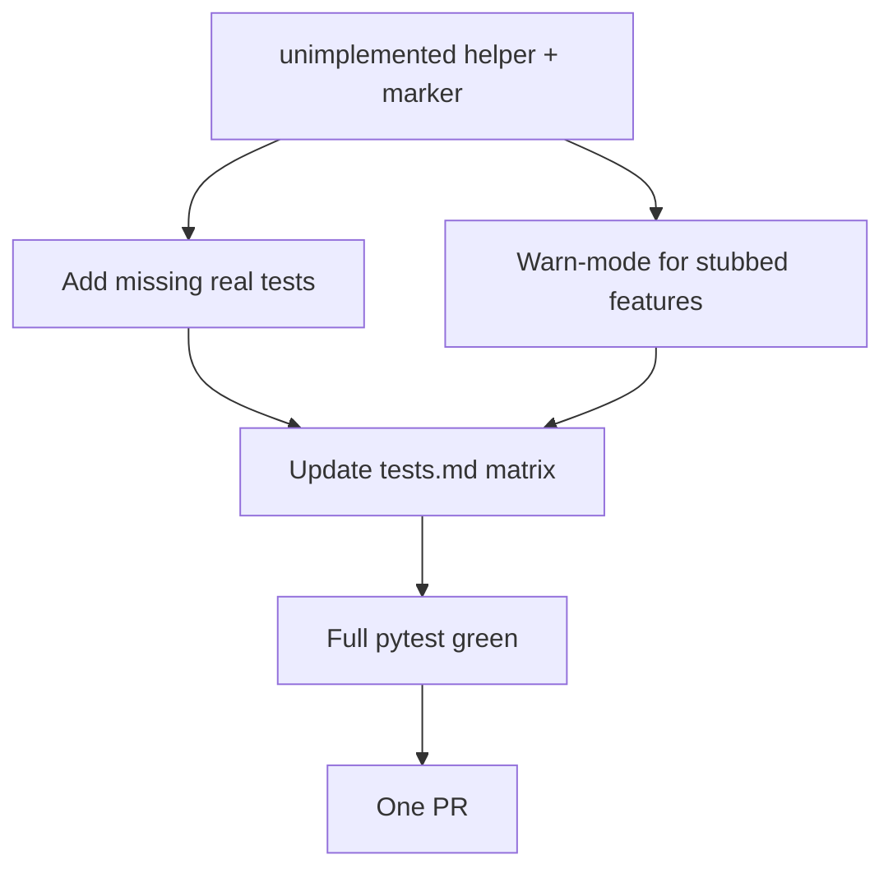

# Python test suite gap-fill (full surface, one PR)

## Decisions locked

- **Scope:** everything pytest discovers — [`tests/`](tests/) + [`migrationservice/tests/`](migrationservice/tests/) (and any other `test_*.py` under the repo; `pytest.ini` already recurses past `migrationservice`).
- **Delivery:** one PR with infrastructure, docs, and prioritized missing tests together.
- **Gate:** full suite must pass (`TESTING=True`, docker compose web container) before the PR is considered done.

## Current state (audit summary)

- ~2,100 tests in `tests/`, plus a large `migrationservice/tests/` suite; CI runs `pytest -n auto --cov` in [`.github/workflows/python.yml`](.github/workflows/python.yml).
- Strong coverage already for upload/encode/HLS, comments, playlists CRUD, manage APIs, RBAC/SAML/LTI, many admin changelist/UI behaviors, password unlock, bulk user media actions.
- Frontend already has warn-mode stubs via [`frontend/tests/_support/unimplemented.ts`](frontend/tests/_support/unimplemented.ts); backend has **no** equivalent (docs only describe Jest).
- No `xfail`/`skip`/`TODO` markers in `tests/` today — gaps are mostly **missing files/cases**, not skipped ones.
- [`tests/test_selenium_smoke.py`](tests/test_selenium_smoke.py) is entirely commented out (dead / unimplemented).

### Confirmed missing / weak areas

| Area | Gap | Classification |
|------|-----|----------------|
| API | `GET /api/v1/media/{token}/playlists` ([`MediaPlaylistMembership`](files/views/media.py)) has no tests | MISSING |
| Admin | Media actions without dedicated tests: `regenerate_thumbnails`, `regenerate_sprites`, `regenerate_preview`, `refresh_derivatives`, `mark_as_unreviewed`, `enable_comments`/`disable_comments`, `feature_selected`/`unfeature_selected` | MISSING |
| Settings/workflow | `MEDIA_IS_REVIEWED=False` end-to-end (upload → not listable → editor review → listable) | WEAK |
| Upload | `UPLOAD_MAX_SIZE` rejection on API upload (page replace has a case; API does not) | MISSING |
| Related media | `RELATED_MEDIA_STRATEGY="calculated"` currently asserts empty list | EXPECTED_BUT_UNIMPLEMENTED → warn-mode |
| Review API | Explicit multipart `result="false"` unreview / listable sync (recent fork fix) | WEAK / regression guard |
| Selenium | Commented smoke file | EXPECTED_BUT_UNIMPLEMENTED or delete |
| Docs | No backend unimplemented pattern; no coverage matrix of primary workflows vs tests | MISSING |
| Migrationservice | Broad suite exists; still needs a failure/auth/idempotency gap pass vs providers/API/orchestrator | WEAK spots TBD during implement |

## Approach



### 1. Backend unimplemented helper (mirror Jest)

Add:

- [`tests/_support/unimplemented.py`](tests/_support/unimplemented.py) — `pytest_unimplemented(description)` that registers a non-failing warn/xfail-style case (CI stays green; summary shows unimplemented count).
- Marker in [`pytest.ini`](pytest.ini): `unimplemented: expected product feature not implemented yet`.
- Hook in root [`conftest.py`](conftest.py) so marked items report as warnings/TODO, not failures.
- Catalog file [`tests/unimplemented/test_stubbed_features.py`](tests/unimplemented/test_stubbed_features.py) for known stubs (at minimum `RELATED_MEDIA_STRATEGY=calculated`; selenium remote smoke if not restored).

Rule (same as frontend docs): use only for stubbed/absent product behavior — not for “tests we have not written yet.”

### 2. Fill real missing tests (same PR)

**API** — extend [`tests/api/`](tests/api/):

- New cases for `MediaPlaylistMembership`: auth required, owner playlists containing media, empty results, unknown token 404, other user’s playlists never leaked.
- `UPLOAD_MAX_SIZE` oversize API upload → 400/rejection.
- `MEDIA_IS_REVIEWED=False` listing gate + editor review unlock.
- Multipart review `result="false"` keeps `is_reviewed`/`listable` consistent ([fork note](docs/_shared/fork-whats-new.md)).

**Admin** — extend [`tests/admin/test_admin_files.py`](tests/admin/test_admin_files.py) (or a focused sibling):

- Bulk (and object-action where applicable) for regenerate thumbnails/sprites/preview, refresh derivatives, mark unreviewed, enable/disable comments, feature/unfeature — assert side effects / queued tasks with mocks where needed; permission denied for insufficient roles.

**Workflows / failures** — add targeted cases where primary paths lack failure coverage:

- Known application states: public / unlisted / private / unreviewed / encoding pending|running|fail / password-locked.
- Common failures already partially covered elsewhere: keep adding only where primary UX/API still lacks a guard (quota, disallowed type, 403/404, encoding fail already strong in pipeline — avoid duplication).

**Migrationservice** — gap-pass [`migrationservice/tests/`](migrationservice/tests/):

- Ensure provider contract, orchestrator failure, API auth (non-superuser), and idempotent re-import failure modes exist; add missing ones; warn-mode only for explicitly stubbed provider behavior.

**Selenium** — replace commented [`tests/test_selenium_smoke.py`](tests/test_selenium_smoke.py) with an `unimplemented` catalog entry (do not reintroduce a hard dependency on selenium hub in default CI).

### 3. Documentation

Update [`docs/en/guides/developer/tests.md`](docs/en/guides/developer/tests.md):

- Backend `pytest_unimplemented` usage (parallel to existing Jest section).
- Coverage matrix: primary workflows → owning test modules (API, admin, pipeline, pages, users, rbac, saml, lti, migrationservice).
- Note that full discovery includes `migrationservice/tests/`.
- How to run/filter unimplemented markers.

Light touch:

- [`AGENTS.md`](AGENTS.md) — one line pointing at the backend unimplemented rule.
- [`docs/_shared/fork-whats-new.md`](docs/_shared/fork-whats-new.md) — short **Tests** / **Documentation** bullet for the matrix + helper (if this lands on the fork beta line).

### 4. Verification (required)

With stack up:

```bash
docker compose -f docker-compose-dev.yaml exec --env TESTING=True -T web pytest -n auto
```

Success criteria:

- Exit 0; no failures.
- New real tests pass.
- Unimplemented items appear as warnings/xfail/TODO-equivalent, not failures.
- Prefer also a coverage run (`make test-coverage`) to spot accidental omissions; no hard % gate unless CI already enforces one.

## Out of scope (this PR)

- Frontend Jest expansion (already has unimplemented pattern).
- Product bug remediation (tests first; fixes come after).
- Restoring live Selenium CI.
- Manually editing upstream `CHANGELOG.md`.

## Key files

- Infra: [`conftest.py`](conftest.py), [`pytest.ini`](pytest.ini), new `tests/_support/unimplemented.py`, `tests/unimplemented/test_stubbed_features.py`
- Gaps: [`tests/api/`](tests/api/), [`tests/admin/test_admin_files.py`](tests/admin/test_admin_files.py), [`tests/settings/`](tests/settings/), [`migrationservice/tests/`](migrationservice/tests/)
- Docs: [`docs/en/guides/developer/tests.md`](docs/en/guides/developer/tests.md), [`AGENTS.md`](AGENTS.md)
