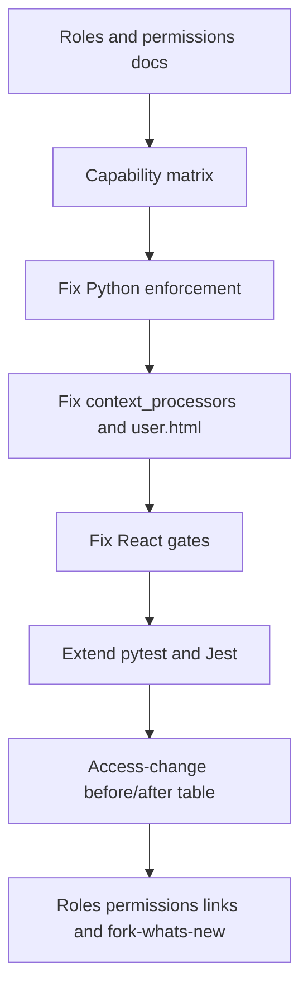

# RBAC and roles permissions audit + alignment (v10 beta)

## Sources of truth

1. Global portal roles: [docs/en/roles/](docs/en/roles/) especially [compare.md](docs/en/roles/compare.md)
2. Media access layers (state, MediaPermission, RBAC, portal roles): [docs/en/guides/operator/permissions.md](docs/en/guides/operator/permissions.md)
3. Settings gates: [docs/en/guides/admin/settings.md](docs/en/guides/admin/settings.md) + roles footnotes (`CAN_ADD_MEDIA`, `CAN_COMMENT`, `USERS_NEEDS_TO_BE_APPROVED`, `MEDIA_IS_REVIEWED`, `PORTAL_WORKFLOW`, `GLOBAL_LOGIN_REQUIRED`, `USE_RBAC`)

When code and docs disagree, **code changes to match docs** unless a finding proves the docs are wrong — in that case, fix the docs in the same PR with an explicit note.

**Out of scope for product change:** site upgrade (server ops) and content migration tooling beyond verifying `is_superuser` gates. Django admin model-permission nuance for staff stays as documented (staff = viewer in portal + admin if `is_staff`).

---

## Phase 1 — Capability matrix (audit artifact)

Build a single matrix covering every capability × actor:

- **Global roles:** anonymous, pending, viewer, editor, manager, staff, superuser
- **Settings-gated viewer:** `CAN_ADD_MEDIA` / `CAN_COMMENT` = `all` / `email_verified` / `advancedUser`
- **MediaPermission:** co-viewer, co-editor, co-owner
- **RBAC (when `USE_RBAC`):** member, contributor, manager

Columns per capability: **Docs**, **Backend**, **Frontend UI**, **Tests**, **Verdict** (`match` / `ui-only-mismatch` / `security-hole` / `over-permissive` / `under-permissive`).

Surfaces to walk:

- Helpers: [files/methods.py](files/methods.py), access helpers on [users/models.py](users/models.py)
- DRF: [cms/permissions.py](cms/permissions.py), [files/permissions.py](files/permissions.py)
- Views: [files/views/](files/views/), [files/management_views.py](files/management_views.py), [users/views.py](users/views.py), [migrationservice/](migrationservice/)
- Config bridge: [files/context_processors.py](files/context_processors.py), [templates/config/core/user.html](templates/config/core/user.html), [url.html](templates/config/core/url.html), [api.html](templates/config/core/api.html)
- Frontend: [member.js](frontend/src/static/js/utils/settings/member.js), header/sidebar/comments/media-actions/manage/profile
- Tests: [tests/rbac/](tests/rbac/), [tests/api/test_api_permissions.py](tests/api/test_api_permissions.py), [tests/settings/test_user_roles_settings.py](tests/settings/test_user_roles_settings.py), [tests/users/test_users_approval.py](tests/users/test_users_approval.py), [frontend/tests/](frontend/tests/)

Every verdict that is not `match` becomes either a code fix **or** a documented access-change warning (see Phase 4).

---

## Phase 2 — Known mismatches to fix (seed list)

Fix order: backend enforcement → config bridge → frontend → tests.

### P0 — Security / doc-breaking over-permission

1. **Manage users reachable by editors** — align [pages.py](files/views/pages.py) `manage_users` and manage user APIs to `is_mediacms_manager`.
2. **Manage-API user delete via `?usernames=`** — add the same superuser guard as the `?tokens=` branch.
3. **Pending write gaps** — block comments, mutating actions, `MediaDetail.post`, manage APIs, and remaining write paths for pending users; keep browse.
4. **Private media on MediaActions** — allow editors / RBAC / share members consistent with [permissions.md](docs/en/guides/operator/permissions.md).

### P1 — Backend consistency with permissions.md

5. **Delete vs co-owner / RBAC manager** — align DELETE (and share-further) with `has_owner_access_to_media`.
6. **Publish page vs API state/category** — align PUT rules with publish ownership for state/share-sensitive fields.
7. **Comment delete** — default: keep API (author / media owner / portal editor); tighten UI `CAN_DELETE_COMMENTS` to match.
8. **Editors bypass upload but not comment** — default: editors+ bypass `CAN_COMMENT` like upload.
9. **Playlist create vs upload permission** — default: authenticated non-pending users may create playlists independent of upload quota / `CAN_ADD_MEDIA`.

### P2 — Frontend / config bridge

10. **`can.addMedia`** — set from `user_allowed_to_upload(request)`, not only `UPLOAD_MEDIA_ALLOWED`.
11. **`can.addComment` / `readComment`** — wire to real helpers; gate Comments UI on `can.addComment`.
12. **`can.contactUser`** — emit `SHOW_CONTACT_FORM` where applicable.
13. **Pending UX** — hide upload/manage/edit affordances when pending.
14. Keep coarse client flags (`can.manage*`, `is.admin`); server remains authority.

### P3 — Settings / edge cleanup

15. Enforce or document UI-only toggles (`CAN_LIKE_MEDIA`, `CAN_REPORT_MEDIA`, `CAN_SHARE_MEDIA`).
16. Align `get_next_state` / serializer / bulk `set_state` for `private_verified`.
17. SAML `set_role_from_mapping` demotion — fix or document.

---

## Phase 3 — Test audit recommendation and config×ACL coverage

**Principle:** extend existing suites first. Do not rewrite role, RBAC, share, or permission-class suites that already exist. Add one new table-driven file only for cross-cutting config×role×surface combinations that do not fit cleanly in a single existing module.

### Already covered (reuse; do not duplicate)

| Area | Primary files | What exists |
|------|---------------|-------------|
| Role matrix (editor/manager/admin vs plain) | [tests/settings/test_user_roles_settings.py](tests/settings/test_user_roles_settings.py), [tests/pages/test_pages_manage.py](tests/pages/test_pages_manage.py), [tests/api/test_api_manage.py](tests/api/test_api_manage.py) | Manage page/API access; media edit/delete/review; promote/demote; password; Django admin for manager |
| `CAN_ADD_MEDIA` values | [tests/api/test_api_permissions.py](tests/api/test_api_permissions.py), [tests/helpers/test_helpers_methods.py](tests/helpers/test_helpers_methods.py), [tests/api/test_api_media_upload_search.py](tests/api/test_api_media_upload_search.py), [tests/pipeline/test_pipeline_upload.py](tests/pipeline/test_pipeline_upload.py) | Helper + DRF + API upload; Fine Uploader for `advancedUser`; editor bypass; quota |
| `CAN_COMMENT` values | [tests/api/test_api_permissions.py](tests/api/test_api_permissions.py), [tests/api/test_api_comments.py](tests/api/test_api_comments.py) | Policy values + create/delete by author/owner/editor |
| `MEDIA_IS_REVIEWED=False` gate | [tests/settings/test_media_is_reviewed.py](tests/settings/test_media_is_reviewed.py), upload/search + feeds | Unreviewed not listable; editor review/unreview; owner cannot self-review; RSS exclusion |
| `PORTAL_WORKFLOW` defaults | [tests/settings/test_portal_workflow.py](tests/settings/test_portal_workflow.py), [tests/helpers/test_helpers_files.py](tests/helpers/test_helpers_files.py), [tests/helpers/test_helpers_methods.py](tests/helpers/test_helpers_methods.py) | Default state including `private_verified`; `get_next_state` for editor vs regular |
| Pending approval writes (partial) | [tests/users/test_users_approval.py](tests/users/test_users_approval.py) | Upload, media PUT, playlist create, `/manage/media` refused; browse allowed; `GLOBAL_LOGIN_REQUIRED` smoke |
| `USE_RBAC` hierarchy | [tests/rbac/test_rbac_access.py](tests/rbac/test_rbac_access.py), list/detail/playlist/category/media_auth tests | Member/contributor/manager open/list/edit-page; off → membership ignored |
| MediaPermission viewer/editor/owner | [tests/api/test_api_media_detail.py](tests/api/test_api_media_detail.py), [tests/pages/test_pages_editors.py](tests/pages/test_pages_editors.py), [tests/pages/test_pages_media.py](tests/pages/test_pages_media.py) | Read/edit/publish split; shared editor cannot publish; co-owner can |
| Members page settings | [tests/pages/test_pages_media.py](tests/pages/test_pages_media.py), [tests/users/test_users_api.py](tests/users/test_users_api.py), [tests/helpers/test_helpers_runtime.py](tests/helpers/test_helpers_runtime.py) | `CAN_SEE_MEMBERS_PAGE` × `ALLOW_ANONYMOUS_USER_LISTING` |
| Frontend flag mapping | [frontend/tests/utils/settings/member.test.ts](frontend/tests/utils/settings/member.test.ts) | Defaults and comment feature AND; not server contracts |

**Caution:** [cms/test_settings.py](cms/test_settings.py) strips `ApprovalMiddleware` (and the middleware is a no-op). Assert pending gates via `user_is_pending_approval` / views, not middleware. Prefer `override_settings` + existing helpers (`create_account`, `create_media`, `RolesTestBase`).

### Gaps to close (config×ACL / pages / actions)

Priority order for new assertions:

1. **`MEDIA_IS_REVIEWED` × listing surfaces** — Example you called out: with `MEDIA_IS_REVIEWED=False` and `is_reviewed=False`, media must not appear for anonymous/strangers on home/featured/recommended/latest, search, category listings, author pages (except owner), playlists for anonymous, and RSS (RSS already covered). Also assert owner + share + RBAC can still open unreviewed media where docs allow. Manager/admin review parity with editor.
2. **Pending write-path matrix** — Extend [test_users_approval.py](tests/users/test_users_approval.py): media DELETE, bulk POST, playlist edit/delete, `@refuse_pending` pages (edit/publish/subtitle/chapters/replace/trim/upload/record), comment POST/delete, like/dislike/report/share. Document or fix unguarded endpoints as part of P0.
3. **`CAN_ADD_MEDIA` / `CAN_COMMENT` × role** — Viewer vs editor vs pending vs anonymous through real endpoints (upload page context, Fine Uploader for `email_verified`/`nobody`, comment create under share/RBAC private media). Editor bypass for comments after P1 fix.
4. **`PORTAL_WORKFLOW` × role transitions** — API PUT / bulk set_state / publish form for each workflow including `private_verified`; shared editor vs RBAC contributor vs owner; interplay with unreviewed media.
5. **`USE_RBAC` write matrix** — Member cannot PUT/DELETE; contributor PUT not DELETE; manager DELETE/PUT per docs after P1; comments/actions on RBAC private media; categories API when RBAC off.
6. **MediaPermission edge cases** — Co-owner delete after P1; viewer cannot share; unreviewed shared media visibility in search/home; revoke/role-change effects.
7. **`GLOBAL_LOGIN_REQUIRED` endpoint sweep** — Media detail, categories, tags, playlists, feeds, embed, media-auth; combos with members-page anonymous and approval.
8. **Manage pages by role (finer)** — Pending on all manage routes; editor vs manager UI/API for users/approval/delete; manage users manager-only after P0.
9. **Feature / action toggles** — Characterize `CAN_LIKE_MEDIA`, `CAN_DISLIKE_MEDIA`, `CAN_REPORT_MEDIA`, `CAN_SHARE_MEDIA`, `ALLOW_RATINGS*` as UI-only today or enforce in P3 product work; pin with tests in a small `test_api_feature_flags.py` (use `@unimplemented` only if product defers enforcement).
10. **Frontend** — `can.addMedia` / `addComment` / `manage*` / pending truth tables aligned with Django-emitted keys.

### Recommendation: extend vs new

**Extend in place (preferred):**

- [tests/settings/test_media_is_reviewed.py](tests/settings/test_media_is_reviewed.py) — listing/search/category/author/playlist surfaces; True/False; share/RBAC open of unreviewed
- [tests/users/test_users_approval.py](tests/users/test_users_approval.py) — full pending write matrix
- [tests/settings/test_portal_workflow.py](tests/settings/test_portal_workflow.py) — role × transition × `private_verified`
- [tests/api/test_api_permissions.py](tests/api/test_api_permissions.py) — pending + RBAC contributor writes + share roles on permission classes
- [tests/api/test_api_comments.py](tests/api/test_api_comments.py), [test_api_media_actions.py](tests/api/test_api_media_actions.py), [test_api_media_detail.py](tests/api/test_api_media_detail.py), [test_api_playlists.py](tests/api/test_api_playlists.py), [test_api_media_bulk.py](tests/api/test_api_media_bulk.py) — pending + post-fix regressions
- [tests/rbac/test_rbac_access.py](tests/rbac/test_rbac_access.py) — write-endpoint matrix
- [tests/pages/test_pages_manage.py](tests/pages/test_pages_manage.py) — pending + manager-only users page
- [tests/settings/test_user_roles_settings.py](tests/settings/test_user_roles_settings.py) — only for role-level regressions of P0/P1
- [frontend/tests/utils/settings/member.test.ts](frontend/tests/utils/settings/member.test.ts) + Header/Sidebar/Comments tests

**Add new (only if needed):**

- `tests/settings/test_access_matrix.py` — table-driven `subTest` of config × role × surface for combinations that span multiple modules (e.g. `MEDIA_IS_REVIEWED=False` + `PORTAL_WORKFLOW=private` + editor publish; `USERS_NEEDS_TO_BE_APPROVED` + `CAN_ADD_MEDIA=advancedUser` + pending). Keep rows sparse and documented; not a full cartesian product.
- `tests/api/test_api_feature_flags.py` — UI-only vs server-enforced characterization for like/dislike/report/share/ratings.
- Optional split `tests/settings/test_global_login_required.py` only if the endpoint sweep outgrows approval tests.

### Tie-in to Phase 2 fixes

Every P0/P1/P2 behavior change lands with a regression in the matching existing file above **and** a row in the access-change docs table. The config matrix work runs in parallel so listing/search/review/workflow combinations are proven even when no product bug was found.

---

## Phase 4 — Access-change warnings (required deliverable)

Publish operator-facing **warnings about access differences** so upgrades from pre-alignment behavior are easy to review. This is not optional fluff — every behavior change that tightens or loosens access gets a row.

### Where

- Primary page: new doc under admin or operator guides, e.g. [docs/en/guides/admin/permissions-changes.md](docs/en/guides/admin/permissions-changes.md) (or `docs/en/guides/operator/permissions-changes.md` if that fits nav better). Prefer the admin guide if the audience is site operators upgrading the beta.
- Cross-links from:
  - [docs/en/guides/operator/permissions.md](docs/en/guides/operator/permissions.md)
  - [docs/en/roles/index.md](docs/en/roles/index.md) (short note + link)
  - [docs/en/guides/admin/site-upgrade.md](docs/en/guides/admin/site-upgrade.md) if that page lists version caution items
  - [docs/_shared/fork-whats-new.md](docs/_shared/fork-whats-new.md) (one bullet pointing at the table)

Follow [docs/en/contributing/writing.md](docs/en/contributing/writing.md): short sentences, active voice, admonitions for warnings, glossary terms.

### Format (simple before/after table)

One summary table at the top of the page. One row per change. Columns:

| Change | Before | After | Who is affected | Expected impact |
|--------|--------|-------|-----------------|-----------------|
| Short name of the rule | What the app did | What the app does now | Role / share / RBAC actor | Practical outcome in one sentence |

Rules for writing rows:

- **Change** — stable short label (e.g. "Manage users page").
- **Before / After** — concrete access outcome, not code identifiers alone (e.g. "Editors could open `/manage/users`" → "Only managers and superusers can open it").
- **Who is affected** — role or share/RBAC role names from the glossary.
- **Expected impact** — what operators should expect (lost UI, new deletes allowed, pending users blocked from comments, etc.). Prefer `Higher restriction`, `Lower restriction`, or `UI matches server` as a lead phrase when useful.

Above the table, a short intro plus a warning admonition:

```markdown
!!! warning "Access differences in this beta"
    These rows describe permission behavior that changed so the app matches the roles and permissions guides. Review the table before you upgrade a portal that already has editors, pending users, shares, or RBAC groups.
```

Optional detail sections below the table may expand a row with steps to verify, but the table alone must be enough to compare before/after.

### How rows are produced

While fixing Phase 2 items, maintain a running list of access deltas. At the end of each fix batch, add or update the matching table row. Do **not** wait until the last commit. Matrix verdicts of `over-permissive` / `under-permissive` / `security-hole` that become code fixes **must** appear in the table. Pure UI-alignment (`ui-only-mismatch` → UI now matches server) also gets a row when operators would notice different buttons or menus.

Seed rows expected from current research (refine wording during implementation):

- Manage users: editors → managers only
- Pending users: broader write blocks (comments and related mutations)
- Media delete: co-owners / RBAC managers gain delete where docs require it
- State/category via API: contributors may lose publish-level changes
- Comment delete UI: contributors may lose delete control if API stays stricter
- Playlist create: may become independent of upload quota
- Upload / comment header affordances: may hide earlier when settings or pending block the action
- MediaActions on private media: editors / share / RBAC members gain consistent open access

---

## Approach diagram



## Execution order

1. Produce capability matrix + finalize fix list; mark each gap as extend-existing vs new-file.
2. Land P0 backend fixes + regressions in existing suites; draft access-change rows.
3. Land P1 backend + regressions; update rows.
4. Land P2 bridge/frontend + Jest; update rows.
5. Fill config×ACL gaps (`MEDIA_IS_REVIEWED` surfaces, pending write matrix, workflow×role, RBAC writes, feature-flag characterization) via extend-first + sparse `test_access_matrix.py`.
6. Finalize permissions-changes page, cross-links, P3 leftovers, fork-whats-new.

Prefer small focused commits (`fix:`, `test:`, `docs:`) on `mediacms-next`.

## Success criteria

- Every matrix cell is `match` or explicitly waived with a docs update.
- No editor-only user can open Manage users or approve via manage API.
- Pending users cannot mutate (upload/edit/comment/playlist/manage).
- Frontend upload/comment/manage affordances match backend helpers.
- MediaPermission owner and RBAC manager delete/control match [permissions.md](docs/en/guides/operator/permissions.md).
- Config×ACL: with `MEDIA_IS_REVIEWED=False` and media unreviewed, media is not visible in public listings/search/category/home/feeds for non-privileged viewers; owner/share/RBAC/editor access matches docs. Other high-priority config combinations from Phase 3 have automated coverage or an explicit waiver.
- Existing suites are extended rather than duplicated; any new matrix file stays sparse and table-driven.
- Access-change page exists with a complete before/after/impact table for every intentional behavior change; linked from permissions, roles index, and fork-whats-new.
- `make test` and `make test-frontend` (or compose equivalents) pass for touched areas.
