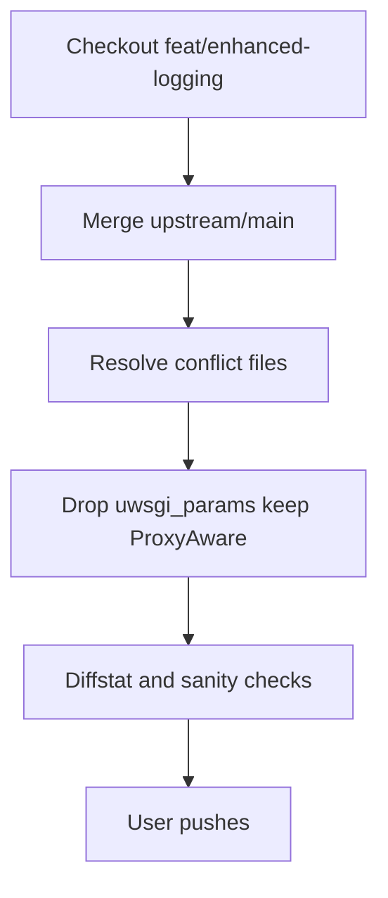

# Sync PR #1455 (enhanced logging)

## Situation

- PR: https://github.com/mediacms-io/mediacms/pull/1455 — branch `feat/enhanced-logging`
- Scale: about +6000/-236 across 45 files, 28 non-merge commits, 69 behind main, GitHub dirty
- Felix scheduled review around spring 2027
- PR description is stale (still mentions removed `cms/logging_utils.py`)

Same workflow as prior PRs: merge upstream, resolve conflicts, you push. Conflict surface is much larger.

## Branch contents (keep both)

1. Enhanced logging: `LOGLEVEL` / `ENABLE_SQL_DEBUG_LOGGING` in `cms/settings.py`; logging across models/tasks/views/users/SAML; docs; template default fixes.
2. Trusted reverse-proxy client IP: new `cms/utils.py`, `cms/middleware.py` (`ProxyAwareMiddleware`), `docs/reverse_proxy.md`, nginx/local_settings tweaks.

Upstream deleted `deploy/docker/uwsgi_params` (uWSGI to gunicorn). Keep proxy middleware/utils; do not resurrect uWSGI.

## Strategy

1. Checkout `feat/enhanced-logging` and merge `upstream/main` (no rebase/rewrite).
2. Resolve predicted conflicts with rules below.
3. Commit merge locally; you run `git push origin feat/enhanced-logging`.

## Conflict resolution rules

Predicted conflict files from merge-tree:

- `cms/settings.py`: keep upstream structure; re-apply PR LOGLEVEL, SQL debug flag, expanded LOGGING, TRUSTED_PROXIES / ProxyAware settings
- `files/tasks.py`, `files/methods.py`, `files/models/media.py`, `files/models/category.py`, `files/views/media.py`, `files/management_views.py`: prefer upstream behavior; re-insert PR logging around current control flow (do not revert LTI/Kaltura/RBAC/search-vector work)
- `uploader/views.py`, `users/models.py`, `users/views.py`, `users/serializers.py`: upstream logic + PR logging / failed-login / auth signals
- `docs/admins_docs.md`: upstream structure + re-apply logging/reverse-proxy sections that still apply
- `deploy/docker/nginx_http_only.conf`: upstream nginx; keep only still-valid PR proxy header lines
- `deploy/docker/uwsgi_params`: accept upstream deletion

After merge, confirm ProxyAware middleware still registered in settings if the PR wired it.

## Verification before push

- Diff vs upstream still shows logging/proxy intent
- No conflict markers
- Grep: LOGLEVEL, ProxyAwareMiddleware, cms.utils get_client_ip; no revived uwsgi_params
- Spot-check logging still wraps current paths in tasks/media/views

## Out of scope

- Clean rebase/squash for spring 2027 review
- Splitting reverse-proxy into a separate PR
- Pushing to GitHub
