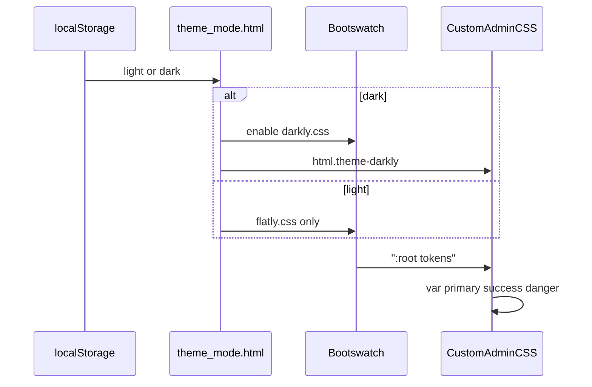

# Align the admin with Flatly and Darkly

The admin is not using the Bootswatch palette you are comparing against.

- Light theme is Flatly ([`JAZZMIN_UI_TWEAKS`](cms/settings.py)), whose tokens are `--primary: #2c3e50`, links `#18bc9c`, `--success: #18bc9c`, `--danger: #e74c3c`.
- Dark theme is currently AdminLTE’s `.dark-mode` class from [`templates/admin/includes/theme_mode.html`](templates/admin/includes/theme_mode.html): canvas `#454d55`, cards `#343a40`, inputs `#3f474e`. [Bootswatch Darkly](https://bootswatch.com/darkly/) is different: body `#222`, cards `#303030`, primary `#375a7f`, links and pagination `#00bc8c`, and **white** inputs (`#fff` / `#444`).
- Shared admin CSS then paints a third palette on top. [`static/jazzmin/css/main.css`](static/jazzmin/css/main.css) hardcodes default Bootstrap blue/green/red (`#007bff`, `#28a745`, `#dc3545`) and slate (`#64748b`), plus white surfaces on inputs, the changelist filter card, and inlines. Dashboard templates repeat those hexes in `<style>` blocks. AdminLTE’s `.content-wrapper` is also fixed at `#f4f6f9`, so even Flatly’s white page never shows through.

Both stylesheets already publish the same custom properties on `:root` (`--primary`, `--secondary`, `--success`, `--info`, `--warning`, `--danger`, `--light`, `--dark`, `--white`, `--gray`). Whichever sheet is active wins. Custom UI should use those, not a private gray scale.

## Theme switch

In [`cms/settings.py`](cms/settings.py), set `JAZZMIN_UI_TWEAKS` to `{"theme": "flatly", "dark_mode_theme": "darkly"}`.

In [`templates/admin/base.html`](templates/admin/base.html) and [`templates/registration/base.html`](templates/registration/base.html):

- Render the Darkly link with `media="not all"` so the OS color scheme does not turn it on.
- Do not put Jazzmin’s `theme-dark` class on `<body>` for every request. That class is not how this palette works.

Update [`templates/admin/includes/theme_mode.html`](templates/admin/includes/theme_mode.html) so the same `MediaCMS[mediacms][theme][mode]` key:

- sets `#jazzmin-dark-mode-theme` to `media="all"` when dark, and `not all` when light
- toggles `theme-darkly` on `<html>`
- stops adding AdminLTE’s `dark-mode` class

Delete the `html.dark-mode` block at the bottom of [`static/jazzmin/css/main.css`](static/jazzmin/css/main.css). Those rules are what make inputs and cards miss the Darkly preview.

Expose `applyMode` on `window` so the header button can call it without a reload. A click writes `MediaCMS[mediacms][theme][mode]` and applies the new mode in this tab. Other open admin and public-site tabs already hear that write through the `storage` event.

## Header switcher

Add a button in [`templates/admin/base.html`](templates/admin/base.html) as the nav item immediately before the language picker (`fas fa-globe`, around line 126). It uses the same `nav-link btn` treatment as the globe and the user menu.

The icon is the indicator:

- Light mode shows `fas fa-sun`.
- Dark mode shows `fas fa-moon`.

The script swaps the icon and the `title` when the mode changes, including when another tab changes it. Titles are `Switch to dark theme` and `Switch to light theme`, marked with `custom_translate` the same way as `Change Language`. Add both strings to [`files/frontend_translations/en.py`](files/frontend_translations/en.py) first, then run `process_translations` so the other language files receive them. The button is not added to the login page, which has no language picker.

## Custom surfaces follow the active theme

Add one small token layer in `main.css`:

- Light: `--mc-canvas: var(--white)`, `--mc-surface: var(--white)`, `--mc-ink: var(--dark)` (Flatly’s `#7b8a8b` input text).
- `html.theme-darkly`: `--mc-canvas: #222` (Darkly body; it is not a `:root` variable), `--mc-surface: var(--dark)` (`#303030` cards), `--mc-ink: var(--secondary)` (`#444`, Darkly’s input text).

Use those tokens, and the Bootswatch semantic variables, instead of hex:

- Canvas and footer: `.content-wrapper` and `.main-footer` use `--mc-canvas`. Light becomes Flatly white; dark becomes Darkly `#222`.
- Header: only under `html.theme-darkly`, replace `navbar-white` with `background: var(--primary)` and light link text so the bar matches Darkly’s `#375a7f`. Light keeps the current white navbar.
- Changelist and change forms: `.changelist-filter-card`, `.inline-related .tabular`, related-widget selects, object-tool selects, and the clipped-text popover use `--mc-surface` / `--mc-ink` and `var(--gray)` borders. Django widgets (`.vTextField`, `.vLargeTextField`, and the same input list) use `background: var(--white)` and `color: var(--mc-ink)`, which is the Darkly preview (white fields on a dark page) and Flatly’s own field colors.
- Status icons and other semantic colors in `main.css` (table header `#64748b`, success `#28a745`, danger `#dc3545`, info `#17a2b8`, links `#007bff`, warning `#d97706`) become `var(--secondary)`, `var(--success)`, `var(--danger)`, `var(--info)`, `var(--primary)`, and `var(--warning)`. Media-type icons that are only categorical (video, audio, image, pdf) move to the nearest theme token (`--primary`, `--indigo`, `--warning`, `--danger`) so they shift with the theme instead of staying default Bootstrap.
- `.callout { color: black }` becomes `color: inherit` so Darkly callouts are not black-on-dark.

Dashboard inline styles in [`templates/admin/index.html`](templates/admin/index.html), [`templates/admin/dashboard/section_base.html`](templates/admin/dashboard/section_base.html), and [`templates/admin/dashboard/_section_nav.html`](templates/admin/dashboard/_section_nav.html) use the same variables for muted text, links, tooltips, and audit icons. Small boxes that already use `bg-info`, `bg-success`, `bg-warning`, and `bg-danger` stay as they are; those classes already come from the active Bootswatch file.

Leave the dark sidebar. Its active highlight can use `var(--primary)` so Flatly’s highlight is `#2c3e50` and Darkly’s is `#375a7f`, instead of AdminLTE blue.

Per-model change templates are not restyled one by one. They inherit this shared CSS. The two social-app templates that set `#666` / `#999` get the same `var(--secondary)` treatment if they still show after the shared pass.

## Check

On the live admin, use the new header button, left of the globe, to switch dark and light without a reload. The icon should show a moon in Darkly and a sun in Flatly. Check the dashboard, media changelist, media change form, and login. Dark should match Darkly (near-black canvas, `#303030` cards, blue-gray header, green links, white fields). Light should match Flatly (white canvas, green links, `#2c3e50` primary, no default Bootstrap blue). An already-open admin tab should follow a change made from another tab, and its icon should update too.
