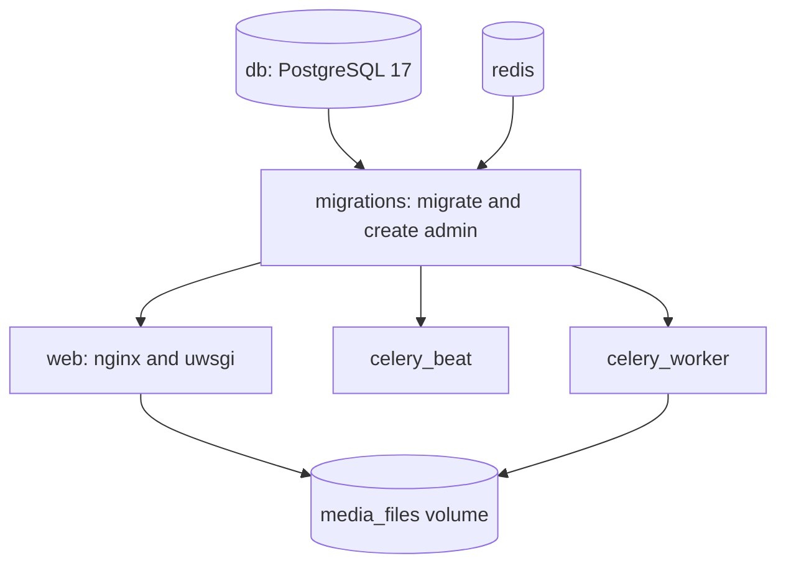

# Install with Docker

Use this page to install MediaCMS on one server with Docker Compose.

## Before you start

- Install a recent version of [Docker](https://docs.docker.com/get-docker/) and [Docker Compose](https://docs.docker.com/compose/install/).
- Use PostgreSQL 15 or later. The development file `docker-compose-dev.yaml` and the default `docker-compose.yaml` use PostgreSQL 17.
- Run the commands as a user that can use Docker.

!!! warning
    MediaCMS version 3 and later needs PostgreSQL 15 or later. A data directory from PostgreSQL 13 does not start with a newer image. Migrate the database first. Read [Update](update.md) and [Site upgrade](../guides/admin/site-upgrade.md).

## Install MediaCMS

1. Open a terminal on the server.
2. Download the code.

    ```bash
    git clone https://github.com/mediacms-io/mediacms
    cd mediacms
    ```

3. Build the local MediaCMS image (Compose defaults to `mediacms:local`, not Docker Hub).

    ```bash
    make docker-build
    ```

4. Start the containers.

    ```bash
    docker compose up
    ```

5. Wait until the output stops. Docker starts all containers.
6. Open `http://localhost` in a browser. On a remote server, open `http://` followed by the server IP address.

## Find the administrator password

The `migrations` container creates an `admin` user. It sets a random password unless you set `ADMIN_PASSWORD` in the Compose file.

1. Read the end of the `migrations` container output.
2. Find the line that starts with `Created admin user with password:`.
3. Copy the password.

```text
migrations_1     | Created admin user with password: gwg1clfkwf
```

To set your own password, remove the comment mark from `ADMIN_PASSWORD` in `docker-compose.yaml` before you run `docker compose up`.

See [First sign-in](first-sign-in.md) to use the password.

## Local images vs registry images

Compose defaults to images built on this machine:

| Variable | Default | Used by |
|----------|---------|---------|
| `MEDIACMS_IMAGE` | `mediacms:local` | `docker-compose.yaml` and variants |
| `MEDIACMS_FULL_IMAGE` | `mediacms:full` | `docker-compose.full.yaml` (Whisper worker) |
| `MEDIACMS_DEV_IMAGE` | `mediacms-dev:latest` | `docker-compose-dev.yaml` |

Build them with `make docker-build` (and `make docker-build-full` for Whisper).

!!! note "arm64 / Apple Silicon builds"
    A local Dockerfile build may warn about `mediacms/mediacms:7.2.0` (`InvalidBaseImagePlatform`). FFmpeg is copied from that pinned **amd64** donor; Bento4 is still an **x86_64** zip. See [Fixes and known issues](../releases/fixes.md#amd64-media-tools-in-the-image).

## Fork beta and stable images (GHCR)

This fork publishes images to GitHub Container Registry. Override the Compose variables instead of editing every `image:` line:

```bash
export MEDIACMS_IMAGE=ghcr.io/mrjoshuap/mediacms:beta
export MEDIACMS_FULL_IMAGE=ghcr.io/mrjoshuap/mediacms-full:beta
docker compose pull
docker compose up
```

| Pull tag | Meaning |
|----------|---------|
| `ghcr.io/mrjoshuap/mediacms:beta` | Latest successful beta **base** image |
| `ghcr.io/mrjoshuap/mediacms-full:beta` | Latest successful beta **full** image (Whisper) |
| `ghcr.io/mrjoshuap/mediacms:mediacms-next` | Same digest as `:beta` (branch alias) |
| `ghcr.io/mrjoshuap/mediacms:stable` | Latest stable **base** release |
| `ghcr.io/mrjoshuap/mediacms-full:stable` | Latest stable **full** release |
| `ghcr.io/mrjoshuap/mediacms:10.0.0.YYYYMMDD[.N]` | Immutable pin for one release |
| `ghcr.io/mrjoshuap/mediacms:upgrade-audit-beta` | Base image alias for beta upgrade drills |
| `ghcr.io/mrjoshuap/mediacms:upgrade-audit` | Base image alias for stable upgrade drills |

Beta builds publish a GitHub **pre-release** on every push to `mediacms-next`. Stable releases publish only when a Git stamp tag `v10.0.0.YYYYMMDD` (or `v10.0.0.YYYYMMDD.N` for a same-day emergency) is pushed from `main`. The product base version lives in `version/FORK_VERSION`. The Git tag keeps the `v` prefix. The GHCR image tag drops it (`10.0.0.YYYYMMDD` or `10.0.0.YYYYMMDD.N`).

Upstream Docker Hub images remain available as `MEDIACMS_IMAGE=mediacms/mediacms:latest` if you want them.

## Enable Whisper transcription (optional)

Whisper creates subtitles automatically. It works only in the Docker installation. It needs a **full** image (`make docker-build-full` → `mediacms:full`, or set `MEDIACMS_FULL_IMAGE` to a GHCR/upstream full tag).

1. Use one of these methods.
    - Run `make docker-build-full`, then `docker compose -f docker-compose.yaml -f docker-compose.full.yaml up`.
    - Set `MEDIACMS_FULL_IMAGE` to a registry full tag and use the same Compose overlay.
2. Open `deploy/docker/local_settings.py`.
3. Set `USE_WHISPER_TRANSCRIBE = True`.
4. Restart the services.

    ```bash
    docker compose restart web celery_worker celery_beat
    ```

## Use your own nginx configuration (optional)

MediaCMS uses nginx to protect media files. nginx asks Django if a user may open a file. If you use your own nginx configuration instead of `deploy/docker/nginx_http_only.conf`, copy these blocks from that file:

- `location = /_media_auth` and `location ~ ^/media/(encoded|hls)/(.*)$`. They check access to encoded and HLS files.
- `location ~ ^/media/original/(.*)$`. It checks access to original files. It sends unknown file types as downloads. The same block serves the sharded `original/<aa>/<bb>/<uid>/source.<ext>` paths and the older `original/user/…` paths.
- `location ~ ^/media/(thumbnails|categories)/(.*)$` and `location ~ ^/media/subtitles/(.*)$`. They check access to thumbnails, category images, and caption files. Without them, new uploads (which store these files under `thumbnails/`, `categories/`, and `subtitles/`) are served without an access check.
- `location ^~ /_protected_pdf/`. Django uses it to serve PDF files. Without it, PDF files do not show.

## Mount a media library for filesystem sync (optional)

A **Filesystem library** migration reads media from `FILESYSTEM_IMPORT_ROOT` (default `/external-media_files`). The image creates this directory. Mount your library under it.

1. Add a bind mount to the `web` and `celery_worker` services. Use one child directory for each library.

    ```yaml
    volumes:
      - /srv/archive-a:/external-media_files/archive-a:ro
    ```

2. Restart the containers.

    ```bash
    docker compose restart web celery_worker celery_beat
    ```

3. Open `/migrations/new/filesystem` and select the mount. See [Content migration](../guides/admin/content-migration.md#filesystem-library).

!!! warning
    Do not add an nginx `location` or `alias` for `/external-media_files`. The library is scanned only. Visitors reach each file through the opaque `/media/original/<aa>/<bb>/<uid>/source.<ext>` path, which nginx checks with `/_media_auth`.

## MediaCMS Architecture

`docker compose up` starts the services in this order. The database and Redis start first. The `migrations` container runs the database migrations and creates the administrator. The web and Celery containers start next.



Workers and web containers must use the same media file system.

## Next step

Choose a deployment pattern in [Deploy](deploy.md). To update an installed portal, read [Update](update.md).
