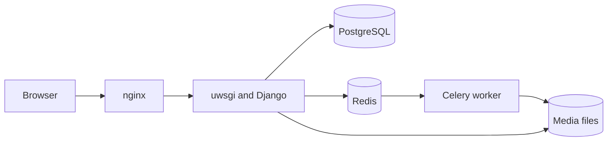

# MediaCMS Documentation

MediaCMS is an open source video and media content management system. It runs on Django and React. It has a REST API.

MediaCMS stores video, audio, image, and PDF files. It encodes video into several resolutions. It can create subtitles with Whisper. It supports roles, categories, playlists, comments, and sharing.

Use this documentation to install MediaCMS, understand each role, and complete common tasks.

## About this fork (10.0.0 / `mediacms-next`)

!!! danger "Not a drop-in production upgrade from upstream"
    This documentation describes the **mrjoshuap** MediaCMS fork at **10.0.0**. The beta line (`mediacms-next`, image tag `:beta`) changes often. Do **not** point a production portal at `:beta` or at an unpinned `mediacms-next` digest unless you accept data, permission, UI, and API churn. Prefer date-stamped image tags (`:10.0.0.YYYYMMDD[.N]`) or `:stable` for anything you must keep running.

!!! warning "Permissions and behavior can break existing workflows"
    The v10 line realigns roles and ACLs with the roles guides. Editors can lose Manage users. Pending users lose more write actions. Co-owners and RBAC managers can gain delete. Review [Permission access changes](guides/admin/permissions-changes.md) and the [Releases](releases/index.md) section **before** you upgrade.

This fork is a "what's possible" release: a place to ship and try combined features early so adopters can steer what stays, what changes, and what comes next. Upstream pull requests can take a long time to land. The work is shaped by several production MediaCMS sites that already run private combinations of these features. A small team moves faster here with modern CI/CD and AI-assisted development, and uses the branch as a shared test bed for multiple pull requests and issues at once.

The goals are consistency across MediaCMS components, a clear structure for future upgrades and migrations, and documentation that stays current (including auto-generated reference pages). The line also prepares a faster release cadence for critical updates, rethinks the admin portal around the role model, and builds a playground for future customizations (headers, banners, ad tracking, page changes) without editing application code for every trial.

Help is welcome. Expect a **fast-moving** beta: APIs, admin screens, permissions, migrations, and docs can change between builds. Before every upgrade, read [Releases](releases/index.md), [Upgrade tips](releases/upgrade-tips.md), [What's new](reference/whats-new.md), and [This version](reference/this-version.md). Choose images with [Fork beta and stable images](getting-started/install.md#fork-beta-and-stable-images-ghcr).

## Where to start

| Section | Use it to |
|---------|-----------|
| [Releases](releases/index.md) | Compare upstream ≤v9 with fork 10.0.0 stable and beta. Find features, fixes, migrations, frontend steps, and upgrade tips. |
| [Getting started](getting-started/index.md) | Install, deploy, and sign in for the first time. Learn the main concepts. |
| [Roles](roles/index.md) | See what each of the six roles can do. Compare the roles. |
| [Guides](guides/index.md) | Follow step-by-step instructions for users, operators, administrators, and developers. |
| [Scenarios](scenarios/index.md) | Follow one role through one path. Use scenarios as a script for a recording or a test. |
| [This version](reference/this-version.md) | Check which MediaCMS version this documentation describes. |
| [What's new](reference/whats-new.md) | Read the full fork change list since upstream, then the upstream release notes. |
| [Languages](languages.md) | Find the languages that this documentation supports. |

## MediaCMS Architecture

All pages in this documentation use the same system. A browser talks to the web server. The web server talks to Django. Django stores data in PostgreSQL. Celery workers encode video in the background.

## How to read this documentation

1. Read [Concepts](getting-started/concepts.md) to learn the terms.
2. Open the page for your [role](roles/index.md).
3. Open the guide for your task.

The [writing guide](contributing/writing.md) and the [glossary](contributing/glossary.md) explain the words and style that this documentation uses.
